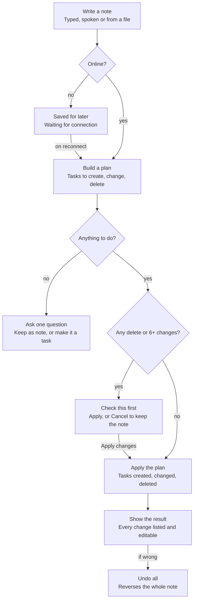

# Agendal PRD — notes to tasks

Oct 23, 2026 · @Xeno

Agendal is a mobile web app (PWA) for students. You write or say whatever is on your mind, and Agendal turns it into dated, organised tasks that you can review and undo. Lists come second, and the note comes first. This PRD describes the product as built in the current prototype (Paper & ink, light and dark) and is the reference for building v1.

## Problem

Students get tasks in bursts: a lecturer announces a quiz, a group chat agrees on a deadline, an errand comes up on the walk home. Most to-do apps make you stop and fill in a form for each one (title, date, time, project, priority). That friction means tasks end up in notes apps, chats or memory, and get missed.

**Opportunity:** keep capture as cheap as writing a note. The person writes one line with several things in it, and Agendal splits it into tasks, finds the dates, times, projects and priorities, and shows exactly what it did. The person stays in control: every change is listed, editable and undoable.

**What changed from the earlier concept:** the earlier design had a chat with an assistant. The chat is replaced by **notes**. A note is written once and turned into tasks; there is no back-and-forth conversation. The assistant asks a question only when a note is unclear or a change is risky.

## Users

The primary user is a university student juggling courses, group projects and personal errands, mostly on their phone.

| User | Context | Needs | What Agendal does |
| --- | --- | --- | --- |
| Busy student (primary) | Several courses, each with quizzes, reports and group work; captures on the go between classes | Get things out of their head in seconds; see what is due today; never miss a deadline | Notes in, tasks out; Inbox shows today and overdue; reminders before quizzes and timed tasks |
| Group-project member | Deadlines agreed in chats and meetings | Turn meeting notes into dated tasks | Paste or attach the notes; Agendal makes one task per action item |
| Planner | Prefers to set every field by hand | Full control over each task | The + button opens a manual New task sheet; every field is editable afterwards |
| Low-vision or keyboard user | Uses large text, a screen reader or a keyboard | Readable contrast, labelled controls, visible focus | WCAG 2.2 AA colours, 44px targets, labelled icon buttons, focus rings |

**Example account used throughout:** example@gmail.com (display name "example"), with projects SQL Course, Adv Web, HCI, Portfolio and Personal.

## Goals and success metrics

**Goals**

1. Capturing several tasks takes one note and under 15 seconds.
2. The assistant is right often enough that people trust it, and when it is wrong, fixing or undoing it takes one tap.
3. People see what needs doing today at a glance, every time they open the app.
4. It works offline and installs like an app on any modern phone.

**Non-goals for v1:** shared lists or assigning tasks to other people; calendar sync; chat with the assistant; a desktop-first layout; native iOS or Android apps.

**Success metrics** (proposed targets for the first 8 weeks after launch; to be confirmed)

| Metric | Definition | Target |
| --- | --- | --- |
| Note-to-task share | Share of new tasks created from notes rather than the manual sheet | ≥ 70% |
| Note acceptance | Share of processed notes not undone within 24 hours | ≥ 90% |
| Edit rate | Share of assistant-made tasks edited within 24 hours | ≤ 20% |
| Follow-up rate | Share of notes where the assistant had to ask what to do | ≤ 10% |
| Time to capture | Median time from opening the note editor to Make tasks | ≤ 15 s |
| Weekly retention | Users active in week 4 ÷ users active in week 1 | ≥ 40% |
| Completion | Share of tasks due in a week that are completed by the end of that week | ≥ 60% |
| Install rate | Signed-in users who install the PWA | ≥ 30% |

## How a note becomes tasks

A note goes through three checks before anything changes: is the device online, is there anything to do, and is the change risky. Every path that changes tasks ends on the result screen, where Undo all reverses the whole note.

Example: “sql quiz monday 9am, email the group tonight, buy printer ink tomorrow” becomes three tasks — SQL quiz (Mon 09:00, High, SQL Course, reminder 1 day before), Email the group (today 20:00, Medium, reminder 15 minutes before), Buy printer ink (tomorrow, Low) — and the note is named “This week”.

## Screens and navigation

Four tabs sit at the bottom: Inbox, Upcoming, Projects and Notes. A floating "Write a note…" bar with a mic sits above the tabs on every list screen, next to a square + button for manual tasks. Search and Account are at the top right of each tab screen. Pushed screens have a back button top-left, and the browser's Back does the same.

| Screen | Reached from | Purpose | Key contents |
| --- | --- | --- | --- |
| Sign in / Create account / Reset password | First launch, sign-out | Access | Email, password with show/hide, Remember me checkbox, Forgot password, lockout after repeated failures |
| Inbox | Tab (default) | What to do today | Date overline, progress summary (done of total), Overdue section, Today section, "Nothing left for today" state, install and offline banners |
| Upcoming | Tab | What's coming | Tasks grouped by day (Tomorrow, then weekdays and dates); filter chips All / Scheduled / Due only |
| Projects | Tab | Work by course or area | Project list with colour, progress and counts; No project; New project |
| Project | Projects | One project's tasks | Progress bar ("3 of 5 tasks completed"), open and completed tasks; menu: rename, change colour, delete |
| Task details | Any task row, a note result | Edit one task | Serif title; schedule (start–end), due date, reminder, repeat, priority, project, notes; "Created by the assistant" tag; Delete task |
| Search | Search icon | Find any task | Searches titles and notes, including completed; chips All / Open / Completed with counts |
| Notes | Tab | History of notes | Note cards: time, generated name, two-line excerpt, task count or "Waiting for connection" |
| Note editor | Capture bar, Notes | Write a note | Full-screen serif text area, example chips, mic, paperclip (attach file), Make tasks (Save note when offline) |
| Note result | After Make tasks, a note card | Review what happened | Overline (time · "3 tasks made"), generated name, "From file" line, original note as a quote, change list with CREATED / CHANGED / DELETED, Undo all / Done |
| New task sheet | + button | Manual task | Title, due chips (Today, Tomorrow, Next week, No date, Pick date…), priority, project; "Only a title is needed" |
| Account sheet | Avatar | Settings | Name and email, Dark mode, Remember me on this device, Install app, Sign out |

## Functional requirements

41 requirements in 8 areas. Must = needed for v1; Should = v1 if time allows, otherwise v1.1; Could = later. IDs are new for this concept and replace the earlier FR list.

**Account and access (AA)**

| ID | Requirement | Priority | Acceptance criteria |
| --- | --- | --- | --- |
| AA-1 | Create an account with email and password | Must | Password is at least 8 characters and differs from the email; Create account stays disabled until valid; success opens Inbox with "Welcome to Agendal. Your account is ready." |
| AA-2 | Sign in with email and password | Must | Wrong details show "Email or password is incorrect."; password has show/hide; a Remember me checkbox (on by default) keeps the session on this device |
| AA-3 | Lock sign-in after repeated failures | Must | After 3 failed attempts, a "Too many attempts" banner shows and Sign in is disabled for 60 s with a countdown |
| AA-4 | Reset a forgotten password by email | Must | The same confirmation shows whether or not the account exists; the link expires in 60 minutes; Resend unlocks after 45 s |
| AA-5 | Sign out | Must | Sign out in the Account sheet returns to Sign in |

**Note capture (NC)**

| ID | Requirement | Priority | Acceptance criteria |
| --- | --- | --- | --- |
| NC-1 | Open the note editor in one tap from any list screen | Must | The capture bar and the Notes tab open a full-screen editor with the cursor in the text; examples show while it is empty |
| NC-2 | Write a free-text note containing several tasks | Must | No fields are required; Make tasks is enabled as soon as there is text |
| NC-3 | Dictate a note | Should | The mic shows "Listening…" with Stop; the recognised text lands in the editor to check ("Here's what I heard."); Make tasks is disabled while listening |
| NC-4 | Turn a file into a note | Should | Accepts text, Markdown, CSV, PDF, Word and photos up to 5 MB; extracted text lands in the editor to check; a removable file chip shows; unsupported or oversized files get a specific error; the result shows "From \<file name>" |
| NC-5 | Start from an example | Could | Tapping an example chip fills the editor |
| NC-6 | Capture while offline | Must | The button reads Save note; the note is stored on the device as "Waiting for connection"; on reconnect it is processed automatically with a toast "Back online. N notes turned into M tasks." |
| NC-7 | Add a task by hand | Must | The + button opens New task: only a title is required; due chips Today, Tomorrow, Next week, No date, Pick date…; priority; project; a toast confirms "Added “…”" |

**Note understanding (NU)** — rules in the next section

| ID | Requirement | Priority | Acceptance criteria |
| --- | --- | --- | --- |
| NU-1 | Split a note into items and make one task per actionable item | Must | Items split on new lines, commas, semicolons, full stops and "then"; bullets are stripped |
| NU-2 | Fill in each task's details | Must | Due date, time, priority, project, repeat and reminder are set per the extraction rules; anything not found is left empty |
| NU-3 | Act on existing tasks from a note | Must | "done X", "move X to Friday" and "delete X" find the matching task and complete, reschedule or delete it |
| NU-4 | Ignore text that isn't a task | Must | Ideas, FYIs and filler are kept in the note but make no task; a note with nothing actionable triggers the follow-up |
| NU-5 | Ask before risky changes | Must | Any delete, or more than 5 changes in one note, shows "Check this first" with the planned changes; nothing is applied until Apply changes |
| NU-6 | Name each note automatically | Should | The name follows the naming rules and shows on the result screen and Notes card |
| NU-7 | Label tasks the assistant made | Should | Task details show "Created by the assistant" |

**Review and control (RV)**

| ID | Requirement | Priority | Acceptance criteria |
| --- | --- | --- | --- |
| RV-1 | Show what happened after every note | Must | The result screen lists each created, changed and deleted task with a CREATED / CHANGED / DELETED badge and its meta; created and changed tasks open their details |
| RV-2 | Undo a whole note in one tap | Must | Undo all removes created tasks, reverts changes and restores deleted tasks; the note is kept and marked Undone |
| RV-3 | Resolve unclear notes | Must | "I couldn't find a task in this note." offers Keep as note or Make it a task |
| RV-4 | Keep every note | Must | The Notes tab lists notes newest first with time, name, excerpt and task count; a card opens its result |

**Tasks (TK)**

| ID | Requirement | Priority | Acceptance criteria |
| --- | --- | --- | --- |
| TK-1 | Complete a task | Must | Tapping the checkbox completes it, updates progress and shows a toast with Undo |
| TK-2 | Edit every field of a task | Must | Title, schedule (start–end), due date, reminder (None; 5, 15 or 30 minutes; 1 hour; 1 day before), repeat (Never, Daily, Weekly, Monthly, Yearly), priority (Low, Medium, High), project and notes |
| TK-3 | Validate the schedule | Must | An end before the start shows "End time must be later than the start time." |
| TK-4 | Repeat tasks | Must | Completing a repeating task creates the next one; deleting one asks "This task only" or "This and all future" |
| TK-5 | Delete a task safely | Must | Delete asks for confirmation and the toast offers Undo |
| TK-6 | Remind before a task | Should | A notification fires at the chosen offset from the start time, or from 09:00 on the due date when there is no time |

**Lists and search (LV)**

| ID | Requirement | Priority | Acceptance criteria |
| --- | --- | --- | --- |
| LV-1 | Show today in Inbox | Must | A summary shows done of total for today; Overdue (in red, with a count) comes before Today; when all are done, "Nothing left for today" links to Upcoming |
| LV-2 | Show what's coming | Must | Upcoming groups tasks by day and filters All / Scheduled / Due only |
| LV-3 | Find any task | Must | Search covers titles and notes, completed included, with All / Open / Completed counts; no match shows "No tasks match “…”" |
| LV-4 | Show task context in every row | Must | Each row shows project dot and name, time, reminder and repeat icons, and a priority flag for High and Medium |

**Projects (PJ)**

| ID | Requirement | Priority | Acceptance criteria |
| --- | --- | --- | --- |
| PJ-1 | Create a project | Must | Name plus one of 8 colours; the new project opens straight away |
| PJ-2 | View a project | Must | Progress bar with "N of M tasks completed", then open and completed tasks |
| PJ-3 | Rename a project or change its colour | Should | Both available from the project's menu |
| PJ-4 | Delete a project | Must | A dialog asks whether to move its tasks to No project or delete them too; the toast offers Undo |

**App and platform (AP)**

| ID | Requirement | Priority | Acceptance criteria |
| --- | --- | --- | --- |
| AP-1 | Install as an app | Must | After the first sign-in, an Install banner shows once (Install / Not now); Install app stays available in Account |
| AP-2 | Work offline | Must | Every edit is saved on the device and syncs later; a "You're offline" banner shows on list screens |
| AP-3 | Light and dark themes | Must | Follows the system setting; Dark mode can be switched in Account |
| AP-4 | Consistent back navigation | Must | The in-app back button and the browser's Back both return to the previous screen |

## Note understanding

The assistant reads a note once, builds a **plan** (tasks to create, tasks to change, tasks to delete, text skipped), checks it against the safety rules, then applies it or asks. The prototype does this with rules; v1 can use a language model with structured output, but it must produce the same plan shape and follow the same rules below.

**What it extracts from each item**

| Field | Understood phrases (examples) | Result | When nothing is found |
| --- | --- | --- | --- |
| Due date | today, tonight, this evening, tomorrow / tmr, day after tomorrow, Monday … Sunday ("next", "this", "by", "on"), next week, in 3 days, in a week, end of the week, end of the month, 26 Oct | A date; weekdays mean the next one ahead | No date (or today if a repeat or time is given) |
| Time | 9am, 6:30pm, at 14, 14:00, morning (09:00), noon (12:00), evening (19:00), tonight (20:00) | Start time | No time |
| Priority | urgent, asap, important, high priority, deadline, exam, quiz, submit → High; low priority, whenever, someday, maybe → Low | Priority | Medium if due today, otherwise Low |
| Project | The project's name anywhere in the item, or course keywords (e.g. sql / database / ER diagram → SQL Course; gym, mum, groceries → Personal) | Project | No project |
| Repeat | every day / daily, every week / weekly / every Monday, every month / monthly | Repeat | Never |
| Reminder | Exams and quizzes → 1 day before; any task with a time → 15 minutes before | Reminder | None |
| Title | What is left after removing the date, time, priority and repeat words and lead-ins ("remember to", "I need to", "please") | Sentence-case title; acronyms (SQL, HCI, CV, UI, API, PDF) kept upper case | — |

**Commands for existing tasks**

| Command | Phrases | Effect |
| --- | --- | --- |
| Complete | done X, finished X, did X, X is done | Marks the task done |
| Reschedule | move / push / reschedule / postpone X to \<when> | Sets the new due date (and time); the result shows "was …" |
| Delete | delete / cancel / remove / drop X | Deletes the task, always after confirmation |

A command matches the open task whose title contains at least 60% of the command's meaningful words. With no match, the item is treated as a new task.

**Skipped text:** items that start with idea, note, thought, remember that or fyi, and filler such as "hmm", "ok", "test" or "thanks".

**Safety rules**

1. Any delete, or more than 5 changes from one note, needs Apply changes before anything happens.
2. A note with no actionable item gets one question: Keep as note, or Make it a task.
3. Every applied note can be undone as a whole from its result screen.
4. Offline notes wait; they are processed on reconnect under the same rules.

**Naming a note**

| Plan | Name | Example |
| --- | --- | --- |
| One task | The task's title | Call mum |
| One change | "Update:" + title | Update: Renew gym membership |
| Only changes | "Updates to N tasks" | Updates to 3 tasks |
| All tasks in one project | Project + "to-dos" | SQL Course to-dos |
| All tasks due the same day | Today's plan / Tomorrow's plan / weekday + plan | Monday plan |
| All due within 7 days | This week | This week |
| Anything else | First title + "+ N more" | Call mum + 1 more |
| Nothing actionable | The note's first words (up to 6) | Ideas for the portfolio site |

Names longer than 34 characters are cut at a word boundary with an ellipsis.

## Non-functional requirements

| ID | Area | Requirement |
| --- | --- | --- |
| NF-1 | Accessibility | Meets WCAG 2.2 AA: text contrast ≥ 4.5:1 and control borders ≥ 3:1 in both themes; colour never carries meaning alone |
| NF-2 | Accessibility | Touch targets ≥ 44 × 44px; every icon-only button has an accessible name; visible 2px focus ring on every control; full keyboard use; respects reduced-motion |
| NF-3 | Accessibility | Works with VoiceOver and TalkBack; status changes ("Listening…", "Reading file…", toasts) are announced |
| NF-4 | Performance | First load interactive in ≤ 3 s on a mid-range phone over 4G; repeat loads from cache in ≤ 1 s |
| NF-5 | Performance | A note of up to 10 items is processed and its result shown in ≤ 2 s (p90) when online |
| NF-6 | Offline | All lists, task edits and note capture work offline; changes queue and sync on reconnect without loss; conflicts resolve last-write-wins per field |
| NF-7 | Platform | Installable PWA (manifest, service worker, icons); supports the last two versions of Chrome, Safari (iOS 16.4+), Samsung Internet, Firefox and Edge |
| NF-8 | Layout | Fluid from 320px to 480px wide (360px reference), centred column up to 600px, `100dvh` height, safe-area insets respected; no native status bar or keyboard drawn |
| NF-9 | Privacy | Notes, attached files and tasks belong to the account holder only; files are used to extract text and are not kept after extraction unless the user saves them; no note content in analytics |
| NF-10 | Security | Passwords hashed (never stored or logged in plain text); HTTPS only; sign-in lockout per AA-3; reset links single-use and expire in 60 minutes |
| NF-11 | Reliability | No task change is lost: every applied note is stored with enough to undo it (before/after values) |
| NF-12 | Content | Follows the theme guide's voice: sentence case, 24-hour times, short dates, no emoji |

## Data model

Five records. Notes keep the plan and what was applied, so any note can be reviewed or undone later.

| Record | Fields | Notes |
| --- | --- | --- |
| User | id, email, display name, password hash, remember-device flag, theme (system / light / dark), install prompt shown, created at | Email is the sign-in name |
| Project | id, user id, name, colour (one of 8 project tokens), created at | "No project" is the absence of a project, not a record |
| Task | id, user id, title, project id, due date, start time, end time, priority (Low / Medium / High), reminder, repeat (Never / Daily / Weekly / Monthly / Yearly), notes, done, done at, created by (user / assistant), source note id, created at, updated at | A repeating task creates its next occurrence when completed |
| Note | id, user id, text, name, source file name, status, plan, applied, created at, processed at | Status: pending (offline) → new → done, confirm, followup, kept or undone |
| Change (inside Note.applied) | kind (created / changed / deleted), task id, before values, label (e.g. "Due Fri (was today)") | Enough to undo exactly |

**Note status**

| Status | Meaning | Next |
| --- | --- | --- |
| pending | Saved offline, not yet read | Processed on reconnect |
| new | Being processed | done, confirm or followup |
| done | Plan applied | undone (Undo all) |
| confirm | Plan waits for Apply changes | done (Apply) or kept (Cancel) |
| followup | Nothing actionable found | kept (Keep as note) or done (Make it a task) |
| kept | Saved as a note only | — |
| undone | Applied, then reversed | — |

## Analytics events

Events carry counts and categories only, never note or task text (NF-9).

| Event | When | Properties | Feeds metric |
| --- | --- | --- | --- |
| note\_editor\_opened | Editor opens | entry (capture bar, Notes, mic) | Time to capture |
| note\_submitted | Make tasks or Save note | input (typed, voice, file), file type, characters, offline | Time to capture |
| note\_processed | Plan built | creates, updates, deletes, skipped, status (done, confirm, followup), ms | Follow-up rate |
| note\_confirmed / note\_cancelled | Apply changes / Cancel on a confirm | changes | — |
| note\_undone | Undo all | minutes since processed | Note acceptance |
| task\_created | Any new task | source (note, manual), has due, has time, has project | Note-to-task share |
| task\_edited | Field changed in details | field, assistant-made | Edit rate |
| task\_completed | Checkbox ticked | assistant-made, overdue, repeating | Completion |
| app\_installed | PWA installed | entry (banner, Account) | Install rate |
| session\_started | App opened | online, installed | Weekly retention |

## Release plan

Three phases, each gated on its exit criteria. Dates are not set yet.

| Phase | Scope | Exit criteria |
| --- | --- | --- |
| 1. MVP | Every Must: account and access, typed notes, note understanding with review and Undo all, tasks, Inbox / Upcoming / Search, projects, offline, install, light and dark | All Must acceptance criteria pass; accessibility audit passes NF-1 to NF-3; note acceptance ≥ 85% in a closed beta |
| 2. v1.1 | Should items: voice notes (NC-3), files as notes (NC-4), note names (NU-6), assistant label (NU-7), reminders (TK-6), project rename and colour (PJ-3) | Metrics at or near the targets above for 4 weeks |
| 3. Later | Could items (examples, NC-5) and candidates: calendar view, shared projects, editing a note to re-plan it, smarter project suggestions, desktop layout | Prioritised from beta feedback |

## Risks and mitigations

| Risk | Impact | Mitigation |
| --- | --- | --- |
| The assistant misreads a note (wrong date, split, or task) | Wrong tasks; loss of trust | Result screen lists every change; one-tap Undo all; each task editable from the result; track edit and undo rates by phrase type |
| A command matches the wrong existing task | A task is wrongly completed, moved or deleted | 60% word-match threshold; deletes always confirmed; changes show the old value ("was today"); Undo all |
| Dates are ambiguous ("Friday" said on a Friday, 24-hour vs am/pm) | Tasks land on the wrong day | Weekdays always mean the next one ahead; dates shown in full on the result; easy edit |
| Offline notes processed later against changed tasks | Commands act on a different state than intended | Process in order on reconnect; the same confirm rules apply; toast reports what happened |
| PWA limits on iOS (install prompt, push notifications) | Fewer installs and reminders on iPhone | Manual install guidance in Account; reminders are a Should, not a Must; in-app Inbox works without push |
| Uploaded files contain personal data | Privacy exposure | Extract text and discard the file (NF-9); 5 MB limit; clear file types |
| A language-model version is slow or costly | Slow result screen | Rules handle common phrases first; the model handles the rest; 2 s p90 budget (NF-5) |

## Open questions

- [ ] Should editing a saved note re-plan it (and update its tasks), or stay read-only as in the prototype?
- [ ] Rules only, or rules plus a language model for note understanding in v1? This decides cost, latency and offline behaviour.
- [ ] Which languages besides English does v1 need to understand (e.g. Vietnamese dates and times)?
- [ ] Should the follow-up question also offer "Ask me when" for items with no date, instead of leaving the date empty?
- [ ] Is the 5-change confirmation threshold right, or should it scale with how sure the assistant is?
- [ ] Week start (Monday or Sunday) and 12- vs 24-hour time: fixed, or a setting?
- [ ] Account deletion and data export: required for launch?
- [ ] Metric targets above are proposals: confirm them before the beta.

## Related

- Theme guide: [Agendal theme guide — Paper & ink](Agendal-Theme-Guide.md) — colours, type, spacing, components and voice for Paper & ink
- [Agendal design system](https://claude.ai/artifact/1tqQg3Ugsmxm6qJWyXaYpu) — tokens, components, icons and logo
- [Agendal prototype](https://claude.ai/artifact/7uABDQJSswS3pUAeSFNag8) — the interactive app this PRD describes (sign in with example@gmail.com)
