# Agendal

**Turn notes into tasks.** Agendal is a phone-first web app (PWA): you write whatever is on your mind in one note, and it becomes dated, organised tasks. You review every change before it is applied and can undo it afterwards. It works offline and installs like an app. Built by a student team for the VNUK _Advanced Web Development_ course.

For example, the note _"sql quiz monday 9am, email the group tonight, buy printer ink tomorrow"_ makes three tasks: **SQL quiz** (Monday 09:00, high priority), **Email the group** (today 20:00, reminder 15 minutes before) and **Buy printer ink** (tomorrow), and the note is named "This week".

Notes can be in English or Vietnamese (with diacritics); the interface is in English. The full product and engineering spec is in [docs/](docs/README.md); [docs/SUMMARY.md](docs/SUMMARY.md) is the whole spec in one read.

## Contents

- [Demo & screenshots](#demo--screenshots)
- [Run it for a review](#run-it-for-a-review)
- [Tour 1: the app (dev server, :3000)](#tour-1-the-app-dev-server-3000)
- [Tour 2: PWA, offline and sync (production build, :3001)](#tour-2-pwa-offline-and-sync-production-build-3001)
- [Everything that is built](#everything-that-is-built)
- [How it works](#how-it-works)
- [Under the hood](#under-the-hood)
- [Data model (ERD)](#data-model-erd)
- [Quality](#quality)
- [Team](#team)
- [For developers](#for-developers)

## Demo & screenshots

<a href="demo/agendal-trailer.mp4">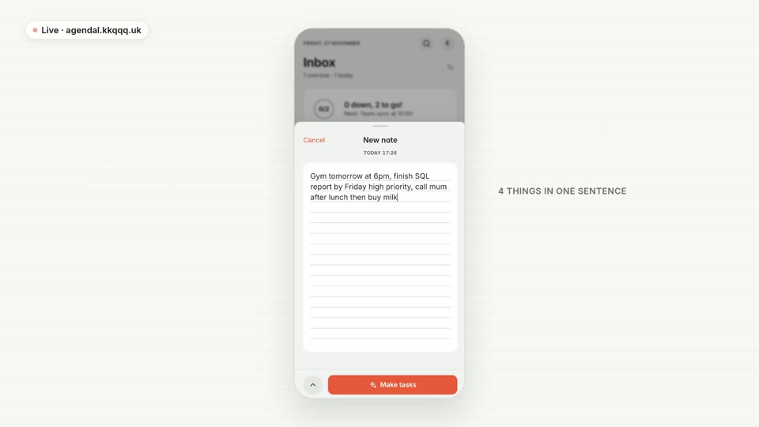</a>

**[Demo trailer](demo/agendal-trailer.mp4)** (2 min 35 s, 1080p), recorded on the live site <https://agendal.kkqqq.uk>. It shows:
- one sentence becoming several dated tasks, and repeating tasks;
- changing plans by writing them ("Move SQL quiz to Monday");
- a file dropped into a note, with the `/api/v1/notes/extract` response;
- a Web Push reminder arriving on a real phone;
- the themes in Settings.

Screenshots from the production build running locally (`compose.prod.yml`, 27 Nov 2026), signed in as the demo account.

| | |
|---|---|
| 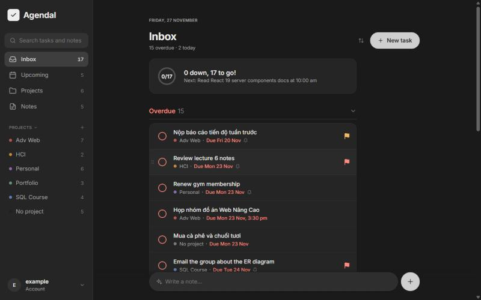 | 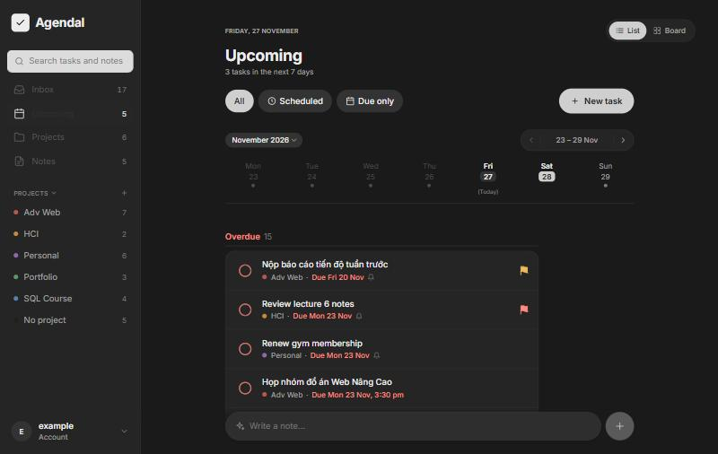 |
| **Inbox:** Overdue first, the progress summary, the note bar | **Upcoming:** week bar, All / Scheduled / Due only |
|  | 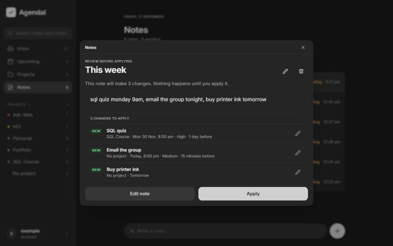 |
| **Note editor:** typed, dictated or from a file | **Check this first:** every change before it is applied |
| 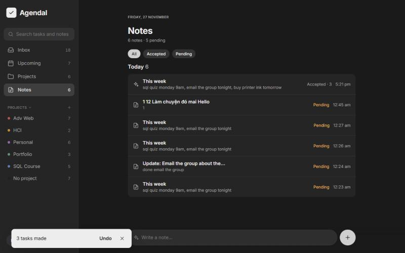 | 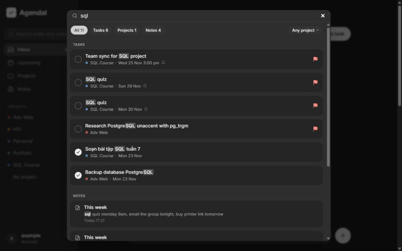 |
| **Applied:** the Notes tab and the Undo toast | **Search** (`Ctrl+K`): tasks, projects and notes |
| 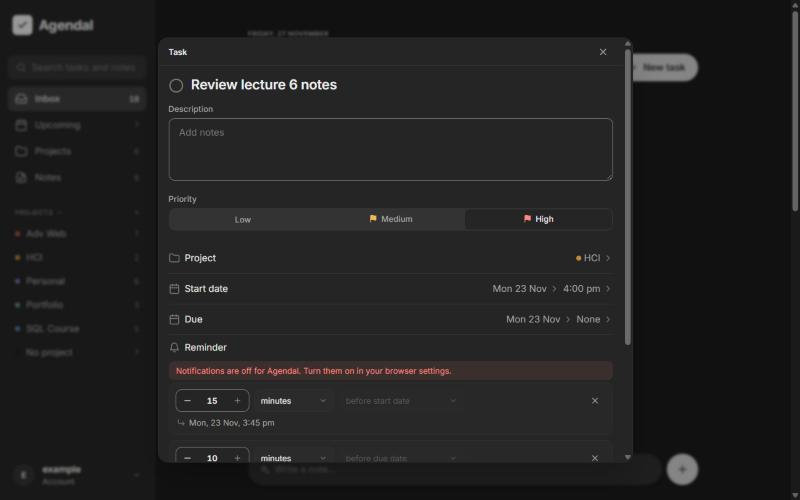 |  |
| **Task details:** priority, project, start, due, reminders | **Projects** with progress |
| 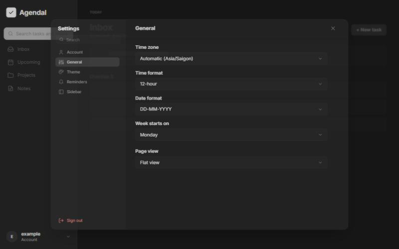 | 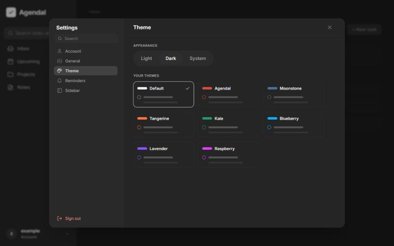 |
| **Settings:** General | **Settings:** Theme, light / dark / system and 8 palettes |
|  | 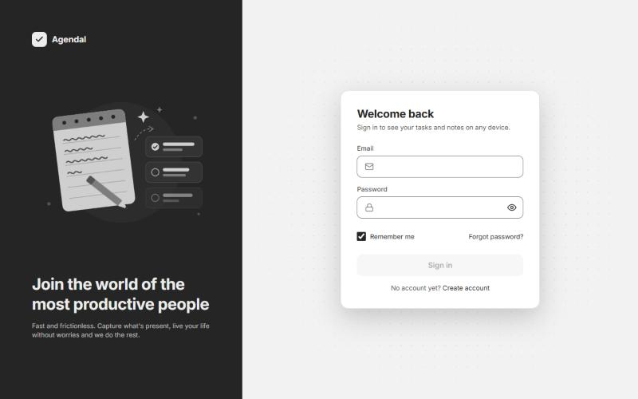 |
| **Upcoming board**, light theme | **Sign in** |
|  |  |
| **Phone:** a tab bar replaces the sidebar | **Phone:** the New task sheet |

More screenshots, of sign-up, the emails, real Web Push reminders, the API docs, Pulse and Telescope, are in [Under the hood](#under-the-hood).

## Run it for a review

The app runs on the team's Linux server at <https://agendal.kkqqq.uk> (IM-65, set up as in [deploy/README.md](deploy/README.md)). To review it on your own machine you need only [Docker](https://www.docker.com/).

```bash
git clone https://github.com/02bbits/Agendal.git
cd Agendal
docker compose up                              # dev server on :3000, API on :8000
docker compose --profile prod up -d web-prod   # production build on :3001, needed for Tour 2
```

The first start takes a few minutes: it installs packages, creates `backend/.env`, migrates and seeds the database. The production build takes another minute or two.

| Address | What | Use it for |
|---|---|---|
| <http://localhost:3000> | Dev server (`web`), reloads on save | Tour 1: every screen and feature except the PWA ones |
| <http://localhost:3001> | Production build (`web-prod`) | Tour 2: service worker, offline, sync, install, update toast. **These run only in a production build** |
| <http://localhost:8025> | Mailpit | Emails: sign-up codes, two-step codes, password resets |
| <http://localhost:8000/docs/api> | API docs, generated from the code | The `/api/v1` endpoints |

- Use **Chrome or Edge** for the full tour, install prompt included; Firefox works too. The session cookie is `__Host-` and `Secure` ([ADR-007](docs/07-architecture/decisions/ADR-007-session-and-auth.md)), so Safari is for the HTTPS site.
- Demo account: **example@gmail.com** / **password**, with sample tasks and projects. You can also create your own account; the 6-digit code arrives in Mailpit.
- :3000 and :3001 are separate sites to the browser: you sign in on each, and the service worker and offline data of :3001 never touch :3000.

## Tour 1: the app (dev server, :3000)

| Area | Try this |
|---|---|
| **Create account** | Create account, enter the code from Mailpit, then the three-step Setup (name; week start, time format, time zone; two-step sign-in). A weak password is refused, and an email that already has an account gets the same answer, so accounts can't be guessed |
| **Notes → tasks** | Write `sql quiz monday 9am, email the group tonight, buy printer ink tomorrow`. *Check this first* lists every change; edit a task, untick one, then **Apply**. The toast's **Undo all** reverses the whole note, and Redo brings it back within 10 s |
| **Vietnamese** | `mai 9h họp nhóm, nộp báo cáo HCI thứ 2`, then `dời họp nhóm sang thứ 3` |
| **Commands on tasks** | After the first note: `move sql quiz to friday`, `done buy printer ink`, `delete email the group` (a delete always asks first) |
| **Dictation and files** | In the note's tray: **Dictate a note** (the words go into the note to check first), or **Upload file** (`.txt`, `.md`, `.csv`, `.pdf`, `.docx`, `.jpg`, `.png`, `.webp`, up to 5 MB): the text lands in the editor before Make tasks. Dictation and photos are read by the language model, so they need it on ([NC](docs/03-modules/NC-note-capture.md) §2.3, §2.4) |
| **Unclear and skipped items** | `idea: dark mode for portfolio site` or `ok thanks` make no task; an undated task such as `Call mum` offers *When?* date chips |
| **Notes tab** | Every saved note with its status (All / Accepted / Pending) and infinite scroll. Open one to see what it did, rename it, **Edit note** to re-plan it, or delete it (its tasks stay) |
| **Inbox** | Overdue (red, with a count) before Today, a progress summary, *No date* and *Completed* (5, then Show all). Tick a task: it settles, moves down, and the toast offers Undo |
| **Upcoming** | Sticky week bar with arrows, List (two weeks) or Board (one week), and the All / Scheduled / Due only filters. A task shows on its start day and, as a dashed card, on its due day |
| **Tasks by hand** | **+**: title, start date and time, due date and time, priority, reminder, repeat (presets or a custom rule: every N days, weeks or months, chosen weekdays, ending on a date or after N times), project, notes. Open a task to edit any field; delete it with Undo |
| **Repeating tasks** | Tick one and the next occurrence appears; untick it and it rolls back |
| **Projects** | Create, rename, pick a colour, delete (keep or delete its tasks, with Undo); each project has a progress bar |
| **Search** | `Ctrl+K` on desktop or the Search tab: tasks, notes and projects, with or without Vietnamese accents, quick filters (Overdue, Due this week, High priority…) and recent searches |
| **Settings** | Account (name, password, two-step), General (time zone, 12/24-hour time, date format, week start, page view), Theme (light / dark / system with a circular reveal, 8 colour palettes), Reminders (on for this device, send a test notification), Sidebar (reorder by drag or keyboard, hide tabs). Sign out, or sign out on all devices |
| **Security** | Three wrong passwords lock sign-in for 60 s (20 in an hour: 15 minutes). Forgot password sends a reset link to Mailpit. With two-step on, sign-in asks for an emailed code |
| **Phone layout** | Narrow the window or use DevTools device mode: a tab bar replaces the sidebar, and details and settings open full screen with a Back bar |
| **Toasts** | Do several things quickly (tick three tasks): up to three toasts stack, each with its own Undo |

## Tour 2: PWA, offline and sync (production build, :3001)

The service worker registers only in a production build, so all of this is checked on <http://localhost:3001> after `docker compose --profile prod up -d web-prod`. Sign in there first. DevTools → **Application** shows the service worker, the caches and the IndexedDB store; DevTools → **Network → Offline** simulates losing the connection.

| Feature | How to check it |
|---|---|
| **Service worker** | Application → Service workers: `sw.js` is activated after the first visit. The app shell and its hashed files are cached; API calls are never cached |
| **Opens offline** | Go offline and reload: the app still opens, and Inbox, Upcoming, Projects and Notes show the copy kept on the device, under a "You're offline" banner |
| **Edit offline, sync later** | Offline, tick a task, edit one, add one with **+**, create a project. Back online, the changes are sent (field by field, the latest edit wins) and the banner goes away |
| **Notes offline** | Offline, the note button reads **Save note** and the note waits in the Notes tab as "Waiting for connection". Back online it is sent, and one toast reports "Back online. N notes turned into M tasks" |
| **Two windows** | Open :3001 in two windows on the same account. A change in one shows in the other within about a minute, or at once when the window is focused. If both edit the same field offline, the losing side shows "Changed on another device" |
| **Install** | The Inbox shows an **Install** banner (also the install icon in the address bar, or Settings → Install app). Installed, Agendal opens in its own window with its icon. Not now hides the banner on this device |
| **Reminders** | Needs VAPID keys (`php artisan push:vapid storage/app/vapid_private_key`, then `VAPID_PUBLIC_KEY` in `backend/.env`) and the `scheduler` and `queue` services. Set a reminder on a task due a few minutes from now: the app asks to send notifications; Allow. When it is due, a notification shows the title and `Mon 09:00 · Project`; tapping it opens the task. Notifications need Chrome, Edge or Firefox (Safari: the installed app) |
| **Update toast** | With the app open, rebuild it with `docker compose restart web-prod`, wait for the build, then return to the tab: "A new version is ready" appears with **Reload** (never while a sheet is open) |
| **Sign out clears the device** | Sign out: the on-device copy and the offline queue are cleared, so the next account starts clean |

When you are done, clear the site data of :3001 (Application → Storage → Clear site data) so the worker and caches go away.

## Everything that is built

Each area links to its module spec, which has the requirements, the edge cases and their tests.

**Accounts and security** ([AA](docs/03-modules/AA-account-access.md), [security](docs/07-architecture/security.md))
- Create account with a 6-digit email code; the account is created only once the code is right. The same answer for an email already in use (no account enumeration). A password strength meter; weak passwords are refused.
- Setup after sign-up: name, week start, time format, time zone, two-step sign-in.
- Sign in with lockout (3 failures → 60 s per email and IP), optional two-step sign-in by emailed code, forgot and reset password, sign out and sign out everywhere.
- Sanctum cookie session (`__Host-`, `Secure`), CSRF on writes, rate limits, an audit log for security events, branded emails sent from the queue.
- Personal access tokens for scripts: six abilities (`tasks:read`, `tasks:write`, `projects:read`, `projects:write`, `notes:read`, `notes:write`) checked on every data route, 7/30/90-day expiry ([api.md](docs/07-architecture/api.md#personal-access-tokens)).

**Notes** ([NC](docs/03-modules/NC-note-capture.md), [NU](docs/03-modules/NU-note-understanding.md), [RV](docs/03-modules/RV-review-control.md))
- Note editor with a draft kept on the device; up to 5,000 characters and 30 items. Dictate a note, or turn a text, Markdown, CSV, PDF, Word file or photo into one (photos lose their EXIF before the model sees them).
- Note understanding on the server with deterministic rules in English and Vietnamese: splitting, dates and times ("monday 9am", "mai 9h", "end of the month", "in 3 days"), repeats ("every monday 7am"), priority, projects and reminders. Ideas, FYIs and chatter are skipped.
- Commands on existing tasks (done, move, delete), matched to open tasks; ties ask, and a delete always confirms.
- A language-model fallback (Gemini) for the items the rules are unsure about: off by default, 20 calls per user per day ([ADR-008](docs/07-architecture/decisions/ADR-008-llm-fallback.md)).
- *Check this first* review before anything changes, the result screen, Undo all and Redo, follow-up for unclear notes, Edit note (re-plan), rename and delete, and the Notes tab with filters.

**Tasks** ([TK](docs/03-modules/TK-tasks.md))
- Title, start date and time, due date and time, priority, reminder, repeat (presets and custom rules), project and notes; start must be before due.
- Complete with Undo and a settle animation, repeating tasks that roll forward and back, delete with Undo.

**Lists and Search** ([LV](docs/03-modules/LV-lists-search.md))
- Inbox: Overdue, Today (starting or due today, in progress, or Planned), No date, Completed; a progress summary; recomputed at midnight.
- Upcoming: week bar, List and Board views, All / Scheduled / Due only, start-day and due-day entries, an Overdue section.
- Search: titles and notes, accent-aware Vietnamese matching, quick filters, recent searches, keyset paging.
- Task row: project, time, reminder and repeat icons, priority flag.

**Projects** ([PJ](docs/03-modules/PJ-projects.md))
- Create, rename, colour, delete (move or delete its tasks) with Undo and restore; a progress bar; "No project".

**Platform** ([AP](docs/03-modules/AP-app-platform.md), [ADR-004](docs/07-architecture/decisions/ADR-004-offline-sync-field-level-lww.md), [ADR-005](docs/07-architecture/decisions/ADR-005-sync-protocol.md))
- PWA: web manifest and icons, an install banner with guidance for Chromium, iOS and Firefox Android, a service worker and an update toast.
- Offline: an IndexedDB copy of tasks, projects, settings and the last 100 notes; a queue for offline edits and notes; sync with field-level last-write-wins, a pull cursor, conflict notices, and one sync per browser at a time.
- Responsive from phone to desktop: a tab bar or a sidebar, a task panel or full-screen details, flat or full-width page view.
- Settings with 5 tabs, light / dark / system themes, 8 palettes, a customisable sidebar, a loading screen on start, stacked toasts, Back navigation, WCAG 2.2 AA (axe checks in both themes).
- Time zones: dates and times are floating local values, and "today" follows the device ([ADR-006](docs/07-architecture/decisions/ADR-006-time-zones.md)).
- Reminders as Web Push notifications, sent by a queued job every minute ([TK §2.5](docs/03-modules/TK-tasks.md#25-reminders-tk-6-should)).
- `GET sync` and `GET counts` answer `304 Not Modified` to a matching ETag, so an idle device's polling skips the list queries.

## How it works

| Part | What |
|---|---|
| `frontend/` | Next.js 16 and React 19, TypeScript strict, Tailwind CSS and daisyUI. Forwards `/api/*` and `/sanctum/*` to the backend, so the browser sees one site |
| `backend/` | Laravel 13 JSON API at `/api/v1`, Sanctum cookie sessions and personal access tokens, a queue worker for emails and reminders, a scheduler, alerts to the admins' Discord |
| Database | PostgreSQL 18 |
| `docker-compose.yml` | The whole stack: PostgreSQL, Mailpit, the API, the queue worker, the scheduler, the dev server and the opt-in production build (`web-prod`) |

A note becomes tasks on the server in one request: normalise, split into items, classify each one (task, command on an existing task, or skip), extract its fields with rules, send unsure items to the language model when it is on, match commands to open tasks, validate, apply the safety rules, and name the note. The result is a **plan** the user reviews before it is applied, and each applied note keeps an undo log for 30 days ([ADR-001](docs/07-architecture/decisions/ADR-001-note-plan-contract.md), [ADR-002](docs/07-architecture/decisions/ADR-002-undo-change-log.md)). The same text, time and tasks always give the same plan.

To turn the language model on, save a Gemini API key in a file, set `NOTE_LLM_ENABLED=true` and `GEMINI_API_KEY_FILE=<path to that file>` in `backend/.env`, and restart `api` ([ADR-008](docs/07-architecture/decisions/ADR-008-llm-fallback.md)). The key itself never goes in `.env`.

## Under the hood

How each part is built, with the code, the tests and screenshots of it running. The screenshots come from the production build (`compose.prod.yml`) run locally on 27 Nov 2026, with mail going to Mailpit.

### Way of working

- Every change starts as a GitHub issue with its scope and a "Done when" list, labels, an assignee and a milestone (for example [#192](https://github.com/02bbits/Agendal/issues/192), [#196](https://github.com/02bbits/Agendal/issues/196)). The build plan is [docs/08-project/tasks.md](docs/08-project/tasks.md).
- Work happens on a topic branch and lands through a [pull request](https://github.com/02bbits/Agendal/pulls?q=is%3Apr) that `Closes #n`. A code owner reviews it, and the Backend, Frontend and Secret scan checks must pass ([ci.yml](.github/workflows/ci.yml)).
- Commits follow Conventional Commits (`feat:`, `fix:`, `perf:`, `test:`, `docs:`, `chore:`), one change each, naming the issue: `eece9af perf: ETag and 304 on sync and counts (Refs #201)`. Docs changes are listed in the [docs changelog](docs/CHANGELOG.md).

### Database

- PostgreSQL 18 through Laravel [migrations](backend/database/migrations): foreign keys, `CHECK` constraints on every enum-like column, composite indexes that lead with `user_id`, partial indexes (open reminders, live project names) and a trigram index for search. A trigger stamps `change_seq` on every write for sync. See the [ERD](#data-model-erd) and [data-model.md](docs/07-architecture/data-model.md).
- [Factories](backend/database/factories) for User, Project, Task and Note (`HasFactory`). [DatabaseSeeder.php](backend/database/seeders/DatabaseSeeder.php) creates the demo account with its projects, tasks and notes, and [DemoSeedTest.php](backend/tests/Feature/DemoSeedTest.php) checks the seed in CI.

### Interface

- Next.js 16 and React 19 with Tailwind CSS and daisyUI utility classes. `sm:` and `md:` breakpoints switch between the phone layout (tab bar, full-screen details) and the desktop one (sidebar, task panel). Shared components live in [frontend/src/ui/components](frontend/src/ui/components).
- React escapes everything it renders, and the code has no `dangerouslySetInnerHTML`. Laravel serves only the JSON API, the error pages and the admin tools.

### Accounts and forms

- **Create account:** email and password, with a strength meter; weak or breached passwords are refused. A 6-digit code is emailed, and the account exists only once the code is right. Then a three-step Setup: name, dates and times, security.
- **Passwords** are hashed (`hashed` cast; Argon2id in production, [.env.production.example](backend/.env.production.example)). Sign-in locks for 60 s after 3 wrong tries per email and IP, and for 15 minutes after 20 in an hour ([LoginController.php](backend/app/Http/Controllers/Auth/LoginController.php)). Two-step sign-in sends a code by email; Forgot password sends a one-time link.
- **Forms:** every write carries Sanctum's CSRF token. The `XSRF-TOKEN` cookie goes back as the `X-XSRF-TOKEN` header ([api.ts](frontend/src/lib/api.ts)). The server validates with `FormRequest` classes ([Requests](backend/app/Http/Requests)), and errors come back per field and show under the field.
- Tests: [RegisterTest.php](backend/tests/Feature/RegisterTest.php), [LoginTest.php](backend/tests/Feature/LoginTest.php), [ChangePasswordTest.php](backend/tests/Feature/ChangePasswordTest.php).

| | |
|---|---|
| 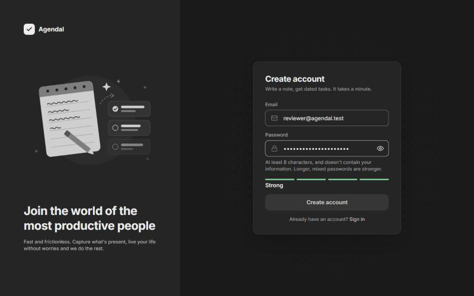 | 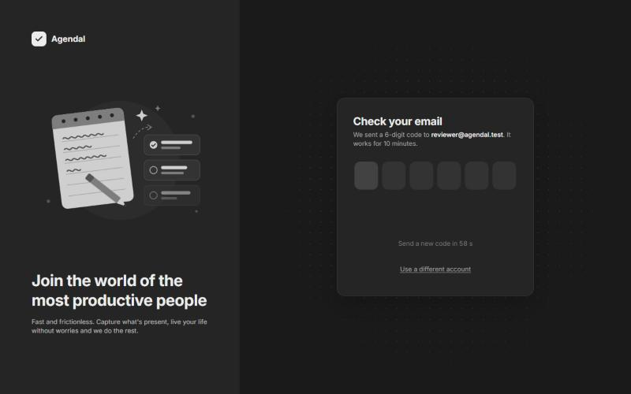 |
| **Create account**, with the strength meter | **Check your email:** the 6-digit code |
| 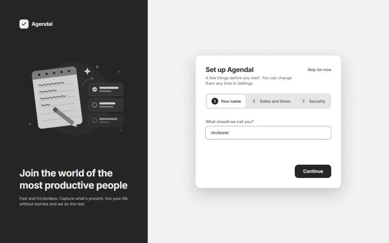 | 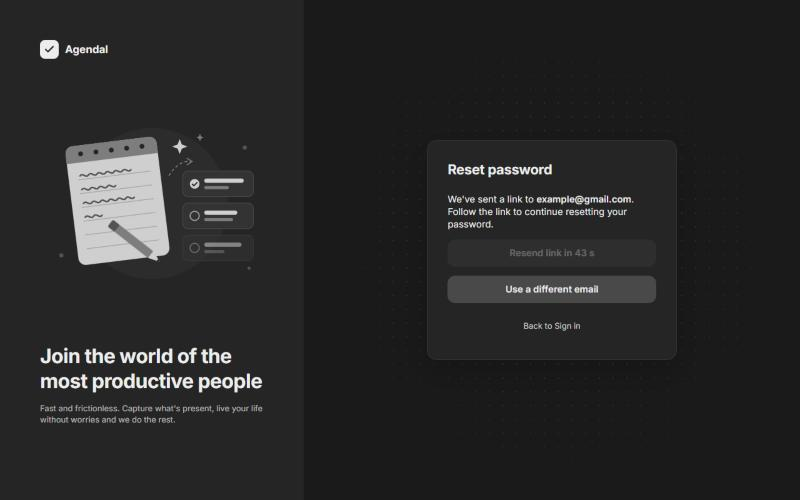 |
| **Setup** after the code | **Forgot password:** the link is sent |

### Email

All five account emails (sign-up code, sign-in code, password reset, password changed, sign-up attempt on an existing email) are `ShouldQueue` notifications ([QueuedMailNotification.php](backend/app/Notifications/Concerns/QueuedMailNotification.php)). They are sent after the database commit by the queue worker, tried 3 times with 10, 30 and 60 s waits, and logged without addresses or codes when they fail ([QueuedMailNotificationsTest.php](backend/tests/Feature/QueuedMailNotificationsTest.php)). The worker checks the queue every second. The queue worker's log for the two emails below:

```
2026-11-27 11:04:56 App\Notifications\ResetPasswordNotification .... RUNNING
2026-11-27 11:04:57 App\Notifications\ResetPasswordNotification 727.40ms DONE
2026-11-27 11:05:30 App\Notifications\VerifyEmailCode .............. RUNNING
2026-11-27 11:05:30 App\Notifications\VerifyEmailCode ......... 34.12ms DONE
```

| | |
|---|---|
| 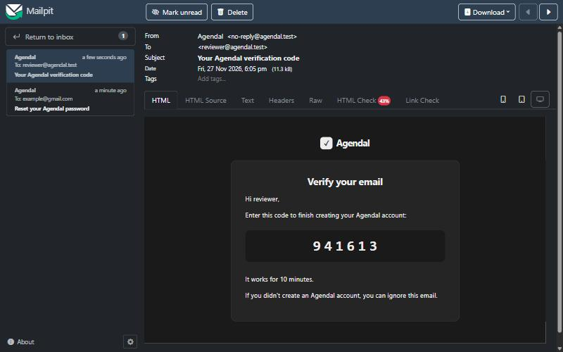 | 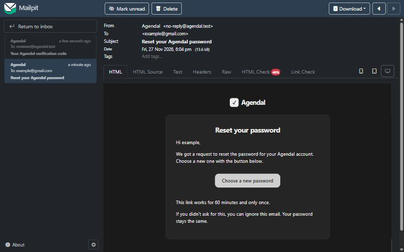 |
| **Sign-up code** email | **Password reset** email |

### Outside services

- **Gemini** reads the note items the rules are unsure about, and it also handles dictation and photos ([NoteLlmFallback.php](backend/app/Services/Notes/NoteLlmFallback.php), [ADR-008](docs/07-architecture/decisions/ADR-008-llm-fallback.md)).
  - The key is read from a secret file, never `.env` ([note_llm.php](backend/config/note_llm.php)).
  - Each call times out after 20 s. Each user gets 20 calls a day, inside a global token budget ([LlmBudget.php](backend/app/Services/Notes/LlmBudget.php)).
  - Quota errors, connection errors and answers that don't match the schema fall back to the rules and are logged.
  - [NoteLlmFallbackTest.php](backend/tests/Unit/Services/NoteLlmFallbackTest.php) checks the request, including its auth header.

<a id="real-gemini"></a>Production calls to Gemini (`note_llm` fallback, `note_ocr` photo/file extraction, and `note_dictation` voice transcription) are written to Laravel's daily application log (`storage/logs/laravel-2026-11-28.log`, `daily` channel in [logging.php](backend/config/logging.php)). Because the full daily log also contains unrelated system output (such as rendered mail bodies), we extracted the Gemini entries below for readability, alongside screenshots of both the full system log and the extracted Gemini lines, plus photo OCR and voice dictation running:

```text
[2026-11-28 03:43:38] production.INFO: note_llm {"elapsed_ms":276.2562,"outcome":"fallback"} {"request_id":"req_ClBUvs9vfoGs25WV"}
[2026-11-28 03:44:26] production.INFO: note_llm {"provider":"gemini","model":"gemini-3.5-flash-lite","tokens":2240,"elapsed_ms":1226.914993,"accepted":1} {"request_id":"req_DyH1iJLM9qaCFAXC"}
[2026-11-28 08:23:23] production.INFO: note_ocr {"provider":"gemini","model":"gemini-3.5-flash-lite","mime":"image/png","tokens":1298} {"request_id":"req_2eLmhxsM1eV0WslE"}
[2026-11-28 08:30:36] production.INFO: note_dictation {"provider":"gemini","model":"gemini-3.5-flash-lite","tokens":576,"seconds":8.9} {"request_id":"req_IBe85xPZ8GbnjRP1"}
```

| | |
|---|---|
| 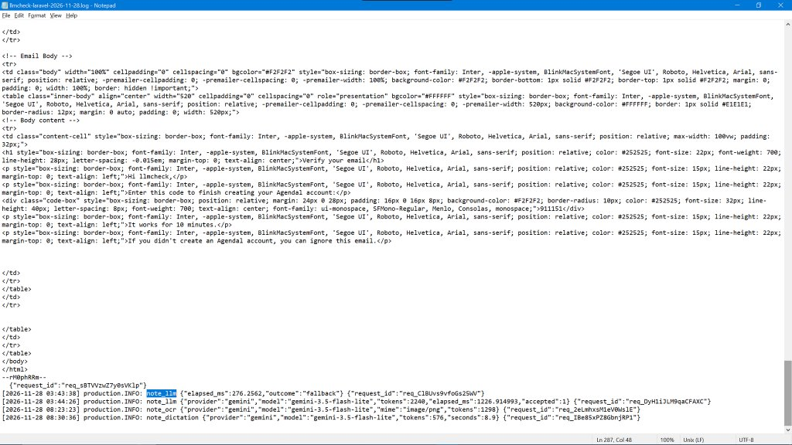 | 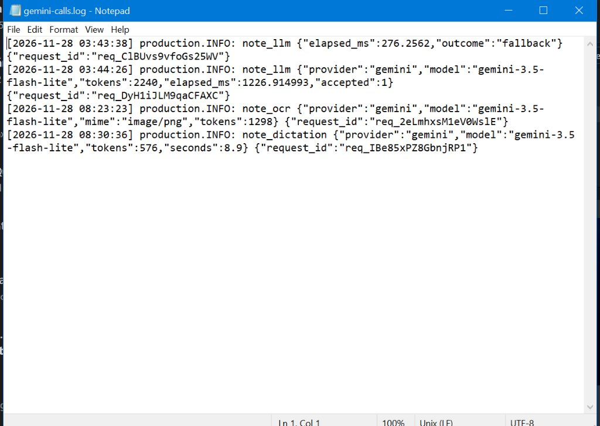 |
| **Full system daily log** (`laravel-2026-11-28.log`) | **Extracted Gemini entries** for readability |
| 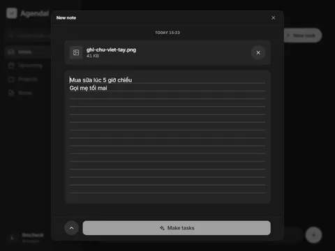 | 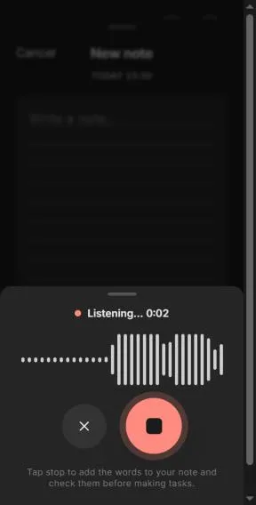 |
| **Photo / file upload (`note_ocr`):** `ghi-chu-viet-tay.png` extracted into note text | **Voice dictation (`note_dictation`):** live audio recording sheet |

- **Web Push** sends reminders through the browser's push service, signed with VAPID ([PushClient.php](backend/app/Services/Push/PushClient.php)). Only known push services are allowed ([push.php](backend/config/push.php)): Google, Mozilla, Apple and Windows.
  - `reminders:send` runs every minute and queues [SendReminderPushes.php](backend/app/Jobs/SendReminderPushes.php) ([ReminderSendTest.php](backend/tests/Feature/ReminderSendTest.php)).

<a id="real-web-push"></a>A real reminder, delivered through Microsoft's push service (`notify.windows.com`) to Edge on Windows. The task starts at 17:39 with a reminder 5 minutes before. At 17:34:02 `reminders:send` queued `SendReminderPushes`, which logged `reminders.sent {"sent":4,"gone":0}`, and the notification arrived:

| | |
|---|---|
|  | 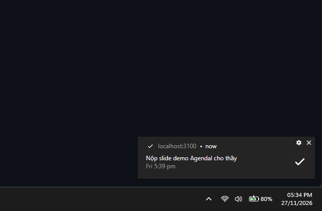 |
| **The task:** reminder 5 minutes before the start | **The notification** from the browser, at 5:34 pm |
| 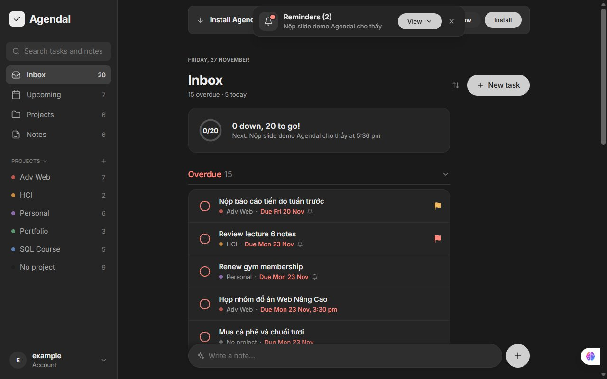 |  |
| **In the app:** the Reminders banner with View | **Settings → Reminders → Send a test notification** |

### REST API

- **Resources:** `/api/v1` has `index`, `store`, `show`, `update` and `destroy` for tasks, projects and notes ([routes/api.php](backend/routes/api.php)), using Eloquent models, [API Resources](backend/app/Http/Resources) and `FormRequest` validation. Responses use 201, 204, 404, 422 and 429; a 429 carries `Retry-After`. Every error has one JSON shape: `code`, `message`, `fields` and the `request_id`.
- **Authentication:** the web app uses Sanctum's cookie session. Scripts use personal access tokens ([TokenController.php](backend/app/Http/Controllers/TokenController.php)). `createToken` takes any of six abilities (`tasks:read`, `tasks:write`, `projects:read`, `projects:write`, `notes:read`, `notes:write`) and an expiry of 7, 30 or 90 days. Each data route names the abilities it needs ([TokenAbilities.php](backend/app/Http/Middleware/TokenAbilities.php)).
- **Docs:** Scramble generates the API docs from the code at `/docs/api`, including the cookie and CSRF security scheme ([scramble.php](backend/config/scramble.php)). [ApiDocsTest.php](backend/tests/Feature/ApiDocsTest.php) checks that every `/api/v1` route is in them, and CI exports `api.json`.
- **Tests:** [TaskApiTest.php](backend/tests/Feature/TaskApiTest.php), [ApiBaseTest.php](backend/tests/Feature/ApiBaseTest.php), [ApiTokenTest.php](backend/tests/Feature/ApiTokenTest.php), and the rest of [backend/tests](backend/tests).


### Logs, errors and monitoring

- **Logs and errors:** every request gets a `request_id` ([AssignRequestId.php](backend/app/Http/Middleware/AssignRequestId.php)), which is on each log line and in each error response. Logs are daily files kept 14 days ([logging.php](backend/config/logging.php)). Error pages are the app's own ([errors/minimal.blade.php](backend/resources/views/errors/minimal.blade.php)), and the API answers errors in JSON.
- **Telescope** is at `/telescope` ([TelescopeServiceProvider.php](backend/app/Providers/TelescopeServiceProvider.php)). It opens only for the emails in `TELESCOPE_ALLOWED_EMAILS` outside local, hides cookies, tokens and CSRF headers, and is pruned after 48 hours.
- **Slow queries:** a query over 500 ms is logged at `error` with the SQL and the `request_id`, never the values, and posted to the admins' Discord ([below](#admin-alerts)); a request whose queries add up to over 2 s is logged at `error` with its total duration and `request_id` ([AppServiceProvider.php](backend/app/Providers/AppServiceProvider.php), [MonitoringTest.php](backend/tests/Feature/MonitoringTest.php)).
- **Pulse** is at `/pulse`, behind the same allow-list. It shows exceptions, slow requests, jobs and queries, and the queue. Its Server health card shows CPU, load, memory, swap, disk, Postgres connections and whether the API and the web app are up. It turns red past CPU 85% for 5 minutes, memory 90% or disk 80% ([ServerHealth.php](backend/app/Livewire/Pulse/ServerHealth.php), [ServerHealthTest.php](backend/tests/Feature/ServerHealthTest.php)).

| | |
|---|---|
|  | 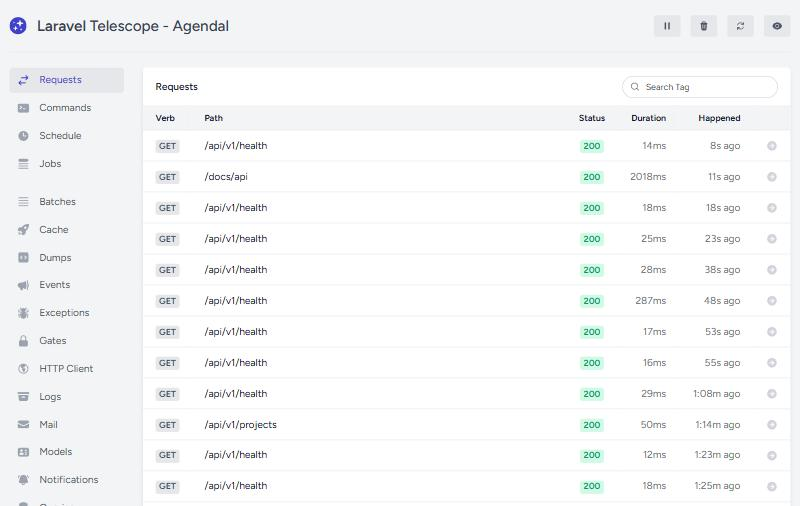 |
| **Pulse:** Server health, exceptions, queues | **Telescope:** requests with status and duration |

<a id="admin-alerts"></a>**Alerts to the admins on Discord.** The server posts to the admins' Discord channel by itself, as one embed per alert: red for critical, amber for a warning, green when a problem is over. The text is in Vietnamese (`DISCORD_ALERT_LOCALE=vi`, [lang/vi/monitoring.php](backend/lang/vi/monitoring.php)).

| What happens | Alert | Code |
|---|---|---|
| A query over 500 ms, or over 2 s of queries in one request | Slow database query, with the SQL without values, the duration, the route and the `request_id` | [SlowQueryAlert.php](backend/app/Services/Monitoring/SlowQueryAlert.php) |
| A request ends in a 5xx error, a queued job fails, or a scheduled task fails | Critical error, with the exception class and source line, the job or command, and the `request_id` | [CriticalErrorAlert.php](backend/app/Services/Monitoring/CriticalErrorAlert.php) |
| CPU, memory, disk, last backup, API or web app crosses its Server health threshold, and again when it is back | Over the threshold / Back to normal, with the current value and the threshold | [ServerHealthAlert.php](backend/app/Services/Monitoring/ServerHealthAlert.php) |
| The server monitor stops sending readings for over a minute, and again when it is back | Server monitor stopped / running again | [routes/console.php](backend/routes/console.php) |

How it is built ([DiscordAlert.php](backend/app/Services/Monitoring/DiscordAlert.php)):
- The webhook URL is a Docker secret (`discord_webhook_url`), read from its file on each alert and never stored in `.env`.
- Each alert is sent once per 5 minutes however often the fault repeats.
- A request posts after its response is sent, and a failed post is logged without ever failing the request.
- Alerts carry no user content (SC-21).
- [MonitoringTest.php](backend/tests/Feature/MonitoringTest.php) checks each alert, and the test suite never posts.

The alerts as they arrived in the admins' channel on 27 Nov 2026:

| | |
|---|---|
| 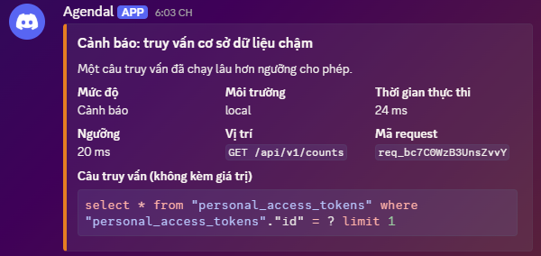 | 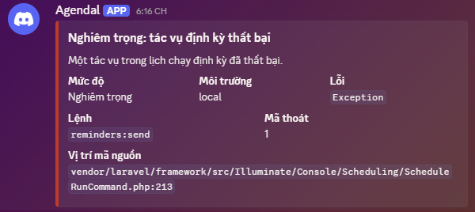 |
| **Slow query:** duration, threshold, route, `request_id` and the SQL without values | **Scheduled task failed:** the command, its exit code, the error and the source line |
| 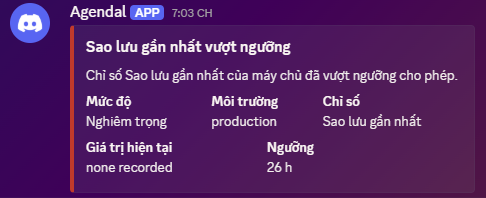 | 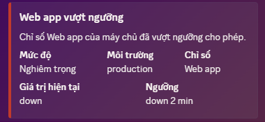 |
| **Last backup** older than 26 h | **Web app** down for 2 minutes |
| 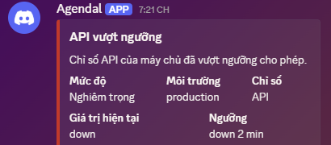 | 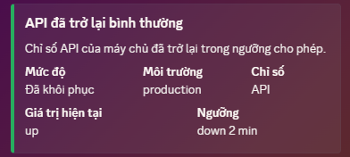 |
| **API** down for 2 minutes | **API back to normal** |
| 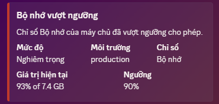 | 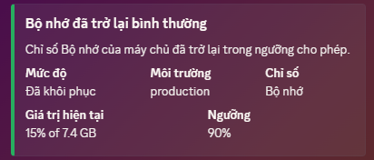 |
| **Memory** at 93% of 7.4 GB, over 90% | **Memory back to normal** at 15% |

### Background work

- **Server:** reminders and every account email run on the queue (above). The queue worker and the scheduler are their own containers in [compose.prod.yml](compose.prod.yml).
- **Client:** offline edits and notes wait in an IndexedDB queue and are sent with `async`/`await` once the device is back online, one sync per browser at a time ([ADR-005](docs/07-architecture/decisions/ADR-005-sync-protocol.md)).

### Loading speed and caching

- **Build:** `next build` minifies and compresses the JavaScript and CSS and splits them by route, so each screen loads only its own code.
- **Prerendering:** `cacheComponents: true` prerenders the static shell of every screen ([next.config.ts](frontend/next.config.ts)), served from the cache at once (`x-nextjs-prerender`).
- **Prefetching:** `partialPrefetching: true` and [usePrefetch.ts](frontend/src/app/frame/usePrefetch.ts) prefetch the other tabs, so switching tabs is instant. The router keeps visited screens for 5 minutes (`staleTimes.dynamic: 300`).
- **Fonts:** Inter through `next/font` ([layout.tsx](frontend/src/app/layout.tsx)): self-hosted and preloaded, only the Latin, Latin Extended and Vietnamese subsets, and `display: swap`, so text shows at once.
- **Scripts:** the one script that runs before paint is the tiny `theme.js` (`beforeInteractive`), so the saved theme never flashes; everything else loads with the page's own chunks.
- **Lazy loading:** the search popup, Settings and the note result overlay are `React.lazy` components, each in its own chunk outside the first load ([lazyOverlays.tsx](frontend/src/app/frame/lazyOverlays.tsx), PR [#219](https://github.com/02bbits/Agendal/pull/219)). Once the page is idle (`requestIdleCallback`) their chunks are fetched in the background and cached by the service worker, so they open at once, offline too.
- **Images:** every image in the interface is a vector SVG (`frontend/public/illustrations/*.svg` and the icons): sharp on any screen and density, 0.7 to 2.2 KB each, cached by the service worker, and decoded off the main thread (`decoding="async"`). Raster files are kept to the app icons the browser and the OS load at fixed sizes: the manifest PNGs (`icon-192.png`, `icon-512.png`), the iOS home-screen icon (`apple-icon.png`) and the favicons.
- **Caching:**
  - The service worker caches the app shell and the hashed files, versioned by build, and deletes old versions on update.
  - API responses are `no-store, private` ([SecurityHeaders.php](backend/app/Http/Middleware/SecurityHeaders.php)), because they are per user and change from other devices.
  - `GET sync` and `GET counts` carry a weak ETag from the user's last change and answer `304 Not Modified` while nothing changed ([CacheValidationTest.php](backend/tests/Feature/CacheValidationTest.php)). An idle device's polling then skips the list queries.
  - Freshness comes from revalidation: the ETag check costs three index lookups and is always right across devices, with no cache to clear on writes.
- **Scaling rules** ([scalability.md](docs/05-quality/scalability.md)):
  - Every query is scoped by `user_id`, and every index leads with it.
  - Project task lists come from one grouped query instead of one per project ([ProjectTaskLists.php](backend/app/Services/Projects/ProjectTaskLists.php)).
  - Lists and search use keyset paging, and sync is incremental by `change_seq`.
  - Telescope and Pulse show slow requests and queries.

## Data model (ERD)

The main tables on PostgreSQL 18, from the migrations in [backend/database/migrations](backend/database/migrations). Projects, tasks and notes are soft-deleted and carry a `change_seq` for sync ([ADR-005](docs/07-architecture/decisions/ADR-005-sync-protocol.md)). Laravel's own tables (sessions, cache, jobs, password resets) and Telescope and Pulse are left out. Every column, constraint and index is in [data-model.md](docs/07-architecture/data-model.md).

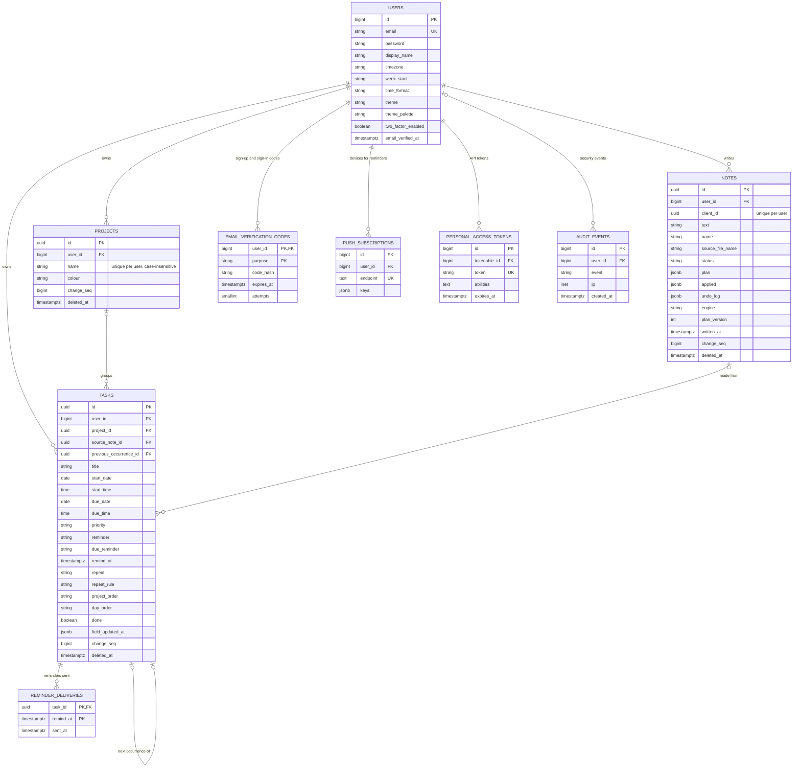

| Read more | |
|---|---|
| [SUMMARY](docs/SUMMARY.md) | The whole spec in one read |
| [Screens](docs/01-product/screens.md), [UX standards](docs/01-product/ux-standards.md), [theme guide](docs/01-product/theme-guide.md) | Every screen and its states, the Graphite design |
| [Modules](docs/03-modules/) | Requirements and edge cases per area |
| [Workflows](docs/04-workflows/README.md) | Capture a note, confirm risky changes, undo, offline capture and sync, sign-in and recovery |
| [Architecture](docs/07-architecture/overview.md) | Components, [API](docs/07-architecture/api.md), [data model](docs/07-architecture/data-model.md), [security](docs/07-architecture/security.md), [decisions](docs/07-architecture/decisions/README.md) |
| [Testing](docs/06-testing/test-strategy.md) | Test strategy, scenarios, the traceability matrix and the note corpus |

## Quality

- **Tests:** 1,757 Pest tests on a real PostgreSQL database for the API and the note engine, with a golden note corpus, and 1,376 Vitest tests in 116 files for the frontend (screens, offline, sync, the service worker), with axe accessibility checks in light and dark.
- **Coverage**, measured in CI with a 70% floor that fails the build:

  | Part | Lines | Statements | Branches | Functions |
  |---|---|---|---|---|
  | Backend (Pest, PCOV) | **95.2%** | | | |
  | Frontend (Vitest, V8) | **90.55%** | **90.55%** | 87.59% | 84.41% |

  From the [CI run on `main`](https://github.com/02bbits/Agendal/actions/runs/45982270498) for ada7789 (27 Nov 2026); each run's summary shows its numbers, and `coverage.xml` and `lcov.info` are uploaded as artifacts.
- **CI:** GitHub Actions runs Pint, Larastan, Pest with coverage, the API docs export, Prettier, ESLint, the type check, Vitest with coverage, the production build, dependency audits and a secret scan (gitleaks) on every pull request and on `main` ([ci.yml](.github/workflows/ci.yml)).
- **Way of working:** every change goes through a GitHub issue and a reviewed pull request; the docs have a dated [changelog](docs/CHANGELOG.md).

## Team

| Member | Area |
|---|---|
| **02bbits** | Platform: repo, CI, accounts, settings, offline sync, install, deployment |
| **3HoTuan3** | Tasks and views: task model, projects, Inbox, Upcoming, Search, design system |
| **khang-ngo4444** | Note understanding: the rules engine, the language-model fallback, the note corpus |

The note flow (editor, review, undo, Notes tab) was shared between the team through GitHub issues.

## For developers

### Run it

Needs only Docker.

```bash
docker compose up        # app on http://localhost:3000, API on :8000
```

The first start installs Composer and npm packages, creates `backend/.env` with an app key, then migrates and seeds (demo account: example@gmail.com / password). Every start migrates, so pulling new migrations needs no extra step. Code is mounted from the host and reloads on save. After changing `package.json`, restart `web` (`docker compose restart web`).

The service worker runs only in a production build. To check it, start one next to the dev server: `docker compose --profile prod up -d web-prod` serves it on <http://localhost:3001> (the first build takes a minute or two). Restart `web-prod` to get a new build, for example to see the update toast. Its worker and caches belong to :3001 only, so the dev app on :3000 stays uncached; clear the site data in DevTools when you're done.

Run commands inside the containers, for example `docker compose exec api php artisan test` or `docker compose exec web npm test`. The API container runs as UID 1000 by default; if yours differs, `export UID GID` first.

#### Without Docker for the app

PHP 8.4+ with `pdo_pgsql`, `intl` and `mbstring`, Composer, Node 20+. Start only the services with `docker compose up -d db mail`, set up once with `cd backend && composer setup && php artisan db:seed` and `cd frontend && npm install && cp .env.example .env.local`, then run `composer run dev` in `backend/` and `npm run dev` in `frontend/`.

Open the app at <http://localhost:3000>, not :8000. Emails such as password resets land in Mailpit at <http://localhost:8025>. API docs are generated from the code at <http://localhost:8000/docs/api> (Scramble; on the server `https://<domain>/docs/api`, behind the `TELESCOPE_ALLOWED_EMAILS` allow-list). CI exports the OpenAPI file as the `api.json` artifact. Use Chrome or Firefox locally: the session cookie is `Secure` with a `__Host-` prefix (ADR-007), and Safari rejects it over plain http.

### Monitoring

Telescope is at <http://localhost:8000/telescope>, open to anyone locally. On the server it records every request, job and scheduled run, but of the rest only exceptions and slow queries, and opens only for the signed-in emails in `TELESCOPE_ALLOWED_EMAILS` (comma-separated); `TELESCOPE_ENABLED=false` turns it off. Entries keep no request or response bodies, query bindings, emails or mail (SC-21), and are pruned after 48 hours.

Pulse is at <http://localhost:8000/pulse> (through Next.js on the server, `https://<domain>/pulse`), behind the same allow-list. It is the error dashboard: exceptions (5xx, failed jobs and scheduled tasks, language-model call failures) by class and line with counts, queue throughput and failures, slow requests, jobs, queries (from 500 ms) and outgoing calls, and the busiest users by id. It keeps no messages, query values, cache keys or emails (SC-21) and trims itself after 7 days. Each error on it links back to its log line through the `request_id`. Links it builds use `APP_URL`, so that must be the public origin. Its Servers and Server health cards (#199) fill only while `php artisan pulse:check` runs (the `pulse` service on the server; locally `docker compose exec api php artisan pulse:check`); see deploy/README.md for the thresholds.

A query over `DB_SLOW_QUERY_MS` (500), or a request whose queries add up to more than `DB_SLOW_REQUEST_MS` (2000), logs at `error` with the SQL and the request ID, never the values. To post alerts to Discord, put the channel's webhook URL in a file and set `DISCORD_ALERT_WEBHOOK_FILE` to its path in `backend/.env`; on the server it is the `discord_webhook_url` secret ([compose.prod.yml](compose.prod.yml)).

### Time

Read the time only through the clock (ADR-006): `ClockInterface` on the server, `@/lib/clock` on the client. Tests pin it with `travelTo()` or `vi.setSystemTime()` plus a zone. A note's "now" is `ClientClock::fromWrittenAt()`: its `written_at`, clamped to server time. API calls go through `@/lib/api`, which sends `X-Timezone`.

### Checks

For IM-32, edit the [splitter scenario CSV](backend/tests/Fixtures/note-splitter-scenarios.csv) and follow the [self-test instructions](backend/tests/Fixtures/README.md). Run only those tests with `cd backend && php vendor/bin/pest tests/Unit/Services/NoteSplitterTest.php`; they require no database.

Dynamic scenario definitions live only in [tests/Support/NoteSplitterScenarios.php](backend/tests/Support/NoteSplitterScenarios.php); run them from `backend/` with `php vendor/bin/pest tests/Unit/Services/NoteSplitterDynamicTest.php`. The rules file is [backend/resources/notes/note-rules.csv](backend/resources/notes/note-rules.csv), shared by the splitter and the field extractor; its path and the note limits are set in [backend/config/notes.php](backend/config/notes.php).

Tests run on the `agendal_test` database, created automatically with a new `db` volume. On a volume made before it existed, create it once:

```bash
docker compose exec db psql -U agendal -c 'CREATE DATABASE agendal_test OWNER agendal'
```

GitHub Actions runs the same checks on every pull request ([ci.yml](.github/workflows/ci.yml)). Run them locally first:

```bash
cd backend && ./vendor/bin/pint --test && composer analyse && php artisan test
cd frontend && npm run format:check && npm run lint && npm run typecheck && npm test
```

Run with line coverage (70% minimum, matching CI; backend requires PCOV or Xdebug):

```bash
cd backend && php -d pcov.enabled=1 -d pcov.directory=app vendor/bin/pest --coverage --min=70
cd frontend && npm run test:coverage
```
