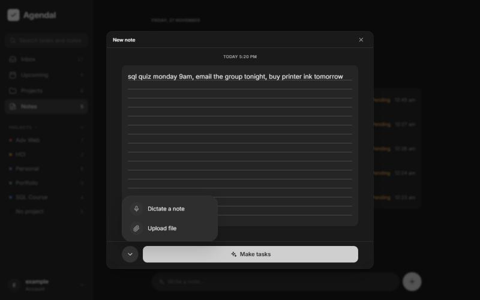
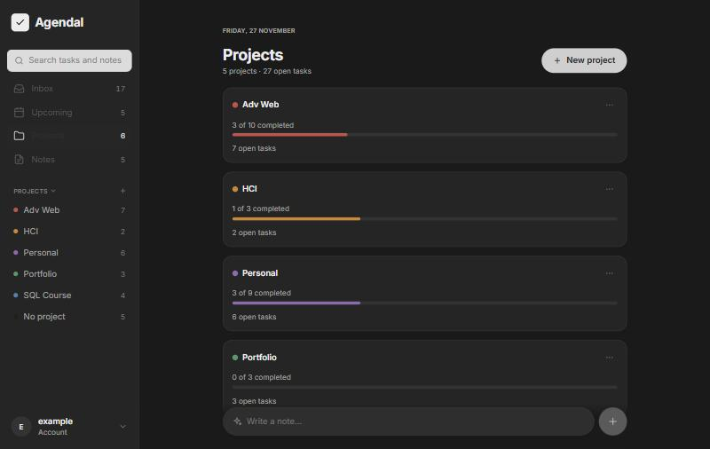
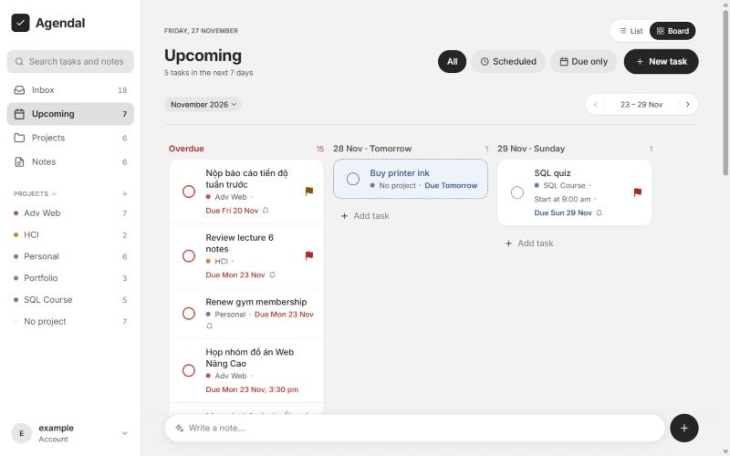
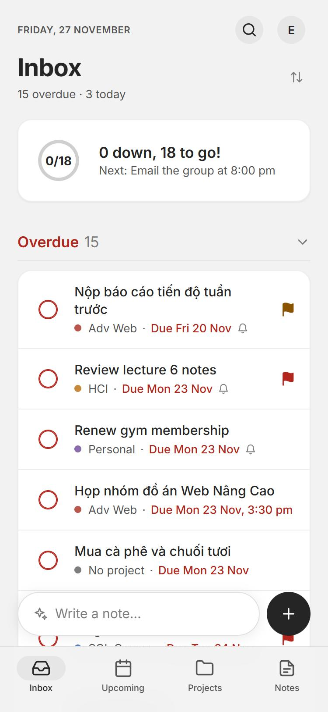
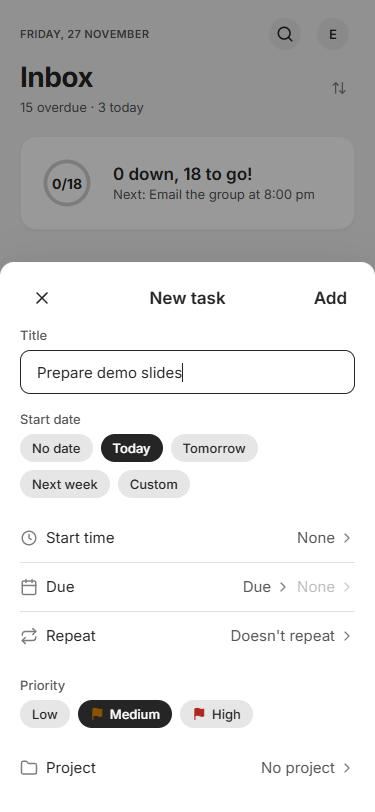
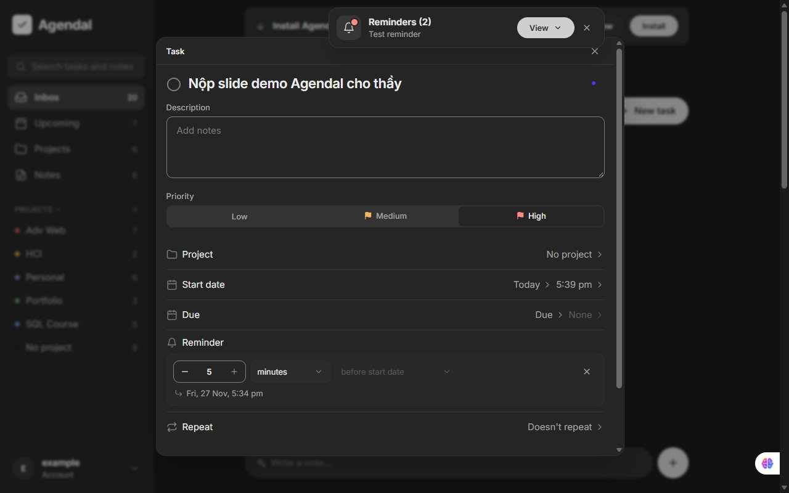
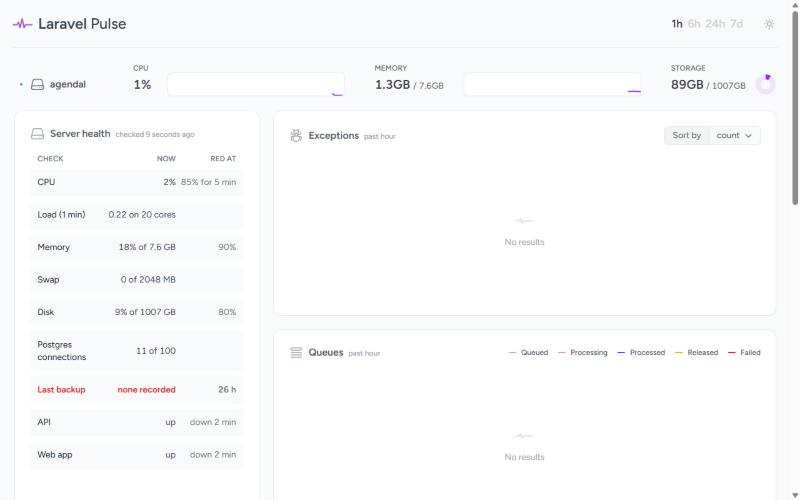
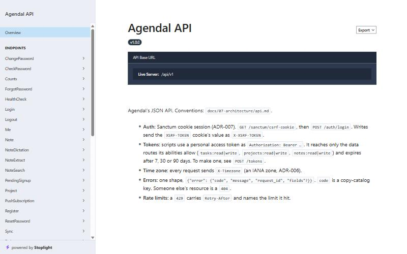
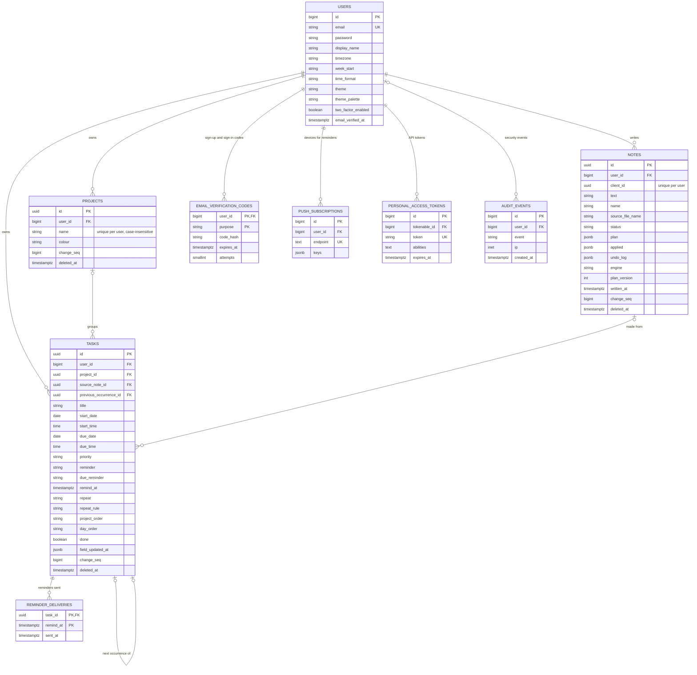

# Agendal

**Turn notes into tasks.** Agendal is a phone-first web app (PWA): you write whatever is on your mind in one note, and it becomes dated, organised tasks. You review every change before it is applied and can undo it afterwards. It works offline and installs like an app. Built by a student team for the VNUK _Advanced Web Development_ course.

For example, the note _"sql quiz monday 9am, email the group tonight, buy printer ink tomorrow"_ makes three tasks: **SQL quiz** (Monday 09:00, high priority), **Email the group** (today 20:00, reminder 15 minutes before) and **Buy printer ink** (tomorrow), and the note is named "This week".

Notes can be in English or Vietnamese (with diacritics); the interface is in English. The full product and engineering spec is in [docs/](docs/README.md); [docs/SUMMARY.md](docs/SUMMARY.md) is the whole spec in one read.

## Contents

- [Demo & screenshots](#demo--screenshots)
- [Run it for a review](#run-it-for-a-review)
- [Tour 1: the app (dev server, :3000)](#tour-1-the-app-dev-server-3000)
- [Tour 2: PWA, offline and sync (production build, :3001)](#tour-2-pwa-offline-and-sync-production-build-3001)
- [Everything that is built](#everything-that-is-built)
- [Not built yet](#not-built-yet)
- [How it works](#how-it-works)
- [Data model (ERD)](#data-model-erd)
- [Quality](#quality)
- [Team](#team)
- [For developers](#for-developers)

## Demo & screenshots

- **Demo video:** _[Add demo video link here]_ (covers note capture with Gemini fallback, *Check this first* review, and Web Push reminders)

Screenshots from the production build running locally (`compose.prod.yml`, 27 Nov 2026), signed in as the demo account.

| | |
|---|---|
|  |  |
| **Inbox:** Overdue first, the progress summary, the note bar | **Upcoming:** week bar, All / Scheduled / Due only |
|  |  |
| **Note editor:** typed, dictated or from a file | **Check this first:** every change before it is applied |
|  |  |
| **Applied:** the Notes tab and the Undo toast | **Search** (`Ctrl+K`): tasks, projects and notes |
|  |  |
| **Task details:** priority, project, start, due, reminders | **Projects** with progress |
|  |  |
| **Settings:** General | **Settings:** Theme, light / dark / system and 8 palettes |
|  |  |
| **Upcoming board**, light theme | **Sign in** |
|  |  |
| **Phone:** a tab bar replaces the sidebar | **Phone:** the New task sheet |

Web Push reminders, sent for real through Microsoft's push service (`notify.windows.com`) to Edge on Windows, on 27 Nov 2026. A task starting at 17:39 with a 5-minute reminder; at 17:34:02 the scheduler's `reminders:send` queued `SendReminderPushes`, which logged `reminders.sent {"sent":4,"gone":0}`, and the notification arrived:

| | |
|---|---|
|  |  |
| **The task:** reminder 5 minutes before the start | **The notification** from the browser, at 5:34 pm |
|  |  |
| **In the app:** the Reminders banner with View | **Settings → Reminders → Send a test notification** |

Behind the app:

| | |
|---|---|
|  |  |
| **Pulse** (`/pulse`): CPU, memory, disk, Postgres connections, API and web status, with thresholds | **Telescope** (`/telescope`): requests, jobs, queries |
|  | |
| **API docs** (`/docs/api`), generated from the code by Scramble | |

## Run it for a review

The app runs on the team's Linux server (IM-65, set up as in [deploy/README.md](deploy/README.md)). To review it on your own machine you need only [Docker](https://www.docker.com/).

```bash
git clone https://github.com/02bbits/Agendal.git
cd Agendal
docker compose up                              # dev server on :3000, API on :8000
docker compose --profile prod up -d web-prod   # production build on :3001, needed for Tour 2
```

The first start takes a few minutes: it installs packages, creates `backend/.env`, migrates and seeds the database. The production build takes another minute or two.

| Address | What | Use it for |
|---|---|---|
| <http://localhost:3000> | Dev server (`web`), reloads on save | Tour 1: every screen and feature except the PWA ones |
| <http://localhost:3001> | Production build (`web-prod`) | Tour 2: service worker, offline, sync, install, update toast. **These run only in a production build** |
| <http://localhost:8025> | Mailpit | Emails: sign-up codes, two-step codes, password resets |
| <http://localhost:8000/docs/api> | API docs, generated from the code | The `/api/v1` endpoints |

- Use **Chrome or Edge**. Firefox works but has no install prompt. Safari rejects the `__Host-` session cookie over plain `http://localhost` ([ADR-007](docs/07-architecture/decisions/ADR-007-session-and-auth.md)).
- Demo account: **example@gmail.com** / **password**, with sample tasks and projects. You can also create your own account; the 6-digit code arrives in Mailpit.
- :3000 and :3001 are separate sites to the browser: you sign in on each, and the service worker and offline data of :3001 never touch :3000.

## Tour 1: the app (dev server, :3000)

| Area | Try this |
|---|---|
| **Create account** | Create account, enter the code from Mailpit, then the three-step Setup (name; week start, time format, time zone; two-step sign-in). A weak password is refused, and an email that already has an account gets the same answer, so accounts can't be guessed |
| **Notes → tasks** | Write `sql quiz monday 9am, email the group tonight, buy printer ink tomorrow`. *Check this first* lists every change; edit a task, untick one, then **Apply**. The toast's **Undo all** reverses the whole note, and Redo brings it back within 10 s |
| **Vietnamese** | `mai 9h họp nhóm, nộp báo cáo HCI thứ 2`, then `dời họp nhóm sang thứ 3` |
| **Commands on tasks** | After the first note: `move sql quiz to friday`, `done buy printer ink`, `delete email the group` (a delete always asks first) |
| **Dictation and files** | In the note's tray: **Dictate a note** (the words go into the note to check first), or **Upload file** (`.txt`, `.md`, `.csv`, `.pdf`, `.docx`, `.jpg`, `.png`, `.webp`, up to 5 MB): the text lands in the editor before Make tasks. Dictation and photos are read by the language model, so they need it on ([NC](docs/03-modules/NC-note-capture.md) §2.3, §2.4) |
| **Unclear and skipped items** | `idea: dark mode for portfolio site` or `ok thanks` make no task; an undated task such as `Call mum` offers *When?* date chips |
| **Notes tab** | Every saved note with its status (All / Accepted / Pending) and infinite scroll. Open one to see what it did, rename it, **Edit note** to re-plan it, or delete it (its tasks stay) |
| **Inbox** | Overdue (red, with a count) before Today, a progress summary, *No date* and *Completed* (5, then Show all). Tick a task: it settles, moves down, and the toast offers Undo |
| **Upcoming** | Sticky week bar with arrows, List (two weeks) or Board (one week), and the All / Scheduled / Due only filters. A task shows on its start day and, as a dashed card, on its due day |
| **Tasks by hand** | **+**: title, start date and time, due date and time, priority, reminder, repeat (presets or a custom rule: every N days, weeks or months, chosen weekdays, ending on a date or after N times), project, notes. Open a task to edit any field; delete it with Undo |
| **Repeating tasks** | Tick one and the next occurrence appears; untick it and it rolls back |
| **Projects** | Create, rename, pick a colour, delete (keep or delete its tasks, with Undo); each project has a progress bar |
| **Search** | `Ctrl+K` on desktop or the Search tab: tasks, notes and projects, with or without Vietnamese accents, quick filters (Overdue, Due this week, High priority…) and recent searches |
| **Settings** | Account (name, password, two-step), General (time zone, 12/24-hour time, date format, week start, page view), Theme (light / dark / system with a circular reveal, 8 colour palettes), Reminders (on for this device, send a test notification), Sidebar (reorder by drag or keyboard, hide tabs). Sign out, or sign out on all devices |
| **Security** | Three wrong passwords lock sign-in for 60 s (20 in an hour: 15 minutes). Forgot password sends a reset link to Mailpit. With two-step on, sign-in asks for an emailed code |
| **Phone layout** | Narrow the window or use DevTools device mode: a tab bar replaces the sidebar, and details and settings open full screen with a Back bar |
| **Toasts** | Do several things quickly (tick three tasks): up to three toasts stack, each with its own Undo |

## Tour 2: PWA, offline and sync (production build, :3001)

The service worker registers only in a production build, so all of this is checked on <http://localhost:3001> after `docker compose --profile prod up -d web-prod`. Sign in there first. DevTools → **Application** shows the service worker, the caches and the IndexedDB store; DevTools → **Network → Offline** simulates losing the connection.

| Feature | How to check it |
|---|---|
| **Service worker** | Application → Service workers: `sw.js` is activated after the first visit. The app shell and its hashed files are cached; API calls are never cached |
| **Opens offline** | Go offline and reload: the app still opens, and Inbox, Upcoming, Projects and Notes show the copy kept on the device, under a "You're offline" banner |
| **Edit offline, sync later** | Offline, tick a task, edit one, add one with **+**, create a project. Back online, the changes are sent (field by field, the latest edit wins) and the banner goes away |
| **Notes offline** | Offline, the note button reads **Save note** and the note waits in the Notes tab as "Waiting for connection". Back online it is sent, and one toast reports "Back online. N notes turned into M tasks" |
| **Two windows** | Open :3001 in two windows on the same account. A change in one shows in the other within about a minute, or at once when the window is focused. If both edit the same field offline, the losing side shows "Changed on another device" |
| **Install** | The Inbox shows an **Install** banner (also the install icon in the address bar, or Settings → Install app). Installed, Agendal opens in its own window with its icon. Not now hides the banner on this device |
| **Reminders** | Needs VAPID keys (`php artisan push:vapid storage/app/vapid_private_key`, then `VAPID_PUBLIC_KEY` in `backend/.env`) and the `scheduler` and `queue` services. Set a reminder on a task due a few minutes from now: the app asks to send notifications; Allow. When it is due, a notification shows the title and `Mon 09:00 · Project`; tapping it opens the task. Notifications need Chrome, Edge or Firefox (Safari: the installed app) |
| **Update toast** | With the app open, rebuild it with `docker compose restart web-prod`, wait for the build, then return to the tab: "A new version is ready" appears with **Reload** (never while a sheet is open) |
| **Sign out clears the device** | Sign out: the on-device copy and the offline queue are cleared, so the next account starts clean |

When you are done, clear the site data of :3001 (Application → Storage → Clear site data) so the worker and caches go away.

## Everything that is built

Each area links to its module spec, which has the requirements, the edge cases and their tests.

**Accounts and security** ([AA](docs/03-modules/AA-account-access.md), [security](docs/07-architecture/security.md))
- Create account with a 6-digit email code; the account is created only once the code is right. The same answer for an email already in use (no account enumeration). A password strength meter; weak passwords are refused.
- Setup after sign-up: name, week start, time format, time zone, two-step sign-in.
- Sign in with lockout (3 failures → 60 s per email and IP), optional two-step sign-in by emailed code, forgot and reset password, sign out and sign out everywhere.
- Sanctum cookie session (`__Host-`, `Secure`), CSRF on writes, rate limits, an audit log for security events, branded emails sent from the queue.
- Personal access tokens for scripts: six abilities (`tasks:read`, `tasks:write`, `projects:read`, `projects:write`, `notes:read`, `notes:write`) checked on every data route, 7/30/90-day expiry ([api.md](docs/07-architecture/api.md#personal-access-tokens)).

**Notes** ([NC](docs/03-modules/NC-note-capture.md), [NU](docs/03-modules/NU-note-understanding.md), [RV](docs/03-modules/RV-review-control.md))
- Note editor with a draft kept on the device; up to 5,000 characters and 30 items. Dictate a note, or turn a text, Markdown, CSV, PDF, Word file or photo into one (photos lose their EXIF before the model sees them).
- Note understanding on the server with deterministic rules in English and Vietnamese: splitting, dates and times ("monday 9am", "mai 9h", "end of the month", "in 3 days"), repeats ("every monday 7am"), priority, projects and reminders. Ideas, FYIs and chatter are skipped.
- Commands on existing tasks (done, move, delete), matched to open tasks; ties ask, and a delete always confirms.
- A language-model fallback (Gemini) for the items the rules are unsure about: off by default, 20 calls per user per day ([ADR-008](docs/07-architecture/decisions/ADR-008-llm-fallback.md)).
- *Check this first* review before anything changes, the result screen, Undo all and Redo, follow-up for unclear notes, Edit note (re-plan), rename and delete, and the Notes tab with filters.

**Tasks** ([TK](docs/03-modules/TK-tasks.md))
- Title, start date and time, due date and time, priority, reminder, repeat (presets and custom rules), project and notes; start must be before due.
- Complete with Undo and a settle animation, repeating tasks that roll forward and back, delete with Undo.

**Lists and Search** ([LV](docs/03-modules/LV-lists-search.md))
- Inbox: Overdue, Today (starting or due today, in progress, or Planned), No date, Completed; a progress summary; recomputed at midnight.
- Upcoming: week bar, List and Board views, All / Scheduled / Due only, start-day and due-day entries, an Overdue section.
- Search: titles and notes, accent-aware Vietnamese matching, quick filters, recent searches, keyset paging.
- Task row: project, time, reminder and repeat icons, priority flag.

**Projects** ([PJ](docs/03-modules/PJ-projects.md))
- Create, rename, colour, delete (move or delete its tasks) with Undo and restore; a progress bar; "No project".

**Platform** ([AP](docs/03-modules/AP-app-platform.md), [ADR-004](docs/07-architecture/decisions/ADR-004-offline-sync-field-level-lww.md), [ADR-005](docs/07-architecture/decisions/ADR-005-sync-protocol.md))
- PWA: web manifest and icons, an install banner with guidance for Chromium, iOS and Firefox Android, a service worker and an update toast.
- Offline: an IndexedDB copy of tasks, projects, settings and the last 100 notes; a queue for offline edits and notes; sync with field-level last-write-wins, a pull cursor, conflict notices, and one sync per browser at a time.
- Responsive from phone to desktop: a tab bar or a sidebar, a task panel or full-screen details, flat or full-width page view.
- Settings with 5 tabs, light / dark / system themes, 8 palettes, a customisable sidebar, a loading screen on start, stacked toasts, Back navigation, WCAG 2.2 AA (axe checks in both themes).
- Time zones: dates and times are floating local values, and "today" follows the device ([ADR-006](docs/07-architecture/decisions/ADR-006-time-zones.md)).
- Reminders as Web Push notifications, sent by a queued job every minute ([TK §2.5](docs/03-modules/TK-tasks.md#25-reminders-tk-6-should)).
- `GET sync` and `GET counts` answer `304 Not Modified` to a matching ETag, so an idle device's polling skips the list queries.

## Not built yet

- **Release work:** the traceability script (IM-60), the end-to-end test suite (IM-61), and the security, performance (Lighthouse) and manual accessibility passes (IM-62 to IM-64).
- **Alerts to people:** errors, slow queries and server thresholds show on Pulse and in the logs, but nothing is sent to an admin yet (#225).
- Out of scope for v1: shared lists, calendar sync, a Vietnamese interface, account deletion and export.

The build plan, issue by issue, is in [docs/08-project/tasks.md](docs/08-project/tasks.md).

## How it works

| Part | What |
|---|---|
| `frontend/` | Next.js 16 and React 19, TypeScript strict, Tailwind CSS and daisyUI. Forwards `/api/*` and `/sanctum/*` to the backend, so the browser sees one site |
| `backend/` | Laravel 13 JSON API at `/api/v1`, Sanctum cookie sessions and personal access tokens, a queue worker for emails and reminders, a scheduler |
| Database | PostgreSQL 18 |
| `docker-compose.yml` | The whole stack: PostgreSQL, Mailpit, the API, the queue worker, the scheduler, the dev server and the opt-in production build (`web-prod`) |

A note becomes tasks on the server in one request: normalise, split into items, classify each one (task, command on an existing task, or skip), extract its fields with rules, send unsure items to the language model when it is on, match commands to open tasks, validate, apply the safety rules, and name the note. The result is a **plan** the user reviews before it is applied, and each applied note keeps an undo log for 30 days ([ADR-001](docs/07-architecture/decisions/ADR-001-note-plan-contract.md), [ADR-002](docs/07-architecture/decisions/ADR-002-undo-change-log.md)). The same text, time and tasks always give the same plan.

To turn the language model on, save a Gemini API key in a file, set `NOTE_LLM_ENABLED=true` and `GEMINI_API_KEY_FILE=<path to that file>` in `backend/.env`, and restart `api` ([ADR-008](docs/07-architecture/decisions/ADR-008-llm-fallback.md)). The key itself never goes in `.env`.

### Asset & image optimisation note (6b)

- **On-demand loading:** the search popup, Settings and the note result overlay are `React.lazy` chunks ([lazyOverlays.tsx](frontend/src/app/frame/lazyOverlays.tsx)), so they are not in the first load. Once the page is idle their chunks are fetched and cached by the service worker, so they still open offline.
- **Why raster image optimisation (`next/image` / WebP / `srcset`) is not used:** All in-app illustrations (`frontend/public/illustrations/*.svg`) and UI icons are **SVG** (which `next/image` does not optimise and which are already resolution-independent). The only raster files are app icons, loaded by the browser or the OS at fixed sizes rather than rendered in a page: the two manifest icons (`frontend/public/icons/icon-192.png` and `icon-512.png`, which the PWA manifest needs as PNG), the iOS home-screen icon (`frontend/src/app/apple-icon.png`) and the favicons (`favicon.ico`). See [scalability.md](docs/05-quality/scalability.md#on-demand-overlays).

## Data model (ERD)

The main tables on PostgreSQL 18, from the migrations in [backend/database/migrations](backend/database/migrations). Projects, tasks and notes are soft-deleted and carry a `change_seq` for sync ([ADR-005](docs/07-architecture/decisions/ADR-005-sync-protocol.md)). Laravel's own tables (sessions, cache, jobs, password resets) and Telescope and Pulse are left out. Every column, constraint and index is in [data-model.md](docs/07-architecture/data-model.md).



| Read more | |
|---|---|
| [SUMMARY](docs/SUMMARY.md) | The whole spec in one read |
| [Screens](docs/01-product/screens.md), [UX standards](docs/01-product/ux-standards.md), [theme guide](docs/01-product/theme-guide.md) | Every screen and its states, the Graphite design |
| [Modules](docs/03-modules/) | Requirements and edge cases per area |
| [Workflows](docs/04-workflows/README.md) | Capture a note, confirm risky changes, undo, offline capture and sync, sign-in and recovery |
| [Architecture](docs/07-architecture/overview.md) | Components, [API](docs/07-architecture/api.md), [data model](docs/07-architecture/data-model.md), [security](docs/07-architecture/security.md), [decisions](docs/07-architecture/decisions/README.md) |
| [Testing](docs/06-testing/test-strategy.md) | Test strategy, scenarios, the traceability matrix and the note corpus |

## Quality

- **Tests:** 1,741 Pest tests on a real PostgreSQL database for the API and the note engine, with a golden note corpus, and 1,366 Vitest tests in 114 files for the frontend (screens, offline, sync, the service worker), with axe accessibility checks in light and dark.
- **Coverage**, measured in CI with a 70% floor that fails the build:

  | Part | Lines | Statements | Branches | Functions |
  |---|---|---|---|---|
  | Backend (Pest, PCOV) | **95.4%** | | | |
  | Frontend (Vitest, V8) | **91.36%** | **91.36%** | 87.97% | 85.78% |

  From the [CI run on `main`](https://github.com/02bbits/Agendal/actions/runs/45942859790) for 3a374c1 (27 Nov 2026); each run's summary shows its numbers, and `coverage.xml` and `lcov.info` are uploaded as artifacts.
- **CI:** GitHub Actions runs Pint, Larastan, Pest with coverage, the API docs export, Prettier, ESLint, the type check, Vitest with coverage, the production build, dependency audits and a secret scan (gitleaks) on every pull request and on `main` ([ci.yml](.github/workflows/ci.yml)).
- **Way of working:** every change goes through a GitHub issue and a reviewed pull request; the docs have a dated [changelog](docs/CHANGELOG.md).

## Team

| Member | Area |
|---|---|
| **02bbits** | Platform: repo, CI, accounts, settings, offline sync, install, deployment |
| **3HoTuan3** | Tasks and views: task model, projects, Inbox, Upcoming, Search, design system |
| **khang-ngo4444** | Note understanding: the rules engine, the language-model fallback, the note corpus |

The note flow (editor, review, undo, Notes tab) was shared between the team through GitHub issues.

## For developers

### Run it

Needs only Docker.

```bash
docker compose up        # app on http://localhost:3000, API on :8000
```

The first start installs Composer and npm packages, creates `backend/.env` with an app key, then migrates and seeds (demo account: example@gmail.com / password). Every start migrates, so pulling new migrations needs no extra step. Code is mounted from the host and reloads on save. After changing `package.json`, restart `web` (`docker compose restart web`).

The service worker runs only in a production build. To check it, start one next to the dev server: `docker compose --profile prod up -d web-prod` serves it on <http://localhost:3001> (the first build takes a minute or two). Restart `web-prod` to get a new build, for example to see the update toast. Its worker and caches belong to :3001 only, so the dev app on :3000 stays uncached; clear the site data in DevTools when you're done.

Run commands inside the containers, for example `docker compose exec api php artisan test` or `docker compose exec web npm test`. The API container runs as UID 1000 by default; if yours differs, `export UID GID` first.

#### Without Docker for the app

PHP 8.4+ with `pdo_pgsql`, `intl` and `mbstring`, Composer, Node 20+. Start only the services with `docker compose up -d db mail`, set up once with `cd backend && composer setup && php artisan db:seed` and `cd frontend && npm install && cp .env.example .env.local`, then run `composer run dev` in `backend/` and `npm run dev` in `frontend/`.

Open the app at <http://localhost:3000>, not :8000. Emails such as password resets land in Mailpit at <http://localhost:8025>. API docs are generated from the code at <http://localhost:8000/docs/api> (Scramble; on the server `https://<domain>/docs/api`, behind the `TELESCOPE_ALLOWED_EMAILS` allow-list). CI exports the OpenAPI file as the `api.json` artifact. Use Chrome or Firefox locally: the session cookie is `Secure` with a `__Host-` prefix (ADR-007), and Safari rejects it over plain http.

### Monitoring

Telescope is at <http://localhost:8000/telescope>, open to anyone locally. On the server it records every request, job and scheduled run, but of the rest only exceptions and slow queries, and opens only for the signed-in emails in `TELESCOPE_ALLOWED_EMAILS` (comma-separated); `TELESCOPE_ENABLED=false` turns it off. Entries keep no request or response bodies, query bindings, emails or mail (SC-21), and are pruned after 48 hours.

Pulse is at <http://localhost:8000/pulse> (through Next.js on the server, `https://<domain>/pulse`), behind the same allow-list. It is the error dashboard: exceptions (5xx, failed jobs and scheduled tasks, language-model call failures) by class and line with counts, queue throughput and failures, slow requests, jobs, queries (from 500 ms) and outgoing calls, and the busiest users by id. It keeps no messages, query values, cache keys or emails (SC-21) and trims itself after 7 days. Nothing is pushed: check it after a deploy and when someone reports a problem; each error's log line still has its `request_id`. Links it builds use `APP_URL`, so that must be the public origin. Its Servers and Server health cards (#199) fill only while `php artisan pulse:check` runs (the `pulse` service on the server; locally `docker compose exec api php artisan pulse:check`); see deploy/README.md for the thresholds.

A query over `DB_SLOW_QUERY_MS` (500), or a request whose queries add up to more than `DB_SLOW_REQUEST_MS` (2000), logs at `error` with the SQL and the request ID, never the values.

### Time

Read the time only through the clock (ADR-006): `ClockInterface` on the server, `@/lib/clock` on the client. Tests pin it with `travelTo()` or `vi.setSystemTime()` plus a zone. A note's "now" is `ClientClock::fromWrittenAt()`: its `written_at`, clamped to server time. API calls go through `@/lib/api`, which sends `X-Timezone`.

### Checks

For IM-32, edit the [splitter scenario CSV](backend/tests/Fixtures/note-splitter-scenarios.csv) and follow the [self-test instructions](backend/tests/Fixtures/README.md). Run only those tests with `cd backend && php vendor/bin/pest tests/Unit/Services/NoteSplitterTest.php`; they require no database.

Dynamic scenario definitions live only in [tests/Support/NoteSplitterScenarios.php](backend/tests/Support/NoteSplitterScenarios.php); run them from `backend/` with `php vendor/bin/pest tests/Unit/Services/NoteSplitterDynamicTest.php`. The rules file is [backend/resources/notes/note-rules.csv](backend/resources/notes/note-rules.csv), shared by the splitter and the field extractor; its path and the note limits are set in [backend/config/notes.php](backend/config/notes.php).

Tests run on the `agendal_test` database, created automatically with a new `db` volume. On a volume made before it existed, create it once:

```bash
docker compose exec db psql -U agendal -c 'CREATE DATABASE agendal_test OWNER agendal'
```

GitHub Actions runs the same checks on every pull request ([ci.yml](.github/workflows/ci.yml)). Run them locally first:

```bash
cd backend && ./vendor/bin/pint --test && composer analyse && php artisan test
cd frontend && npm run format:check && npm run lint && npm run typecheck && npm test
```

Run with line coverage (70% minimum, matching CI; backend requires PCOV or Xdebug):

```bash
cd backend && php -d pcov.enabled=1 -d pcov.directory=app vendor/bin/pest --coverage --min=70
cd frontend && npm run test:coverage
```
