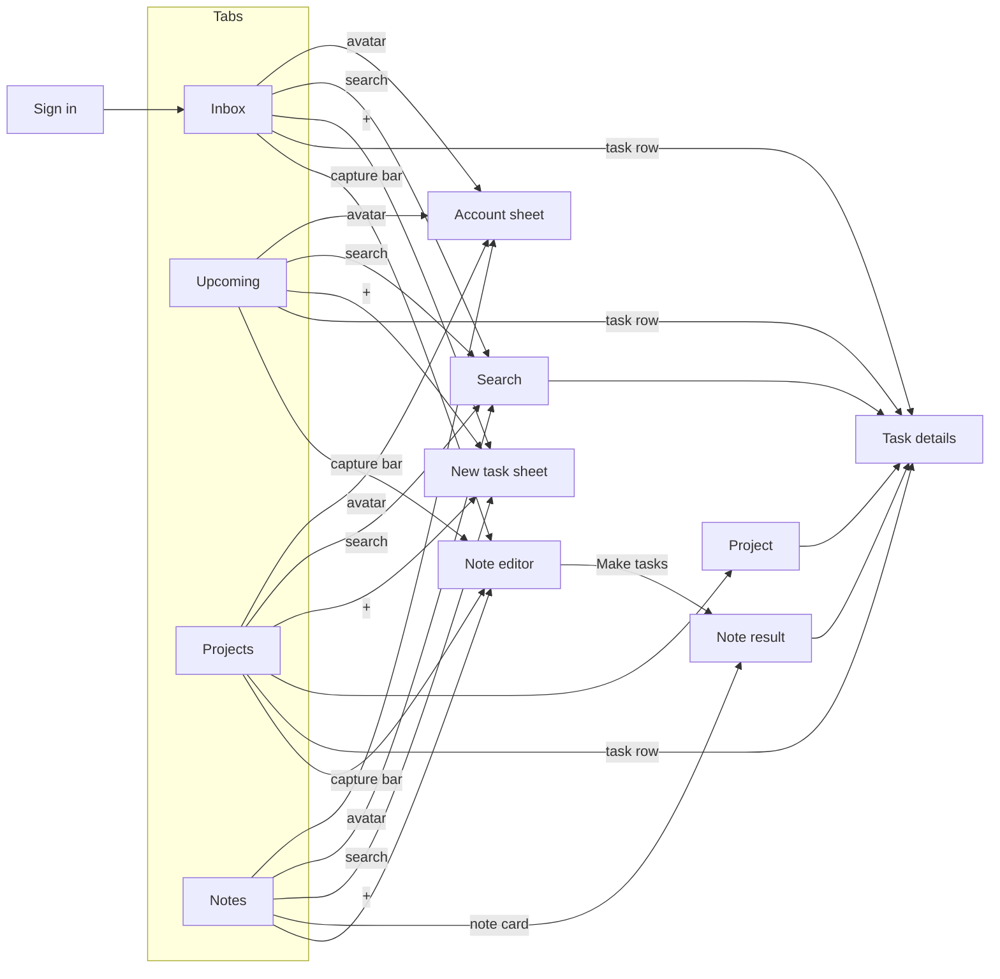

# Screens and Navigation

Four tabs sit at the bottom: **Inbox, Upcoming, Projects and Notes**. A floating "Write a note…" bar with a mic sits above the tabs on every list screen, next to a square + button for manual tasks. Search and Account are at the top right of each tab screen. Pushed screens have a back button top-left, and the browser's Back does the same (AP-4).

| Screen | Reached from | Purpose | Key contents | Requirements |
|---|---|---|---|---|
| Sign in / Create account / Reset password | First launch, sign-out | Access | Email, password with show/hide, Remember me checkbox, Forgot password, lockout after repeated failures | AA-1–4 |
| Inbox | Tab (default) | What to do today | Date overline, progress summary (done of total), Overdue section, Today section, "Nothing left for today" state, install and offline banners | LV-1, LV-4, AP-1, AP-2 |
| Upcoming | Tab | What's coming | Tasks grouped by day (Tomorrow, then weekdays and dates). Filter chips All / Scheduled / Due only | LV-2 |
| Projects | Tab | Work by course or area | Project list with colour, progress and counts. No project. New project | PJ-1 |
| Project | Projects | One project's tasks | Progress bar ("3 of 5 tasks completed"), open and completed tasks. Menu: rename, change colour, delete | PJ-2–4 |
| Task details | Any task row, a note result | Edit one task | Serif title. Schedule (start–end), due date, reminder, repeat, priority, project, notes. "Created by the assistant" tag. Delete task | TK-2–6, NU-7 |
| Search | Search icon | Find any task | Searches titles and notes, including completed. Chips All / Open / Completed with counts | LV-3 |
| Notes | Tab | History of notes | Note cards: time, generated name, two-line excerpt, task count or "Waiting for connection" | RV-4, NC-6 |
| Note editor | Capture bar, Notes | Write a note | Full-screen serif text area, example chips, mic, paperclip (attach file), Make tasks (Save note when offline) | NC-1–6 |
| Note result | After Make tasks, a note card | Review what happened | Overline (time · "3 tasks made"), generated name, "From file" line, original note as a quote, change list with CREATED / CHANGED / DELETED, Undo all / Done | RV-1–3, NU-5, NU-6 |
| New task sheet | + button | Manual task | Title, due chips (Today, Tomorrow, Next week, No date, Pick date…), priority, project. "Only a title is needed" | NC-7 |
| Account sheet | Avatar | Settings | Name and email, Dark mode, Remember me on this device, Install app, Sign out | AA-5, AP-1, AP-3 |

