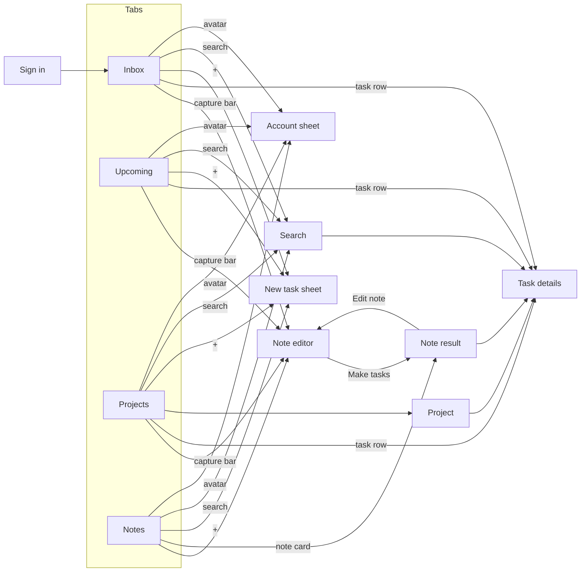

# Screens and Navigation

Four tabs sit at the bottom: **Inbox, Upcoming, Projects and Notes**. A floating "Write a note…" bar with a mic sits above the tabs on every list screen, next to a round + button for manual tasks. Search and Account are at the top right of each tab screen. Pushed screens have a back button top-left, and the browser's Back does the same ([AP-4](../03-modules/AP-app-platform.md#ap-4)).

| Screen | Reached from | Purpose | Key contents | Requirements |
|---|---|---|---|---|
| Sign in / Create account / Reset password | First launch, sign-out | Access | Email, password with show/hide, Remember me checkbox, Forgot password, lockout after repeated failures | [AA-1](../03-modules/AA-account-access.md#aa-1)–4 |
| Loading screen | Opening or reloading any screen (the sign-in screens too), going into the app or out of it, and a tab opened for the first time (#161) | Cover the start, the way in and out, and a first tab switch, while things load | Opening or reloading any screen, the sign-in screens included: full screen, the theme's plain background (light or dark), the app logo in the middle and a spinner under it, at least 400 ms and until the session check answers (at most 3 s), then a 150 ms fade. The same full screen covers going into the app from the sign-in screens (signed in, with or without the two-step code; Setup's Finish or Skip; a signed-in visit to Sign in or Verify) until the app screen is there, and going out (Sign out, Sign out on all devices, a session that ended) until Sign in is there; moving between the sign-in screens themselves has none. A sign-out held back offline takes it away again. Tapping a tab lights it up at once. The first time a tab opens, its header (date, title, Search, Account) shows at once with, below it, a spinner on a phone (no logo or name: that is only for the start screen) or a skeleton of the list from 768px; the tab bar and sidebar stay. The tab then shows its own skeleton until its list is there. Opened again, it shows its list at once. All four tabs are fetched ahead after sign-in. Read as "Loading"; motion stops with reduced motion | [AP-1](../03-modules/AP-app-platform.md#ap-1) |
| Inbox | Tab (default) | What to do today | Date overline, progress summary (done of total), Overdue section, Today section, "Nothing left for today" state, install and offline banners | [LV-1](../03-modules/LV-lists-search.md#lv-1), [LV-4](../03-modules/LV-lists-search.md#lv-4), [AP-1](../03-modules/AP-app-platform.md#ap-1), [AP-2](../03-modules/AP-app-platform.md#ap-2) |
| Upcoming | Tab | What's coming | Tasks grouped by day (Tomorrow, then weekdays and dates). Filter chips All / Scheduled / Due only | [LV-2](../03-modules/LV-lists-search.md#lv-2) |
| Projects | Tab | Work by area | Project list with colour, progress and counts. No project. New project | [PJ-1](../03-modules/PJ-projects.md#pj-1) |
| Project | Projects | One project's tasks | Progress bar ("3 of 5 tasks completed"), open and completed tasks. Menu: rename, change colour, delete | [PJ-2](../03-modules/PJ-projects.md#pj-2)–4 |
| Task details | Any task row, a note result | Edit one task | Schedule (start–end), due date, reminder, repeat, priority, project, notes. "✦ Made from your note" link. Delete task | [TK-2](../03-modules/TK-tasks.md#tk-2)–6, [NU-7](../03-modules/NU-note-understanding.md#nu-7) |
| Search | Sidebar Search, `/` or Ctrl+K | Find any task, project or note | A popup from 768 px, a full screen below it. Quick filters, recent searches and projects before typing. Chips All / Tasks / Projects / Notes with counts | [LV-3](../03-modules/LV-lists-search.md#lv-3) |
| Notes | Tab | History of notes | Note cards: time, generated name, two-line excerpt, task count or "Waiting for connection", Edited | [RV-4](../03-modules/RV-review-control.md#rv-4), [RV-5](../03-modules/RV-review-control.md#rv-5), [NC-6](../03-modules/NC-note-capture.md#nc-6) |
| Note editor | Capture bar, Notes, Edit note | Write or edit a note | A drawer: the time written, ruled note paper, a tray (round arrow) with the mic and Upload file, Make tasks (Save note when offline) | [NC-1](../03-modules/NC-note-capture.md#nc-1)–6 |
| Note result | After Make tasks, a note card | Review what happened | Overline (time · "3 tasks made"), generated name, "From file" line, original note as a quote, change list with CREATED / UPDATED / DELETED, When? chips on undated tasks, Undo all / Done, menu with Edit note | [RV-1](../03-modules/RV-review-control.md#rv-1)–5, [NU-5](../03-modules/NU-note-understanding.md#nu-5), [NU-6](../03-modules/NU-note-understanding.md#nu-6) |
| New task sheet | + button | Manual task | Title, due chips (Today, Tomorrow, Next week, No date, Custom), priority, project | [NC-7](../03-modules/NC-note-capture.md#nc-7) |
| Settings dialog | Avatar / Account | User & App Settings | Full-featured Todoist-style modal with left sub-navigation rail: Account (name, email, password, sign out), General (timezone, time/date format, week start, page view on desktop only, smart date recognition), Theme (appearance with circular reveal transition, 8 theme palettes with pulse ripple, theme-synced sidebar highlights), Sidebar (task counts toggle, drag-and-drop & keyboard reordering, tab enable/disable, reset to default, live preview), Notifications (Web Push & VAPID diagnostics), and roadmap placeholders | [AA-5](../03-modules/AA-account-access.md#aa-5), [AP-1](../03-modules/AP-app-platform.md#ap-1), [AP-3](../03-modules/AP-app-platform.md#ap-3), [AP-5](../03-modules/AP-app-platform.md#ap-5) |

