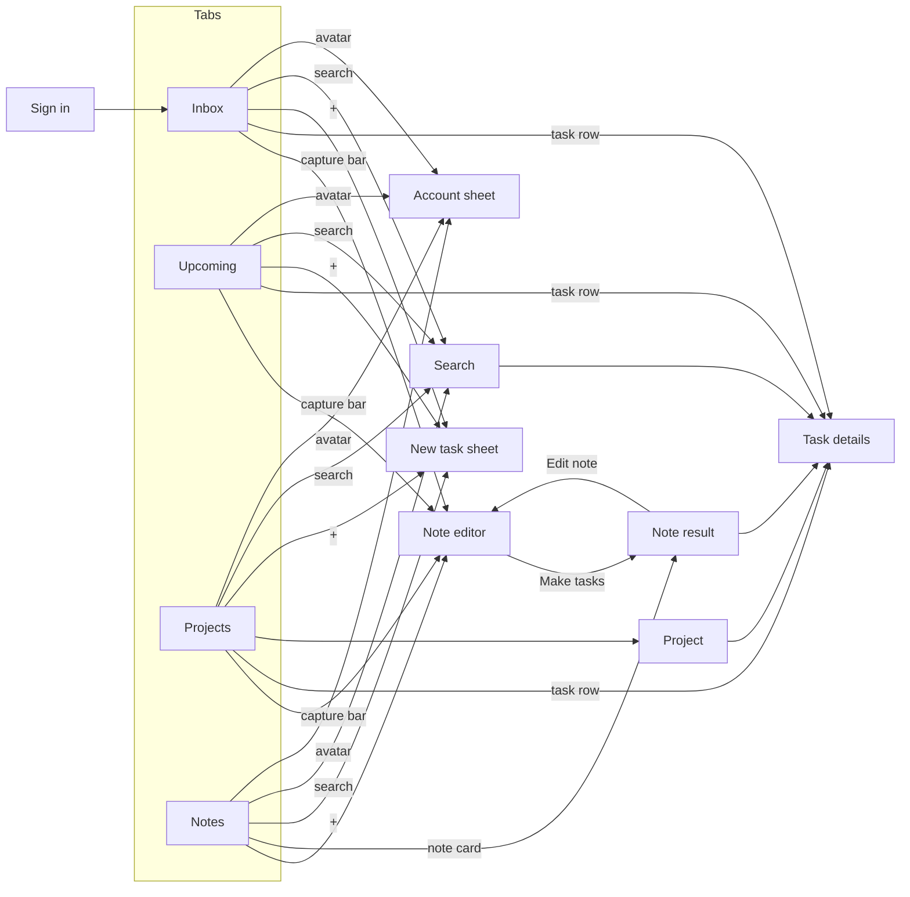

# Screens and Navigation

Four tabs sit at the bottom: **Inbox, Upcoming, Projects and Notes**. A floating "Write a note…" bar with a mic sits above the tabs on every list screen, next to a square + button for manual tasks. Search and Account are at the top right of each tab screen. Pushed screens have a back button top-left, and the browser's Back does the same ([AP-4](../03-modules/AP-app-platform.md#ap-4)).

| Screen | Reached from | Purpose | Key contents | Requirements |
|---|---|---|---|---|
| Sign in / Create account / Reset password | First launch, sign-out | Access | Email, password with show/hide, Remember me checkbox, Forgot password, lockout after repeated failures | [AA-1](../03-modules/AA-account-access.md#aa-1)–4 |
| Inbox | Tab (default) | What to do today | Date overline, progress summary (done of total), Overdue section, Today section, "Nothing left for today" state, install and offline banners | [LV-1](../03-modules/LV-lists-search.md#lv-1), [LV-4](../03-modules/LV-lists-search.md#lv-4), [AP-1](../03-modules/AP-app-platform.md#ap-1), [AP-2](../03-modules/AP-app-platform.md#ap-2) |
| Upcoming | Tab | What's coming | Tasks grouped by day (Tomorrow, then weekdays and dates). Filter chips All / Scheduled / Due only | [LV-2](../03-modules/LV-lists-search.md#lv-2) |
| Projects | Tab | Work by area | Project list with colour, progress and counts. No project. New project | [PJ-1](../03-modules/PJ-projects.md#pj-1) |
| Project | Projects | One project's tasks | Progress bar ("3 of 5 tasks completed"), open and completed tasks. Menu: rename, change colour, delete | [PJ-2](../03-modules/PJ-projects.md#pj-2)–4 |
| Task details | Any task row, a note result | Edit one task | Serif title. Schedule (start–end), due date, reminder, repeat, priority, project, notes. "Created by the assistant" tag. Delete task | [TK-2](../03-modules/TK-tasks.md#tk-2)–6, [NU-7](../03-modules/NU-note-understanding.md#nu-7) |
| Search | Search icon | Find any task | Searches titles and notes, including completed. Chips All / Open / Completed with counts | [LV-3](../03-modules/LV-lists-search.md#lv-3) |
| Notes | Tab | History of notes | Note cards: time, generated name, two-line excerpt, task count or "Waiting for connection", Edited | [RV-4](../03-modules/RV-review-control.md#rv-4), [RV-5](../03-modules/RV-review-control.md#rv-5), [NC-6](../03-modules/NC-note-capture.md#nc-6) |
| Note editor | Capture bar, Notes, Edit note | Write or edit a note | Full-screen serif text area, example chips, mic, paperclip (attach file), Make tasks (Save note when offline) | [NC-1](../03-modules/NC-note-capture.md#nc-1)–6 |
| Note result | After Make tasks, a note card | Review what happened | Overline (time · "3 tasks made"), generated name, "From file" line, original note as a quote, change list with CREATED / UPDATED / DELETED, When? chips on undated tasks, Undo all / Done, menu with Edit note | [RV-1](../03-modules/RV-review-control.md#rv-1)–5, [NU-5](../03-modules/NU-note-understanding.md#nu-5), [NU-6](../03-modules/NU-note-understanding.md#nu-6) |
| New task sheet | + button | Manual task | Title, due chips (Today, Tomorrow, Next week, No date, Pick date…), priority, project. "Only a title is needed" | [NC-7](../03-modules/NC-note-capture.md#nc-7) |
| Account sheet | Avatar | Settings | Name and email, Appearance (System / Light / Dark), Week starts on, Time format, Remember me on this device, Reminders, Install app, Sign out, Sign out on all devices | [AA-5](../03-modules/AA-account-access.md#aa-5), [AP-1](../03-modules/AP-app-platform.md#ap-1), [AP-3](../03-modules/AP-app-platform.md#ap-3), [AP-5](../03-modules/AP-app-platform.md#ap-5) |

