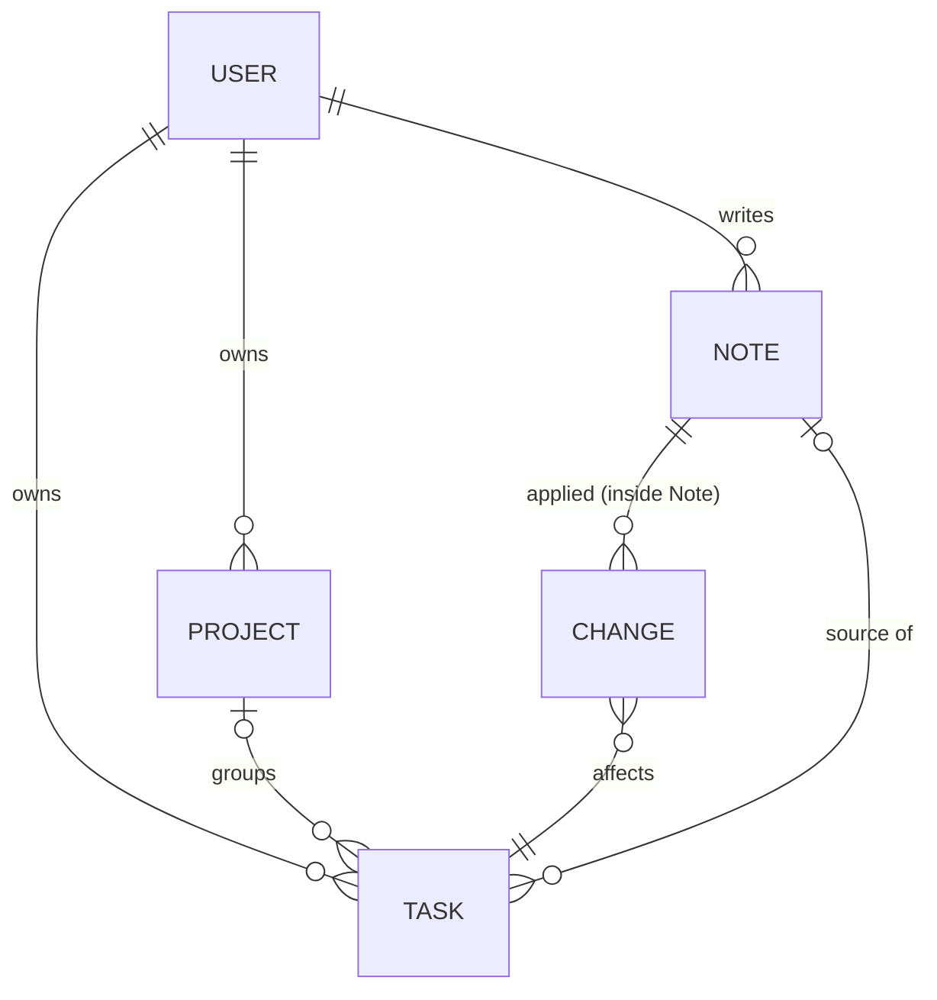

# Domain Overview

Five records. Notes keep their plan and what was applied, so any note can be reviewed or undone later.

| Concept | Purpose | Detail |
|---|---|---|
| **Note** | What the student wrote, typed, dictated or from a file, plus the plan built from it and what was applied | [note-model.md](note-model.md) |
| **Plan** | Tasks to create, change and delete, plus skipped text. Built once per note | [note-model.md](note-model.md#plan) |
| **Change** | One applied create, change or delete, with before values so it can be undone | [note-model.md](note-model.md#change) |
| **Task** | An actionable item. It can be made from a note or by hand | [task-model.md](task-model.md) |
| **Project** | A named, coloured group of tasks. *No project* is the absence of a project, not a record | — |
| **User** | The account holder. Owns everything above | — |

Everything belongs to exactly one user. There is no shared data in v1.
