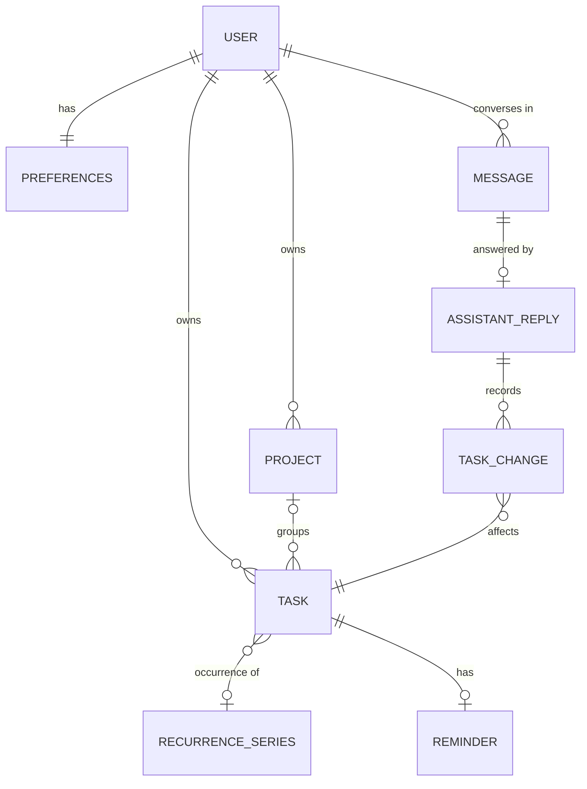

# Domain Overview

| Concept | Purpose |
|---|---|
| **Task** | The central entity, an actionable item. See [task-model.md](task-model.md). |
| **Project** | A named, coloured group of tasks. Tasks without one belong to *No project*. |
| **Recurrence series** | The repeat rule (daily/weekly/monthly/yearly, optional end date) that produces task occurrences. |
| **Reminder** | When to notify the user about a task. |
| **Message / Assistant reply** | The conversation. A reply that changes data carries a **change set** (shown as a summary card) that can be undone as one unit. |
| **Notification** | A reminder, nudge, morning summary, or encouragement. |
| **Preferences** | Theme, accent colour, week start, morning-summary time, default reminder, notification toggles (NFR-16, FR-55). |

Everything belongs to exactly one user. There is no shared data.
