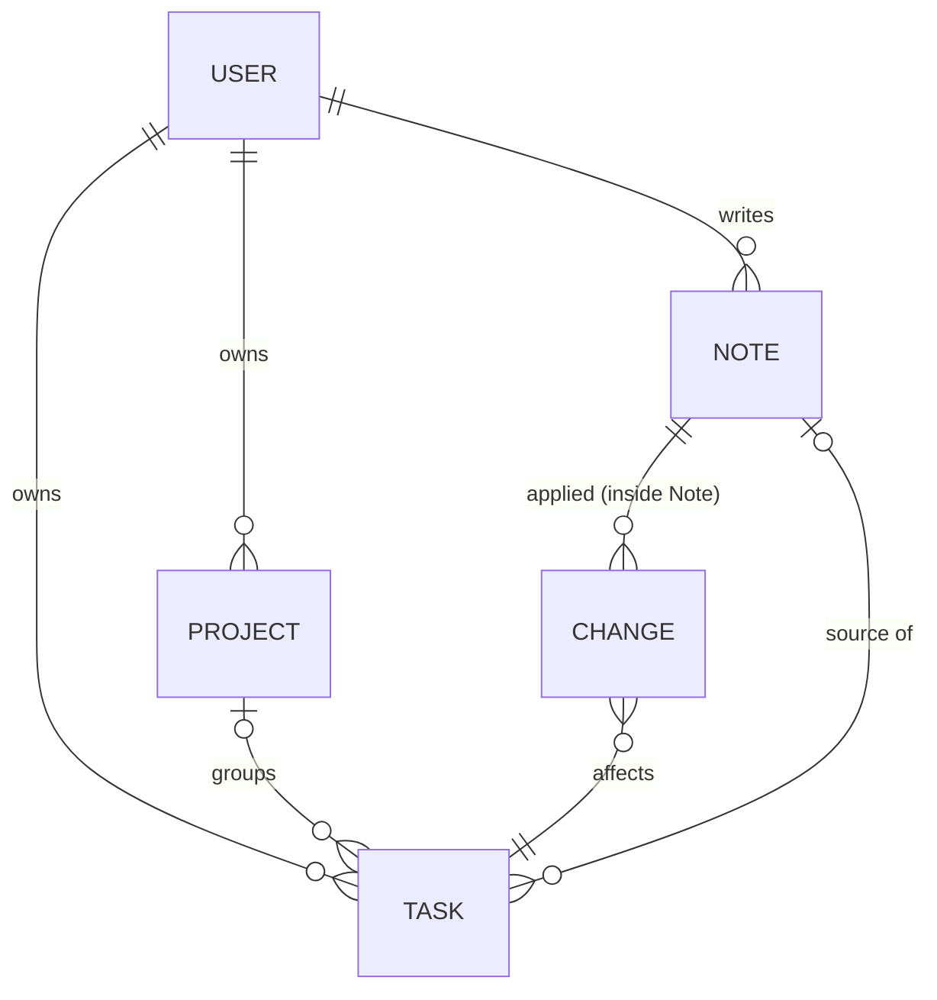
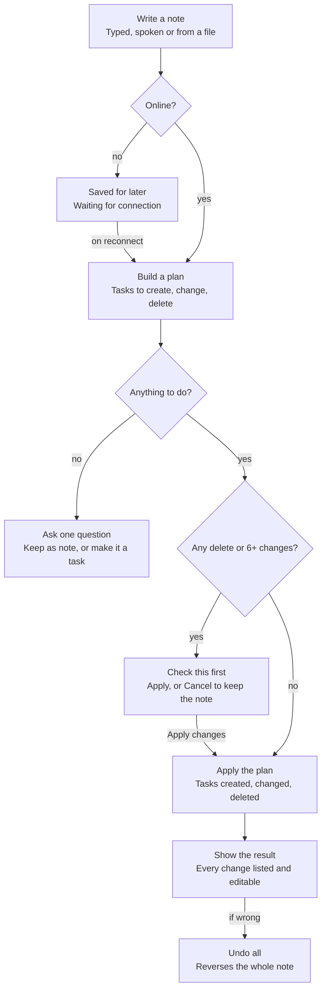
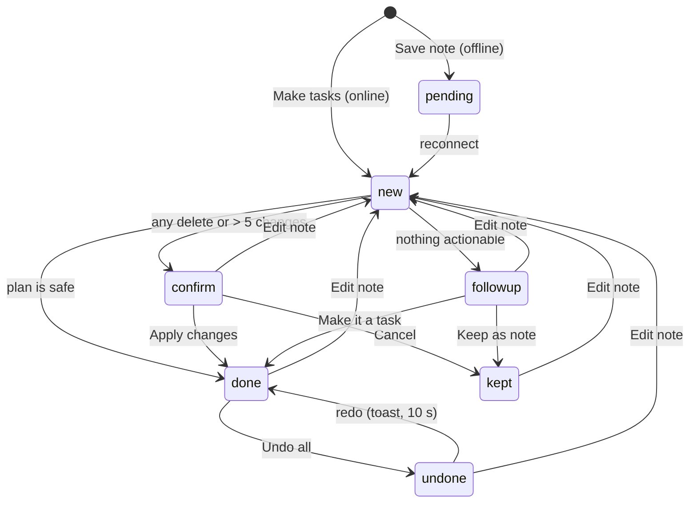

# Domain

Five records. Notes keep their plan and what was applied, so any note can be reviewed or undone later.

| Concept | Purpose | Detail |
|---|---|---|
| **Note** | What the user wrote, typed, dictated or from a file, plus the plan built from it and what was applied | [Note model](#note-model) |
| **Plan** | Tasks to create, change and delete, plus skipped text. Built when the note is processed, and again when it is edited | [Plan](#plan) |
| **Change** | One applied create, change or delete, with before values so it can be undone | [Change](#change) |
| **Task** | An actionable item. It can be made from a note or by hand | [Task model](#task-model) |
| **Project** | A named, coloured group of tasks. *No project* is the absence of a project, not a record | — |
| **User** | The account holder. Owns everything above | — |

Everything belongs to exactly one user. There is no shared data in v1.

## Terminology

Domain terms, used the same way in requirements, UI copy, and code. For acronyms and technical terms, see the [glossary](../08-project/glossary.md).

| Term | Definition |
|---|---|
| Note | Free text the user writes, dictates or attaches. It is turned into tasks once and kept in the Notes tab |
| Item | One piece of a note after splitting on new lines, commas, semicolons, full stops and "then" ([NU-1](../03-modules/NU-note-understanding.md#nu-1)) |
| Plan | What the assistant intends to do with a note: create, change, delete, skip |
| Command | An item that acts on an existing task: complete, reschedule or delete ([NU-3](../03-modules/NU-note-understanding.md#nu-3)) |
| Skipped text | Items that make no task: ideas, FYIs, filler ([NU-4](../03-modules/NU-note-understanding.md#nu-4)) |
| Change | One applied create, change or delete, with enough data to undo it |
| Result screen | Lists every change from a note with CREATED / UPDATED / DELETED badges ([RV-1](../03-modules/RV-review-control.md#rv-1)) |
| Undo all | Reverses every change from one note. The note is kept and marked Undone ([RV-2](../03-modules/RV-review-control.md#rv-2)) |
| Check this first | The confirmation shown before a risky plan: any delete, or more than 5 changes ([NU-5](../03-modules/NU-note-understanding.md#nu-5)) |
| Follow-up | The one question for a note with nothing actionable: Keep as note, or Make it a task ([RV-3](../03-modules/RV-review-control.md#rv-3)) |
| Note name | A name generated from the plan, e.g. "This week" or "SQL Course to-dos" ([NU-6](../03-modules/NU-note-understanding.md#nu-6)) |
| Pending note | A note saved offline, shown as "Waiting for connection" ([NC-6](../03-modules/NC-note-capture.md#nc-6)) |
| Due date | When the task must be done |
| Schedule | When the user will work on it: a start time and an end time |
| Overdue | Not done, and the due date has passed. Shown in red with a count in Inbox ([LV-1](../03-modules/LV-lists-search.md#lv-1)) |
| Today | Tasks due or scheduled today |
| No project | Tasks without a project. It is not a record |
| Created by the assistant | Label on tasks made from a note ([NU-7](../03-modules/NU-note-understanding.md#nu-7)) |

## Note Model

The note is the centre of v2: every assistant action comes from one note, and the note keeps enough to explain and undo it.

### Note

| Field | Meaning |
|---|---|
| id, user id | Owner ([NF-9](../05-quality/nfr.md#nf-9)) |
| text | What the user wrote, or the checked text from dictation or a file |
| name | Generated name ([naming rules](business-rules.md#naming-a-note-nu-6)) |
| source file name | Set when the note came from a file. The file itself is not kept ([NF-9](../05-quality/nfr.md#nf-9)) |
| status | `pending`, `new`, `done`, `confirm`, `followup`, `kept`, `undone` ([state transitions](#state-transitions)) |
| plan | What the assistant intends to do (below) |
| applied | The list of changes actually made (below) |
| created at, processed at | Timestamps. Pending notes have no `processed at` until reconnect |

### Plan

Built when the note is processed (and again if it is edited), by rules or a language model. Either way it has the same shape ([ADR-001](../07-architecture/decisions/ADR-001-note-plan-contract.md)):

| Part | Holds |
|---|---|
| create | New tasks with their extracted fields |
| update | Matched existing tasks, with the new values (complete or reschedule) |
| delete | Matched existing tasks to delete |
| skipped | Text kept in the note but making no task |

### Change

One entry in `Note.applied`.

| Field | Meaning |
|---|---|
| kind | `created`, `updated` or `deleted` |
| task id | The task affected |
| before values | Field values before the change. Enough to undo exactly ([NF-11](../05-quality/nfr.md#nf-11)) |
| label | What the result screen shows, e.g. "Due Fri (was today)" |

## Task Model

Conceptual model. For storage, see [data-model.md](../07-architecture/data-model.md).

| Field | Values | Required | Ref |
|---|---|---|---|
| title | Sentence case. Acronyms kept upper case | **yes**, the only required field | [NC-7](../03-modules/NC-note-capture.md#nc-7) |
| project | One of the user's projects, or none (*No project*) | no | PJ |
| due date | A date | no | [TK-2](../03-modules/TK-tasks.md#tk-2) |
| start time, end time | Times. End must be later than start | no | [TK-3](../03-modules/TK-tasks.md#tk-3) |
| priority | Low, Medium, High | no | [TK-2](../03-modules/TK-tasks.md#tk-2) |
| reminder | None; 5, 15 or 30 minutes; 1 hour; 1 day before | no | [TK-2](../03-modules/TK-tasks.md#tk-2), [TK-6](../03-modules/TK-tasks.md#tk-6) |
| repeat | Never, Daily, Weekly, Monthly, Yearly | no | [TK-4](../03-modules/TK-tasks.md#tk-4) |
| notes | Free text. Searched by [LV-3](../03-modules/LV-lists-search.md#lv-3) | no | [TK-2](../03-modules/TK-tasks.md#tk-2) |
| done, done at | Completion | system | [TK-1](../03-modules/TK-tasks.md#tk-1) |
| created by | user or assistant | system | [NU-7](../03-modules/NU-note-understanding.md#nu-7) |
| source note id | The note that made it | system | [RV-1](../03-modules/RV-review-control.md#rv-1) |
| created at, updated at | Timestamps | system | — |

### Derived

- **Overdue**: not done and the due date is before today.
- **Today**: due date or start date is today.
- **Project progress**: completed tasks ÷ all tasks in the project ("3 of 5 tasks completed").

### Task states

A task is **open** or **done**. Deleting removes it, and it can be restored by Undo (toast or Undo all). Completing a repeating task creates its next occurrence ([TK-4](../03-modules/TK-tasks.md#tk-4)). See [state transitions](#task).

## Note Lifecycle

A note goes through three checks before anything changes: is the device online, is there anything to do, and is the change risky. Every path that changes tasks ends on the result screen, where Undo all reverses the whole note.

### Worked example

Note: *"sql quiz monday 9am, email the group tonight, buy printer ink tomorrow"*

| Item | Title | Due / time | Priority | Project | Reminder | Rule that fired |
|---|---|---|---|---|---|---|
| sql quiz monday 9am | SQL quiz | Mon, 09:00 | High | SQL Course | 1 day before | "quiz" → High and 1 day before; "sql" → SQL Course |
| email the group tonight | Email the group | Today, 20:00 | Medium | — | 15 minutes before | "tonight" → 20:00; due today → Medium; has a time → 15 min |
| buy printer ink tomorrow | Buy printer ink | Tomorrow | Low | — | None | Not due today → Low |

All three are due within 7 days, so the note is named **"This week"**. 3 changes and no delete, so no confirmation. The result screen shows 3 CREATED rows.

## State Transitions

### Note

| Status | Meaning | Next |
|---|---|---|
| `pending` | Saved offline, not yet read | Processed on reconnect → `new` |
| `new` | Being processed | `done`, `confirm` or `followup` |
| `done` | Plan applied | `undone` (Undo all), `new` (Edit note) |
| `confirm` | Plan waits for Apply changes | `done` (Apply), `kept` (Cancel), `new` (Edit note) |
| `followup` | Nothing actionable found | `kept` (Keep as note), `done` (Make it a task), `new` (Edit note) |
| `kept` | Saved as a note only | `new` (Edit note) |
| `undone` | Applied, then reversed | `done` (redo from the toast, within 10 s), `new` (Edit note) |

**Edit note** first undoes whatever the note applied (the same rules as Undo all), then plans the new text from scratch ([RV-5](../03-modules/RV-review-control.md#rv-5)).

### Task

| From | Event | To | Actor | Guard / side effect | Ref |
|---|---|---|---|---|---|
| — | Create | open | User (+ sheet), assistant (note) | Title present | [NC-7](../03-modules/NC-note-capture.md#nc-7), [NU-1](../03-modules/NU-note-understanding.md#nu-1) |
| open | Edit | open | User, assistant (reschedule) | End later than start | [TK-2](../03-modules/TK-tasks.md#tk-2), [TK-3](../03-modules/TK-tasks.md#tk-3), [NU-3](../03-modules/NU-note-understanding.md#nu-3) |
| open | Complete | done | User (checkbox), assistant ("done X") | Toast with Undo. Progress updates. Repeating → next occurrence created | [TK-1](../03-modules/TK-tasks.md#tk-1), [TK-4](../03-modules/TK-tasks.md#tk-4), [NU-3](../03-modules/NU-note-understanding.md#nu-3) |
| done | Undo (toast) | open | User | — | [TK-1](../03-modules/TK-tasks.md#tk-1) |
| open / done | Delete | (removed) | User, assistant ("delete X") | User confirms. Repeating asks "This task only" or "This and all future" | [TK-4](../03-modules/TK-tasks.md#tk-4), [TK-5](../03-modules/TK-tasks.md#tk-5), [NU-5](../03-modules/NU-note-understanding.md#nu-5) |
| (removed) | Undo (toast or Undo all) | previous state | User | Restored from before values | [TK-5](../03-modules/TK-tasks.md#tk-5), [RV-2](../03-modules/RV-review-control.md#rv-2) |
