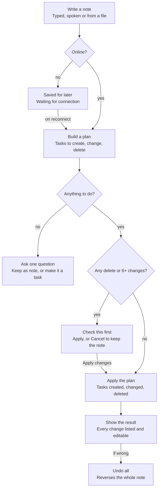

# Note Lifecycle

A note goes through three checks before anything changes: is the device online, is there anything to do, and is the change risky. Every path that changes tasks ends on the result screen, where Undo all reverses the whole note.

## Worked example

Note: *"sql quiz monday 9am, email the group tonight, buy printer ink tomorrow"*

| Item | Title | Due / time | Priority | Project | Reminder | Rule that fired |
|---|---|---|---|---|---|---|
| sql quiz monday 9am | SQL quiz | Mon, 09:00 | High | SQL Course | 1 day before | "quiz" → High and 1 day before; "sql" → SQL Course |
| email the group tonight | Email the group | Today, 20:00 | Medium | — | 15 minutes before | "tonight" → 20:00; due today → Medium; has a time → 15 min |
| buy printer ink tomorrow | Buy printer ink | Tomorrow | Low | — | None | Not due today → Low |

All three are due within 7 days, so the note is named **"This week"**. 3 changes and no delete, so no confirmation. The result screen shows 3 CREATED rows.
