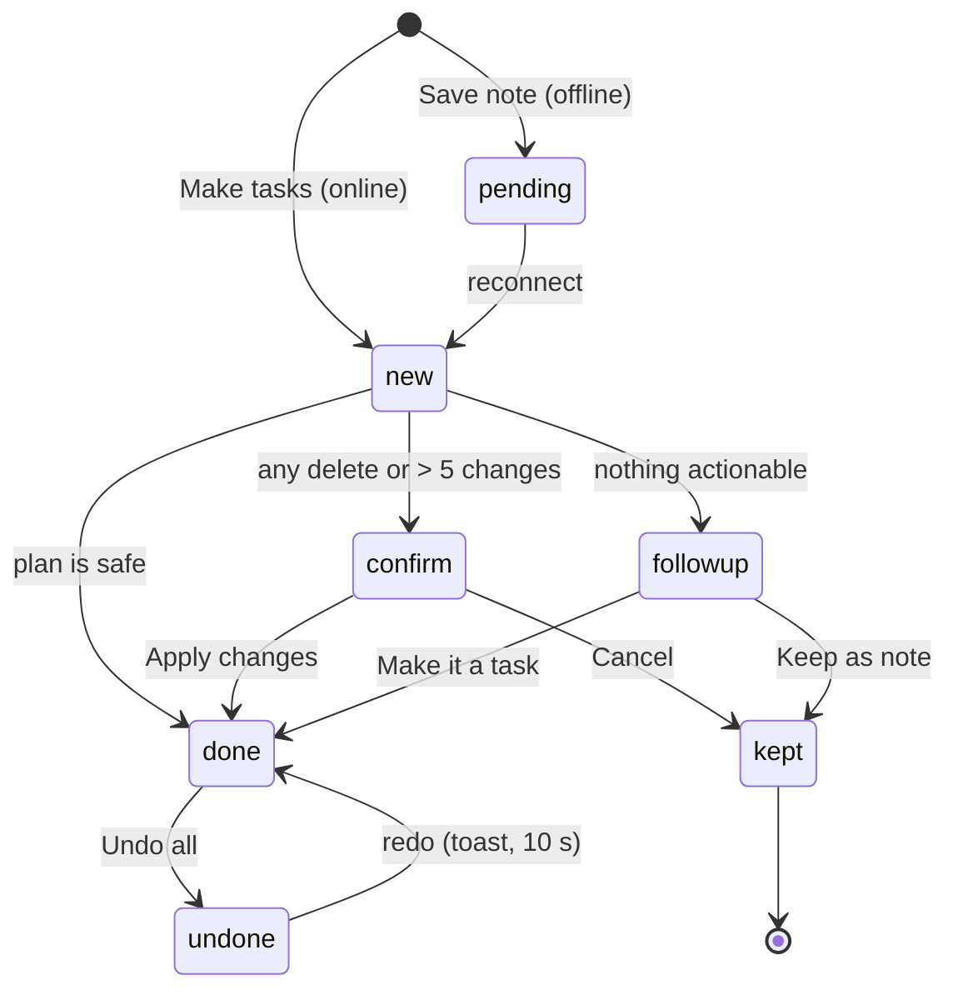

# State Transitions

## Note

| Status | Meaning | Next |
|---|---|---|
| `pending` | Saved offline, not yet read | Processed on reconnect → `new` |
| `new` | Being processed | `done`, `confirm` or `followup` |
| `done` | Plan applied | `undone` (Undo all) |
| `confirm` | Plan waits for Apply changes | `done` (Apply) or `kept` (Cancel) |
| `followup` | Nothing actionable found | `kept` (Keep as note) or `done` (Make it a task) |
| `kept` | Saved as a note only | — |
| `undone` | Applied, then reversed | `done` (redo from the toast, within 10 s) |

## Task

| # | From | Event | To | Actor | Guard / side effect | Ref |
|---|---|---|---|---|---|---|
| T1 | — | Create | open | User (+ sheet), assistant (note) | Title present | NC-7, NU-1 |
| T2 | open | Edit | open | User, assistant (reschedule) | End later than start | TK-2, TK-3, NU-3 |
| T3 | open | Complete | done | User (checkbox), assistant ("done X") | Toast with Undo. Progress updates. Repeating → next occurrence created | TK-1, TK-4, NU-3 |
| T4 | done | Undo (toast) | open | User | — | TK-1 |
| T5 | open / done | Delete | (removed) | User, assistant ("delete X") | User confirms. Repeating asks "This task only" or "This and all future" | TK-4, TK-5, NU-5 |
| T6 | (removed) | Undo (toast or Undo all) | previous state | User | Restored from before values | TK-5, RV-2 |
