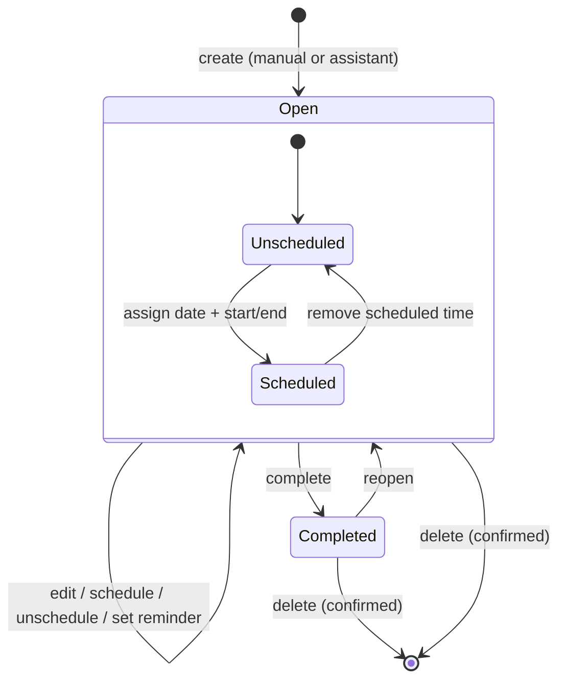

# Task Lifecycle

A task has only two stored states: **Open** and **Completed**. Deletion removes it. *Scheduled* and *Overdue* are attributes or derived labels of an open task, not states.

## Side effects

| Event | Side effects |
|---|---|
| Create / edit | All views update without reload (FR-51). A reminder job is (re)planned. |
| Complete | Encouragement shown (FR-52). Inbox progress updates (FR-46). If repeating, the next occurrence is created (FR-41). Pending reminder cancelled. |
| Reopen | Progress updates. A next occurrence that was already created is **not** removed (see [open questions](../08-project/open-questions.md)). |
| Due date passes while open | Shown as overdue (FR-32). Nudge sent (FR-53). |
| Delete | Removed from all views. Pending reminder cancelled. For a repeating task, the user chooses this occurrence or all future ones (FR-42). |

Any of these done by the assistant is recorded in the reply's change set and can be undone (FR-20).
