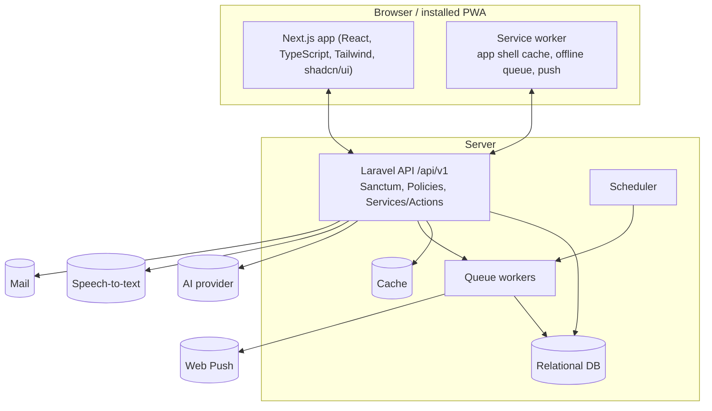

# Architecture Overview

## Containers

| Container | Responsibility | Key NFRs |
|---|---|---|
| **Next.js frontend** | Mobile-first UI. Server Components for data-heavy pages. Chat panel and voice recorder lazy-loaded with `next/dynamic` | NFR-3, NFR-19 |
| **Service worker** | Caches the app shell, keeps loaded tasks readable offline, queues offline changes, receives push | NFR-4, NFR-20, NFR-24 |
| **Laravel API** | REST under `/api/v1`. Auth (Sanctum), authorization (Policies), business logic in Services/Actions, assistant orchestration | NFR-7, NFR-11, NFR-25, NFR-26 |
| **Assistant service** (inside the API) | Builds the minimal prompt context. Maps the model's tool calls to whitelisted actions. Validates and applies them in one transaction | NFR-12, NFR-13, NFR-21 |
| **Queue workers + scheduler** | Reminders, nudges, morning summaries, next occurrences. 3 retries, then `failed_jobs` | NFR-5 |
| **Cache** | Inbox, Upcoming, and project progress, invalidated on any task change | NFR-4 |

## Cross-view real-time updates (FR-51)

Changes must appear in all open views without reload. The transport (WebSockets via Laravel Reverb/Pusher, SSE, or polling) is not decided yet. See [open questions](../08-project/open-questions.md).

## Assistant request flow

1. The client sends `POST /api/v1/assistant/messages` with an `Idempotency-Key` ([ADR-002](technical-decisions/ADR-002-idempotency.md)).
2. The API loads the relevant tasks and calls the AI provider with a fixed tool schema ([ADR-001](technical-decisions/ADR-001-assistant-action-whitelist.md)).
3. The returned actions are validated and authorized, then applied in `DB::transaction()` and stored as a change set.
4. The reply streams to the client. The summary card is rendered from the change set.
