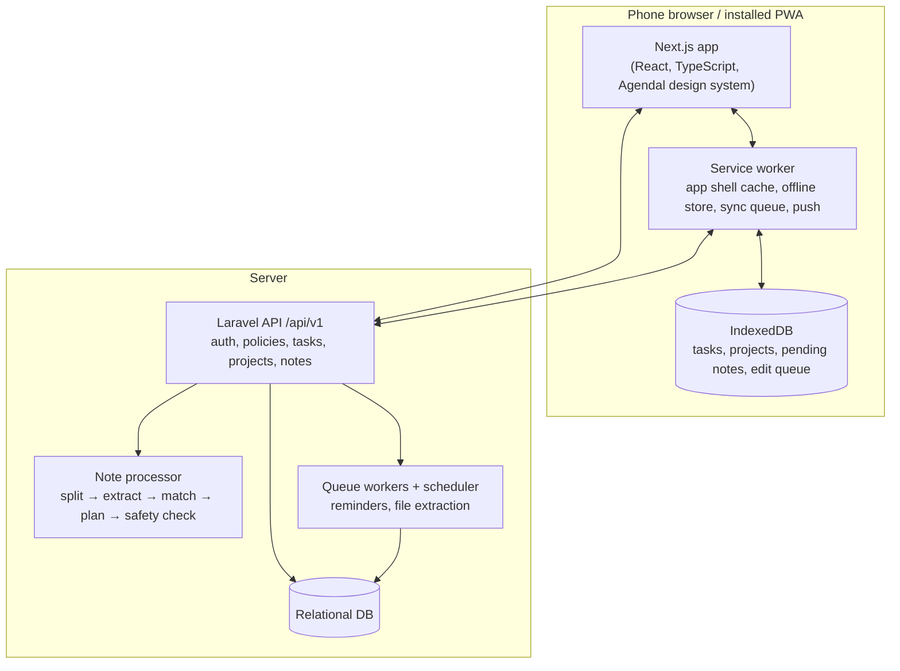

# Architecture Overview

## Containers

| Container | Responsibility | Requirements |
|---|---|---|
| **Next.js app** | All screens ([screens](../01-product/screens-and-navigation.md)) built from the Agendal design system. Light and dark themes | AP-3, NF-1–3, NF-8, NF-12 |
| **Service worker + IndexedDB** | Cached app shell (repeat load ≤ 1 s). Offline copy of lists. Queue of edits and pending notes, replayed in order on reconnect | AP-2, NC-6, NF-4, NF-6, NF-7 |
| **Laravel API** | Auth with lockout and reset. Per-user authorization. CRUD for tasks and projects. Notes, plans, undo | AA, TK, PJ, LV, RV, NF-9–11 |
| **Note processor** | Builds a plan with the [rules](../02-domain/business-rules.md). Applies it, or returns `confirm` / `followup` | NU-1–7, NF-5 |
| **Queue workers + scheduler** | Reminder delivery. Text extraction from files | TK-6, NC-4 |

## Note processing

1. The client sends `POST /notes` with a client-generated id ([ADR-003](technical-decisions/ADR-003-offline-note-queue-and-idempotency.md)).
2. The processor builds the plan ([ADR-001](technical-decisions/ADR-001-note-plan-contract.md)) and checks the safety rules.
3. A safe plan is applied in one transaction. Each change is stored in `notes.applied` with its before values ([ADR-002](technical-decisions/ADR-002-undo-change-log.md)).
4. The response carries the status, name and changes, and the result screen renders from it. Budget: ≤ 2 s p90 for 10 items (NF-5).

## Offline

Everything except note processing works on the device. Edits are queued as per-field patches with timestamps, and resolved last-write-wins per field ([ADR-004](technical-decisions/ADR-004-offline-sync-field-level-lww.md)). Notes written offline wait as `pending` and are processed in order on reconnect.

## Deployment

The PRD sets only NF-7. The following is carried over from V1 and needs confirming:

| Item | Plan |
|---|---|
| Environments | Development, staging, production. HTTPS everywhere (service worker, push, NF-10) |
| Processes | Next.js server, Laravel API, an always-on queue worker, and the scheduler (cron every minute) |
| CI | Lint, type-check and tests on every pull request (GitHub Actions). The sample-note test set runs on any change to the rules |
| Secrets | Server `.env` and CI secrets only (email, push keys, any model key) |
