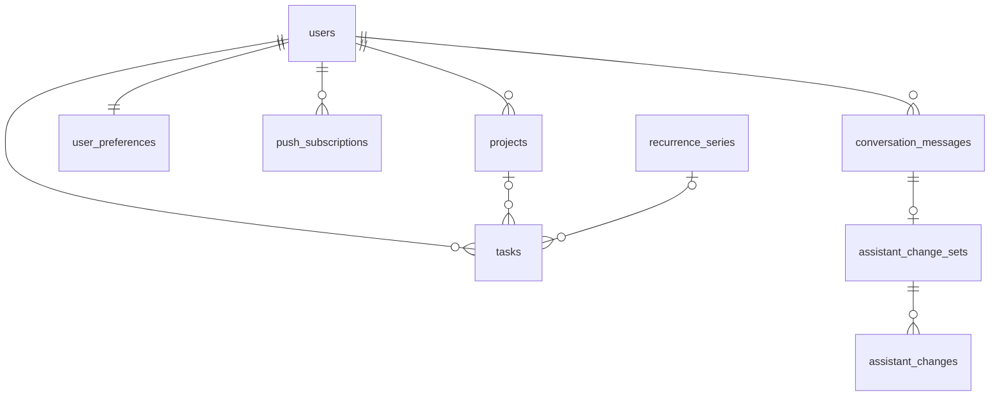

# Data Model

Draft. The DBMS is not decided yet ([open questions](../08-project/open-questions.md)). All tables except `users` carry `user_id` for ownership (NFR-11).

| Table | Key columns | Constraints / notes |
|---|---|---|
| `users` | id, email, password, timezone | email unique; password hashed (NFR-6) |
| `user_preferences` | user_id, theme, accent_colour, week_start, morning_summary_at, default_reminder, encouragement_on, nudges_on, morning_summary_on | one row per user (NFR-16, FR-55) |
| `projects` | id, user_id, name, colour | |
| `tasks` | id, user_id, project_id?, title, description?, priority?, due_at?, scheduled_start?, scheduled_end?, reminder_at?, reminder_offset?, completed_at?, series_id?, occurrence_date?, version | CHECK `scheduled_end > scheduled_start` (FR-30); priority ∈ {high, medium, low}; **UNIQUE (series_id, occurrence_date)** (NFR-23) |
| `recurrence_series` | id, user_id, frequency, ends_on? | frequency ∈ {daily, weekly, monthly, yearly} |
| `reminder_deliveries` | task_id, remind_at, sent_at | UNIQUE (task_id, remind_at), so each reminder is sent once (NFR-23) |
| `conversation_messages` | id, user_id, role, content, request_id | UNIQUE (user_id, request_id) for idempotency (NFR-23) |
| `assistant_change_sets` | id, message_id, undone_at? | the unit of undo (FR-20) |
| `assistant_changes` | change_set_id, task_id, action, before (json), after (json) | `before` snapshot restores on undo |
| `push_subscriptions` | user_id, endpoint, keys | |
| `failed_jobs` | Laravel default | NFR-5 |

Indexes: `tasks (user_id, due_at)`, `tasks (user_id, scheduled_start)`, plus full-text on `tasks (title, description)` for search (FR-61).
