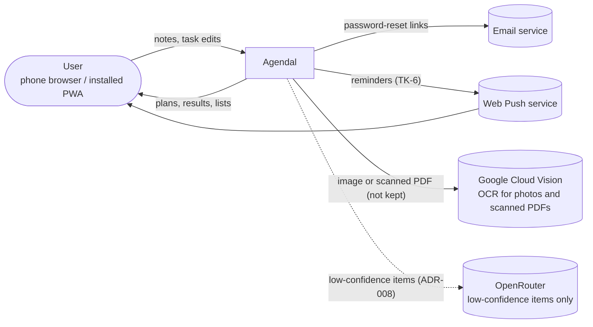
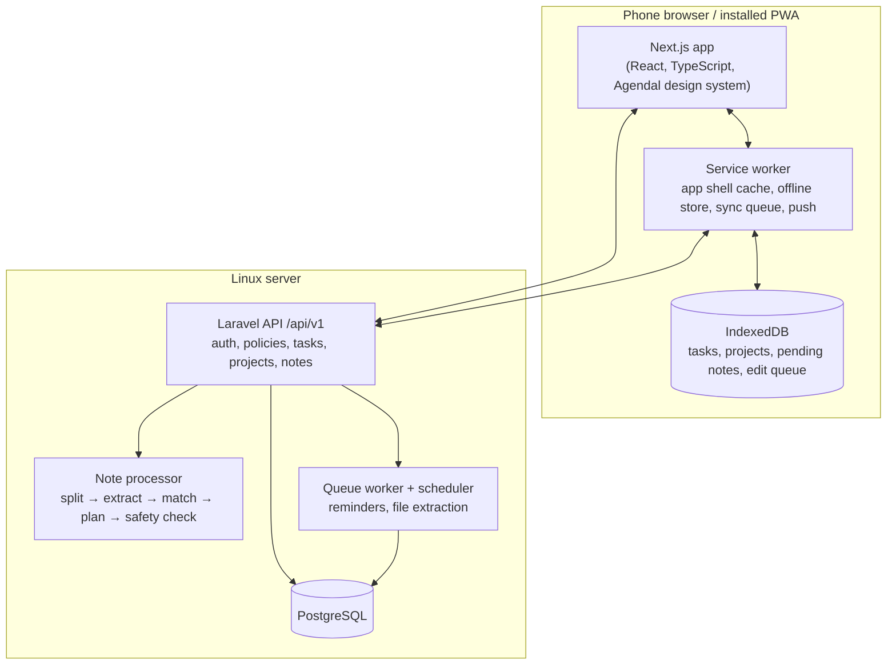

# Architecture Overview

**Stack ([Q13](../08-project/open-questions.md#q13), [Q14](../08-project/open-questions.md#q14)):** Next.js (React, TypeScript) on the front end, a Laravel API on the back end, and PostgreSQL, all on one Linux server. Details: [data model](data-model.md), [API](api.md), [security](security.md), [decisions (ADRs)](decisions/).

## System context

| External system | Needed for | Failure impact |
|---|---|---|
| Email service (SMTP) | [AA-4](../03-modules/AA-account-access.md#aa-4) | Reset delayed. Sign-in otherwise unaffected |
| Web Push | [TK-6](../03-modules/TK-tasks.md#tk-6) (Should) | No push reminders. Inbox still shows what is due |
| Google Cloud Vision ([Q12](../08-project/open-questions.md#q12)) | [NC-4](../03-modules/NC-note-capture.md#nc-4) (Should): photos and PDFs without a text layer. Text PDFs and Word files are read on the server, with no outside call | Photos and scanned PDFs can't be read. Typing still works |
| OpenRouter ([Q19](../08-project/open-questions.md#q19)) | The language-model fallback ([ADR-008](decisions/ADR-008-llm-fallback.md)) | Rules handle notes alone |
| Browser speech service | [NC-3](../03-modules/NC-note-capture.md#nc-3) (Should), through the Web Speech API | Dictation unavailable. Typing still works |

## Containers

| Container | Responsibility | Requirements |
|---|---|---|
| **Next.js app** | All screens ([screens](../01-product/screens.md)) built from the Agendal design system. Light and dark themes | [AP-3](../03-modules/AP-app-platform.md#ap-3), [NF-1](../05-quality/nfr.md#nf-1)–3, [NF-8](../05-quality/nfr.md#nf-8), [NF-12](../05-quality/nfr.md#nf-12) |
| **Service worker + IndexedDB** | Cached app shell (repeat load ≤ 1 s). Offline copy of lists. Queue of edits and pending notes, replayed in order on reconnect | [AP-2](../03-modules/AP-app-platform.md#ap-2), [NC-6](../03-modules/NC-note-capture.md#nc-6), [NF-4](../05-quality/nfr.md#nf-4), [NF-6](../05-quality/nfr.md#nf-6), [NF-7](../05-quality/nfr.md#nf-7) |
| **Laravel API** | Auth with lockout and reset. Per-user authorization. CRUD for tasks and projects. Notes, plans, undo, edit | AA, TK, PJ, LV, RV, [NF-9](../05-quality/nfr.md#nf-9)–11 |
| **Note processor** | Builds a plan with the [rules](../02-domain/business-rules.md), in English and Vietnamese. Applies it, or returns `confirm` / `followup` | [NU-1](../03-modules/NU-note-understanding.md#nu-1)–7, [NF-5](../05-quality/nfr.md#nf-5) |
| **Queue worker + scheduler** | Reminder delivery. Text extraction from files | [TK-6](../03-modules/TK-tasks.md#tk-6), [NC-4](../03-modules/NC-note-capture.md#nc-4) |
| **PostgreSQL** | All data. `pg_trgm` and `unaccent` for accent-insensitive search, and candidate lookup for command matching | [LV-3](../03-modules/LV-lists-search.md#lv-3), [NU-3](../03-modules/NU-note-understanding.md#nu-3) |

## Note processing

1. The client sends `POST /notes` with a client-generated id ([ADR-003](decisions/ADR-003-offline-note-queue-and-idempotency.md)).
2. The processor builds the plan ([ADR-001](decisions/ADR-001-note-plan-contract.md)) and checks the safety rules.
3. A safe plan is applied in one transaction. Each change is stored in `notes.applied` with its before values ([ADR-002](decisions/ADR-002-undo-change-log.md)).
4. The response carries the status, name and changes, and the result screen renders from it. Budget: ≤ 2 s p90 for 10 items ([NF-5](../05-quality/nfr.md#nf-5)).

## Offline

Everything except note processing works on the device. Edits are queued as per-field patches with timestamps, and resolved last-write-wins per field ([ADR-004](decisions/ADR-004-offline-sync-field-level-lww.md)). Notes written offline wait as `pending` and are processed in order on reconnect.

## Deployment

One Linux server ([Q14](../08-project/open-questions.md#q14)). It's a demo, so there's no cluster or managed cloud.

| Item | Plan |
|---|---|
| Environments | Local development and the server. HTTPS everywhere (service worker, push, [NF-10](../05-quality/nfr.md#nf-10)), with a Let's Encrypt certificate |
| Processes | Nginx (TLS, static files, reverse proxy), the Next.js server (Node), PHP-FPM for Laravel, one queue worker under Supervisor, the scheduler (cron every minute), PostgreSQL |
| Backups | Nightly `pg_dump`, kept 7 days, copied off the server ([scalability](../05-quality/scalability.md#data-protection-and-operations)) |
| CI | Lint, type-check and tests on every pull request (GitHub Actions). The note corpus runs on any change to the rules |
| Secrets | Server `.env` and CI secrets only: email, push keys, the OpenRouter key, and the Google Cloud service-account key |
