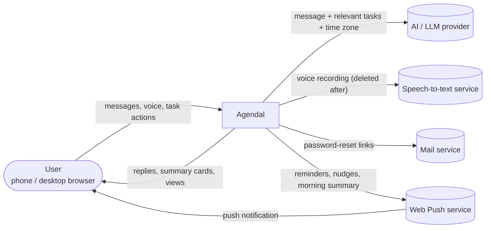

# System Context

| External system | Failure impact (NFR-22) |
|---|---|
| AI provider (timeout 15 s) | Assistant unavailable. Manual task management keeps working |
| Speech-to-text (timeout 10 s) | Voice unavailable. Typing still works (NFR-18) |
| Mail (timeout 10 s) | Password reset delayed. Logged |
| Web Push (timeout 10 s) | Notifications retried 3×, then `failed_jobs` (NFR-5) |

The specific AI, speech, and push vendors are not chosen yet ([open questions](../08-project/open-questions.md)).
