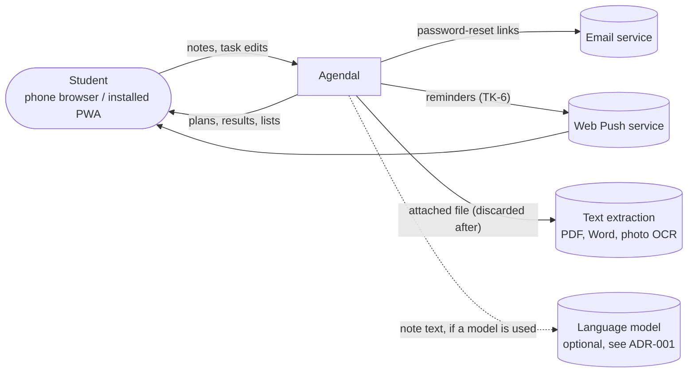

# System Context

| External system | Needed for | Failure impact |
|---|---|---|
| Email service | AA-4 | Reset delayed. Sign-in otherwise unaffected |
| Web Push | TK-6 (Should) | No push reminders. Inbox still shows what is due |
| Text extraction | NC-4 (Should) | Files can't be read. Typing still works |
| Language model | Only if v1 adds one ([open question](../08-project/open-questions.md)) | Rules handle notes alone |
| Speech recognition | NC-3 (Should). Possibly the browser's own Web Speech API | Dictation unavailable. Typing still works |

Vendors are not chosen yet.
