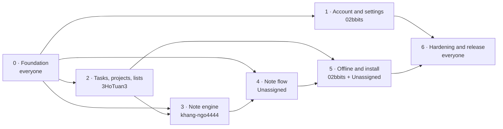

# MVP Tasks

The build plan for the **MVP**: every **Must** requirement in the [release plan](../01-product/overview.md#release-plan). Each task links to the requirements it covers. **Done when** names the tests from the module's section 11. A task is done only when those tests pass and the [Definition of Done](../06-testing/test-strategy.md#definition-of-done-per-feature) holds. Should and Could items are listed under [After MVP](#after-mvp).

## Owners

The **owner** is accountable for the task. Other people can help, and the paired tasks name both people.

| Owner              | Area                                                                                  | Modules                                                                                                     |
| ------------------ | ------------------------------------------------------------------------------------- | ----------------------------------------------------------------------------------------------------------- |
| **khang-ngo4444** | Note understanding: the rules engine, the OpenRouter fallback, the note corpus        | [NU](../03-modules/NU-note-understanding.md)                                                                |
| **Unassigned**      | Note flow: the editor, the result screen, undo, the Notes tab, Edit note              | [NC](../03-modules/NC-note-capture.md), [RV](../03-modules/RV-review-control.md)                            |
| **3HoTuan3**       | Tasks and views: the task model, projects, Inbox, Upcoming, Search, the design system | [TK](../03-modules/TK-tasks.md), [PJ](../03-modules/PJ-projects.md), [LV](../03-modules/LV-lists-search.md) |
| **02bbits**             | Platform: repo, CI, auth, settings, offline sync, install, deployment                 | [AA](../03-modules/AA-account-access.md), [AP](../03-modules/AP-app-platform.md)                            |

## Order

Phase 0 must finish first. After that, phases 1, 2, 4 run in parallel. The note-flow owner builds phase 4 against the plan fixtures from IM-02 until khang-ngo4444's engine (phase 3) is ready. The critical path is IM-02 → task model (IM-20) → note applier (IM-37) → undo and Edit note (IM-44, IM-47) → offline notes (IM-53).

## Phase 0 · Foundation (week 1)

| ID                      | Task                                                                                                                                                                                                                                    | Owner     | Depends on | Covers                                                                                                                                                                                                                              | Done when                                                                                    |
| ----------------------- | --------------------------------------------------------------------------------------------------------------------------------------------------------------------------------------------------------------------------------------- | --------- | ---------- | ----------------------------------------------------------------------------------------------------------------------------------------------------------------------------------------------------------------------------------- | -------------------------------------------------------------------------------------------- |
| IM-01 | Repo setup: Next.js (TypeScript strict) and Laravel in one repo, PostgreSQL, docker-compose for local dev, ESLint, Prettier, Pint, `.env.example`                                                                                       | 02bbits | —          | [Engineering conventions](project.md#engineering-conventions)                                                                                                                                                                       | `docker compose up` serves the app shell and `GET /api/v1/health`. Lint and type-check pass  |
| IM-02 | Agree on the contracts as a team: the NotePlan JSON shape, `POST /notes` responses, the task and project resources. Commit fixture plans (`done`, `confirm`, `followup`, with created, updated and deleted changes) for front-end mocks | khang-ngo4444 + Unassigned + 3HoTuan3 | —          | [ADR-001](../07-architecture/decisions/ADR-001-note-plan-contract.md), [API](../07-architecture/api.md), [NU §7](../03-modules/NU-note-understanding.md#7-api-contract), [RV §7](../03-modules/RV-review-control.md#7-api-contract) | Fixtures validate against a shared JSON Schema used by both the API and the front end        |
| IM-03 | Migrations for every table in the data model, with the CHECK and UNIQUE constraints, the `pg_trgm` and `unaccent` extensions, and a seeder for example@gmail.com with SQL Course, Adv Web, HCI, Portfolio and Personal                  | 02bbits | IM-01      | [Data model](../07-architecture/data-model.md), [Test data](../06-testing/test-strategy.md#test-data)                                                                                                                               | `php artisan migrate:fresh --seed` runs cleanly. T-TK-22 (end > start CHECK) passes          |
| IM-04 | CI on GitHub Actions: lint, format, type-check, unit and API tests, dependency audit and secret scan. Merges blocked on failure                                                                                                         | 02bbits | IM-01      | [CI gates](../06-testing/test-strategy.md#ci-gates-merge-blocked-if-any-fail) 1, 2, 6, [NF-21](../05-quality/nfr.md#nf-21)                                                                                                          | A failing test blocks a PR. SEC-70                                                           |
| IM-05 | Injected clock and time zone on both server and client. Floating local dates and times, `remind_at` in UTC                                                                                                                              | khang-ngo4444 | IM-01      | [ADR-006](../07-architecture/decisions/ADR-006-time-zones.md)                                                                                                                                                                       | Every date test pins `now` and `timezone`. No direct `now()` calls outside the clock service |
| IM-06 | Design system on Tailwind CSS and daisyUI: map the Paper & ink tokens to custom `agendal-light` and `agendal-dark` daisyUI themes (switched by `data-theme`), type scale, then buttons, inputs, chips, sheets, dialogs, toasts with Undo, empty states, customised to the theme guide sizes. Motion with `motion-safe` / `motion-reduce`                                                                                                 | 3HoTuan3 | IM-01      | [Theme guide](../01-product/theme-guide.md), [UX standards](../01-product/ux-standards.md), [NF-1](../05-quality/nfr.md#nf-1)–[NF-3](../05-quality/nfr.md#nf-3), [NF-8](../05-quality/nfr.md#nf-8)                                  | Each component has a component test and passes axe in both themes. Components match the theme guide specs, not daisyUI defaults. Motion follows UX-50–UX-52                            |
| IM-07 | App shell: tab bar (Inbox, Upcoming, Notes, Projects, Search), capture bar, `+` button, routing, Account sheet. Copy loaded from the copy catalog                                                                                       | 3HoTuan3 | IM-06      | [Screens](../01-product/screens.md), [Copy catalog](../01-product/copy-catalog.md), [NF-12](../05-quality/nfr.md#nf-12)                                                                                                             | Every route renders with an empty state. No hard-coded strings                               |
| IM-08 | API base: `/api/v1` versioning, the error format with request ID, policies scoping every query by `user_id` (others' IDs → `404`), security headers, metadata-only logging, generated API docs                                          | 02bbits | IM-01      | [API conventions](../07-architecture/api.md#conventions), [SC-10](../07-architecture/security.md#sc-10), [SC-21](../07-architecture/security.md#sc-21), [NF-16](../05-quality/nfr.md#nf-16)                                         | T-AP-40. SEC-12 scaffold runs for every route                                                |

## Phase 1 · Account and settings (02bbits)

| ID | Task | Owner | Depends on | Covers | Done when |
|---|---|---|---|---|---|
| IM-10 | Sessions with Sanctum: CSRF cookie, HttpOnly session cookie, Remember me (30 days) or session cookie (2 h idle) | 02bbits | IM-08 | [ADR-007](../07-architecture/decisions/ADR-007-session-and-auth.md), [NF-15](../05-quality/nfr.md#nf-15), [SC-06](../07-architecture/security.md#sc-06), [SC-09](../07-architecture/security.md#sc-09) | T-AA-12, T-AA-13, SEC-02 |
| IM-11 | Create account: API and screen, client and server validation, breached-password check, welcome toast | 02bbits | IM-10, IM-07 | [AA-1](../03-modules/AA-account-access.md#aa-1), [SC-02](../07-architecture/security.md#sc-02) | T-AA-01, T-AA-02, T-AA-04, T-AA-05, T-AA-108 |
| IM-12 | Sign in: API and screen, show/hide password, generic error, lockout after 3 failures per (email, IP) with a 60 s countdown | 02bbits | IM-10, IM-07 | [AA-2](../03-modules/AA-account-access.md#aa-2), [AA-3](../03-modules/AA-account-access.md#aa-3), [SC-01](../07-architecture/security.md#sc-01)–[SC-04](../07-architecture/security.md#sc-04) | T-AA-10, T-AA-11, T-AA-20, T-AA-103, SEC-05, SEC-07, SEC-08 |
| IM-13 | Password reset: request and reset screens, same response for unknown emails, 60-minute single-use token, Resend after 45 s, notice email, all sessions ended | 02bbits | IM-12 | [AA-4](../03-modules/AA-account-access.md#aa-4), [SC-05](../07-architecture/security.md#sc-05) | T-AA-30, T-AA-31, T-AA-32, T-AA-42, SEC-09 |
| IM-14 | Sign out: clear session, wipe IndexedDB and caches, return to Sign in | 02bbits | IM-12 | [AA-5](../03-modules/AA-account-access.md#aa-5), [SC-19](../07-architecture/security.md#sc-19) | T-AA-40, T-AA-41, SEC-50 |
| IM-15 | Rate limits, input limits and the audit log for security events | 02bbits | IM-12 | [NF-13](../05-quality/nfr.md#nf-13), [NF-14](../05-quality/nfr.md#nf-14), [NF-20](../05-quality/nfr.md#nf-20) | SEC-10, SEC-60. Every limit in the NF-13 and NF-14 tables has a test |
| IM-16 | `GET/PATCH /me` and Account settings: theme (system / light / dark, no flash), week start, time format. Shared formatting helpers used by every picker and list | 02bbits | IM-10, IM-06 | [AP-3](../03-modules/AP-app-platform.md#ap-3), [AP-5](../03-modules/AP-app-platform.md#ap-5) | T-AP-20, T-AP-21, T-AP-22, T-AP-50, T-AP-51, T-AP-52 |
| IM-17 | Back navigation: in-app back and browser Back return to the previous screen on every route | 02bbits | IM-07 | [AP-4](../03-modules/AP-app-platform.md#ap-4) | T-AP-30, T-AP-106 |
| IM-18 | AA edge cases and accessibility | 02bbits | IM-11–IM-14 | [AA-E1](../03-modules/AA-account-access.md#aa-e1)–[AA-E13](../03-modules/AA-account-access.md#aa-e13) | T-AA-101–113, A11Y-60–62 |

## Phase 2 · Tasks, projects and lists (3HoTuan3)

| ID | Task | Owner | Depends on | Covers | Done when |
|---|---|---|---|---|---|
| IM-20 | Task API: create, read, patch per field, delete, complete, reopen, restore. Client-generated UUID v7, `change_seq`, `field_updated_at` | 3HoTuan3 | IM-03, IM-08 | [TK-1](../03-modules/TK-tasks.md#tk-1), [TK-2](../03-modules/TK-tasks.md#tk-2), [TK-5](../03-modules/TK-tasks.md#tk-5), [API](../07-architecture/api.md#resources) | T-TK-11, T-TK-41, SEC-12 rows for tasks |
| IM-21 | Task row component: checkbox, project dot and name, time, reminder and repeat icons, priority flag | 3HoTuan3 | IM-06 | [LV-4](../03-modules/LV-lists-search.md#lv-4) | T-LV-30, A11Y-51 |
| IM-22 | Complete a task with progress update and Undo toast | 3HoTuan3 | IM-20, IM-21 | [TK-1](../03-modules/TK-tasks.md#tk-1), [WF-06](../04-workflows/WF-06-complete-a-task.md) | T-TK-01, T-TK-02, T-TK-03 |
| IM-23 | Task details sheet: every field (title, schedule, due, reminder, repeat, priority, project, notes), schedule validation | 3HoTuan3 | IM-20, IM-16 | [TK-2](../03-modules/TK-tasks.md#tk-2), [TK-3](../03-modules/TK-tasks.md#tk-3) | T-TK-10, T-TK-20, T-TK-21 |
| IM-24 | Repeating tasks: next occurrence on complete (once, via `previous_occurrence_id`), delete "This task only" / "This and all future" | 3HoTuan3 | IM-22, IM-05 | [TK-4](../03-modules/TK-tasks.md#tk-4) | T-TK-30, T-TK-31, T-TK-101–103, T-TK-105, T-TK-115 |
| IM-25 | Delete a task: confirmation and Undo (restore) | 3HoTuan3 | IM-20 | [TK-5](../03-modules/TK-tasks.md#tk-5) | T-TK-40, T-TK-41 |
| IM-26 | New task by hand (`+`): title only required, due chips, priority, project, "Added “…”" toast | 3HoTuan3 | IM-23 | [NC-7](../03-modules/NC-note-capture.md#nc-7), [TS-09](../06-testing/test-scenarios.md#ts-09) | T-NC-50, T-NC-51, T-NC-52, T-NC-53 |
| IM-27 | Projects API and screens: create with 8 colours (opens straight away, also from a picker), project view with progress, delete with move or delete tasks, Undo | 3HoTuan3 | IM-20 | [PJ-1](../03-modules/PJ-projects.md#pj-1), [PJ-2](../03-modules/PJ-projects.md#pj-2), [PJ-4](../03-modules/PJ-projects.md#pj-4) | T-PJ-01–03, T-PJ-10, T-PJ-11, T-PJ-30, T-PJ-31, SEC-18 |
| IM-28 | Inbox: today summary, Overdue before Today, "Nothing left for today" | 3HoTuan3 | IM-21, IM-22 | [LV-1](../03-modules/LV-lists-search.md#lv-1) | T-LV-01–04, T-LV-111 |
| IM-29 | Upcoming: grouped by day, 14-day paging, All / Scheduled / Due only, week start from settings | 3HoTuan3 | IM-21, IM-16 | [LV-2](../03-modules/LV-lists-search.md#lv-2), [AP-5](../03-modules/AP-app-platform.md#ap-5) | T-LV-10, T-LV-11, T-LV-112 |
| IM-30 | Search: titles and notes, accent-insensitive (`unaccent` + `pg_trgm`), All / Open / Completed counts, no-match message | 3HoTuan3 | IM-20, IM-03 | [LV-3](../03-modules/LV-lists-search.md#lv-3) | T-LV-20–22, T-LV-105–107, PERF-05 |
| IM-31 | TK, PJ and LV edge cases and accessibility | 3HoTuan3 | IM-20–IM-30 | [TK-E1](../03-modules/TK-tasks.md#tk-e1)–E16, [PJ-E1](../03-modules/PJ-projects.md#pj-e1)–E9, [LV-E1](../03-modules/LV-lists-search.md#lv-e1)–E12 | T-TK-101–116, T-PJ-101–109, T-LV-101–112, A11Y-40–43, A11Y-50–53, A11Y-80–82 |

## Phase 3 · Note engine (khang-ngo4444)

All engine code is Pest-tested with the clock injected. The [business rules](../02-domain/business-rules.md) are the spec.

| ID                      | Task                                                                                                                                                                            | Owner          | Depends on   | Covers                                                                                                                                                                                                                                                                                     | Done when                                                                 |
| ----------------------- | ------------------------------------------------------------------------------------------------------------------------------------------------------------------------------- | -------------- | ------------ | ------------------------------------------------------------------------------------------------------------------------------------------------------------------------------------------------------------------------------------------------------------------------------------------ | ------------------------------------------------------------------------- |
| IM-32 | Splitter: new lines, commas, semicolons, full stops, "then" / "rồi" / "sau đó", bullet stripping                                                                                | khang-ngo4444 | IM-05        | [NU-1](../03-modules/NU-note-understanding.md#nu-1)                                                                                                                                                                                                                                        | T-NU-01–07, T-NU-120                                                      |
| IM-33 | Extractors in English and Vietnamese (with accents): due date (week start from settings), time, priority, project, repeat, reminder, title cleanup. Unknown fields stay empty   | khang-ngo4444 | IM-32, IM-16 | [NU-2](../03-modules/NU-note-understanding.md#nu-2), [AP-5](../03-modules/AP-app-platform.md#ap-5)                                                                                                                                                                                         | T-NU-10–18, T-NU-110                                                      |
| IM-34 | Non-task filter (ideas, FYIs, filler kept in `skipped`) and the `followup` status                                                                                               | khang-ngo4444 | IM-32        | [NU-4](../03-modules/NU-note-understanding.md#nu-4)                                                                                                                                                                                                                                        | T-NU-30–33                                                                |
| IM-35 | Command matcher: "done / move / delete X" against open tasks, 60% threshold, Vietnamese commands                                                                                | khang-ngo4444 | IM-33, IM-20 | [NU-3](../03-modules/NU-note-understanding.md#nu-3)                                                                                                                                                                                                                                        | T-NU-20–25                                                                |
| IM-36 | Safety check: any delete or more than 5 changes → `confirm`, ties → `confirm`. Plan validation drops invalid entries                                                            | khang-ngo4444 | IM-35        | [NU-5](../03-modules/NU-note-understanding.md#nu-5), [BR-01](../02-domain/business-rules.md#br-01), [SC-13](../07-architecture/security.md#sc-13)                                                                                                                                          | T-NU-40–43, T-NU-71                                                       |
| IM-37 | `POST /notes` and the applier: idempotent by `client_id`, one transaction, change log with before values in `notes.applied`, `created_by = assistant`, 200 ms engine limit      | khang-ngo4444 | IM-36        | [ADR-002](../07-architecture/decisions/ADR-002-undo-change-log.md), [ADR-003](../07-architecture/decisions/ADR-003-offline-note-queue-and-idempotency.md), [SC-14](../07-architecture/security.md#sc-14), [SC-24](../07-architecture/security.md#sc-24), [NF-5](../05-quality/nfr.md#nf-5) | T-NU-60, T-NU-70, T-NU-72, T-NU-73, T-NU-80–86, SEC-13, SEC-23            |
| IM-38 | OpenRouter fallback for low-confidence items: Structured Outputs, candidate IDs only, `data_collection: "deny"`, per-user cap, global budget, kill switch, recorded stub for CI | khang-ngo4444 | IM-37        | [ADR-008](../07-architecture/decisions/ADR-008-llm-fallback.md), [NF-18](../05-quality/nfr.md#nf-18), [SC-12](../07-architecture/security.md#sc-12), [SC-20](../07-architecture/security.md#sc-20)                                                                                         | SEC-40–43. With the provider down, the engine still answers in rules mode |
| IM-39 | Corpus runner over `seed.yaml` in rules mode (CI) and LLM mode (nightly), with accuracy gates. Grow the corpus to ≥ 200 cases, ≥ 8 per category, ≥ 1 per NU edge case           | khang-ngo4444 | IM-37, IM-38 | [Note corpus](../06-testing/note-corpus/README.md)                                                                                                                                                                                                                                         | Both modes pass every accuracy gate                                       |
| IM-40 | NU edge cases. Engine coverage ≥ 95%                                                                                                                                            | khang-ngo4444 | IM-32–IM-38  | [NU-E1](../03-modules/NU-note-understanding.md#nu-e1)–E41                                                                                                                                                                                                                                  | T-NU-101–141                                                              |

## Phase 4 · Note flow (Unassigned)

| ID | Task | Owner | Depends on | Covers | Done when |
|---|---|---|---|---|---|
| IM-41 | Note editor: opens full-screen from the capture bar and the Notes tab with focus in the text, examples when empty, Make tasks enabled with text | Unassigned | IM-07 | [NC-1](../03-modules/NC-note-capture.md#nc-1), [NC-2](../03-modules/NC-note-capture.md#nc-2) | T-NC-01–04, T-NC-115 |
| IM-42 | Submit flow: `POST /notes` with client id, written time and zone. Loading and error states. Uses IM-02 fixtures until IM-37 lands | Unassigned | IM-41, IM-02 | [WF-01](../04-workflows/WF-01-capture-and-process-note.md) | Component tests for every state in the [NC state matrix](../03-modules/NC-note-capture.md#3-state-matrix) |
| IM-43 | Result screen: CREATED / UPDATED / DELETED badges, meta and "was" labels, open details, When? chips for undated tasks | Unassigned | IM-42, IM-23 | [RV-1](../03-modules/RV-review-control.md#rv-1), [TS-01](../06-testing/test-scenarios.md#ts-01) | T-RV-01–05, T-RV-113 |
| IM-44 | Undo all and the 10 s redo: atomic reverse of the change log, note kept as Undone | Unassigned | IM-37, IM-43 | [RV-2](../03-modules/RV-review-control.md#rv-2), [NF-11](../05-quality/nfr.md#nf-11), [WF-04](../04-workflows/WF-04-undo-a-note.md) | T-RV-10–13 |
| IM-45 | Check this first: planned changes with tick boxes, Apply changes and Cancel | Unassigned | IM-43, IM-36 | [NU-5](../03-modules/NU-note-understanding.md#nu-5), [WF-02](../04-workflows/WF-02-confirm-risky-changes.md) | T-RV-40, T-RV-41 |
| IM-46 | Follow-up: "I couldn't find a task in this note." with Keep as note and Make it a task | Unassigned | IM-43, IM-34 | [RV-3](../03-modules/RV-review-control.md#rv-3), [WF-03](../04-workflows/WF-03-resolve-unclear-note.md) | T-RV-20–22 |
| IM-47 | Edit note: open the text, undo the old plan and plan the new text in one transaction, card shows Edited | Unassigned + khang-ngo4444 | IM-44, IM-45 | [RV-5](../03-modules/RV-review-control.md#rv-5) | T-RV-60–64 |
| IM-48 | Notes tab: newest first with time, name, excerpt and task count, pagination, a card opens its result | Unassigned | IM-43 | [RV-4](../03-modules/RV-review-control.md#rv-4) | T-RV-30–33 |
| IM-49 | Note status machine (invalid transitions → `409`), RV and NC edge cases, accessibility | Unassigned | IM-43–IM-48 | [RV-E1](../03-modules/RV-review-control.md#rv-e1)–E20, [NC-E1](../03-modules/NC-note-capture.md#nc-e1)–E17 | T-RV-50, T-RV-101–120, T-NC-101–117 (Must parts), A11Y-20–24, A11Y-30–34 |

## Phase 5 · Offline and install (02bbits, paired with Unassigned)

| ID | Task | Owner | Depends on | Covers | Done when |
|---|---|---|---|---|---|
| IM-50 | Service worker: app-shell cache (repeat load ≤ 1 s), no authenticated API responses in the HTTP cache | 02bbits | IM-07 | [AP-2](../03-modules/AP-app-platform.md#ap-2), [NF-4](../05-quality/nfr.md#nf-4), [NF-19](../05-quality/nfr.md#nf-19) | SEC-51. Lighthouse repeat-load check |
| IM-51 | IndexedDB store for tasks, projects and settings. Lists read from it first. "You're offline" banner | 02bbits | IM-50, IM-28 | [AP-2](../03-modules/AP-app-platform.md#ap-2), [NF-7](../05-quality/nfr.md#nf-7) | T-AP-10, T-AP-104 |
| IM-52 | Sync: per-field patch queue with last-write-wins, `GET /sync` with cursor (`410` → full resync), `POST /sync/patches` with timestamp clamping and field allow-list | 02bbits | IM-51, IM-20 | [ADR-004](../07-architecture/decisions/ADR-004-offline-sync-field-level-lww.md), [ADR-005](../07-architecture/decisions/ADR-005-sync-protocol.md), [NF-6](../05-quality/nfr.md#nf-6), [SC-17](../07-architecture/security.md#sc-17) | OFF-10–15, OFF-20–21, SEC-14, PERF-04 |
| IM-53 | Offline notes: Save note, "Waiting for connection", processed in order on reconnect, "Back online. N notes turned into M tasks." | 02bbits + Unassigned | IM-52, IM-42 | [NC-6](../03-modules/NC-note-capture.md#nc-6), [WF-05](../04-workflows/WF-05-offline-capture-and-sync.md), [TS-08](../06-testing/test-scenarios.md#ts-08) | T-NC-40, T-NC-41, OFF-01–04 |
| IM-54 | Install: web manifest and icons, Install banner once after the first sign-in (iOS guidance), Install app in Account | 02bbits | IM-50, IM-16 | [AP-1](../03-modules/AP-app-platform.md#ap-1) | T-AP-01–03, T-AP-101 |
| IM-55 | Retention purge job for tombstones and expired data. AP edge cases and accessibility | 02bbits | IM-52 | [AP-E1](../03-modules/AP-app-platform.md#ap-e1)–E13 | T-AP-41, T-AP-101–110, A11Y-70–73 |

## Phase 6 · Hardening and release (everyone)

| ID | Task | Owner | Depends on | Covers | Done when |
|---|---|---|---|---|---|
| IM-60 | Traceability script: every acceptance criterion in the module tables maps to an existing test ID. Coverage gates (backend ≥ 80%, note engine ≥ 95%) | 02bbits | IM-04 | [CI gates](../06-testing/test-strategy.md#ci-gates-merge-blocked-if-any-fail) 3, 4, [Traceability matrix](../06-testing/traceability-matrix.md) | CI fails when a test ID is missing or coverage drops |
| IM-61 | E2E for WF-01 to WF-07 on Chromium and WebKit. axe on every screen and state | Unassigned + 3HoTuan3 | Phases 1–5 | [Workflows](../04-workflows/README.md), [CI gates](../06-testing/test-strategy.md#ci-gates-merge-blocked-if-any-fail) 5, 7 | All green in CI |
| IM-62 | Security pass: authorization matrix (SEC-12) for every route, XSS cases, ASVS checklist, nightly ZAP baseline | 02bbits + khang-ngo4444 | Phases 1–5 | [Authorization matrix](../07-architecture/security.md#authorization-matrix), [ASVS checklist](../06-testing/asvs-checklist.md), [SC-08](../07-architecture/security.md#sc-08) | SEC-01, SEC-12, SEC-20, SEC-21 pass. Checklist signed off |
| IM-63 | Performance: k6 for the note budget (≤ 2 s p90 for 10 items), Lighthouse | khang-ngo4444 + 3HoTuan3 | Phases 3–5 | [NF-4](../05-quality/nfr.md#nf-4), [NF-5](../05-quality/nfr.md#nf-5), [Scalability](../05-quality/scalability.md) | Budgets met in the nightly run |
| IM-64 | Manual accessibility audit (VoiceOver, TalkBack, keyboard only) | Unassigned + 3HoTuan3 | IM-61 | [NF-1](../05-quality/nfr.md#nf-1)–[NF-3](../05-quality/nfr.md#nf-3) | Audit passes |
| IM-65 | Deploy to the Linux server: HTTPS, SMTP, queue worker and scheduler, backups, OpenRouter key, nightly jobs | 02bbits | IM-60 | [Deployment](../07-architecture/overview.md#deployment) | The demo account works on the public URL |

## MVP gate

From the [release gates](../06-testing/test-strategy.md#release-gates):

- [ ] Every Must acceptance criterion passes (IM-60 shows no gaps)
- [ ] Accessibility audit passes NF-1 to NF-3 (IM-64)
- [ ] The note corpus passes every accuracy gate in rules mode and LLM mode (IM-39)
- [ ] Every CI gate is green on `main`

## After MVP

These requirements are not in the MVP and have no tasks yet: [NC-3](../03-modules/NC-note-capture.md#nc-3) dictation, [NC-4](../03-modules/NC-note-capture.md#nc-4) file to note, [NC-5](../03-modules/NC-note-capture.md#nc-5) example chips, [NU-6](../03-modules/NU-note-understanding.md#nu-6) note names, [NU-7](../03-modules/NU-note-understanding.md#nu-7) "Created by the assistant" label, [TK-6](../03-modules/TK-tasks.md#tk-6) reminders, [PJ-3](../03-modules/PJ-projects.md#pj-3) rename a project, and sign out on all devices.
