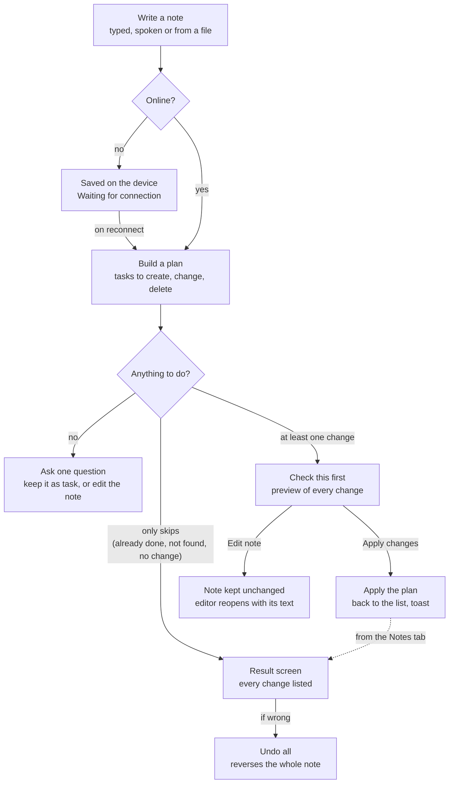
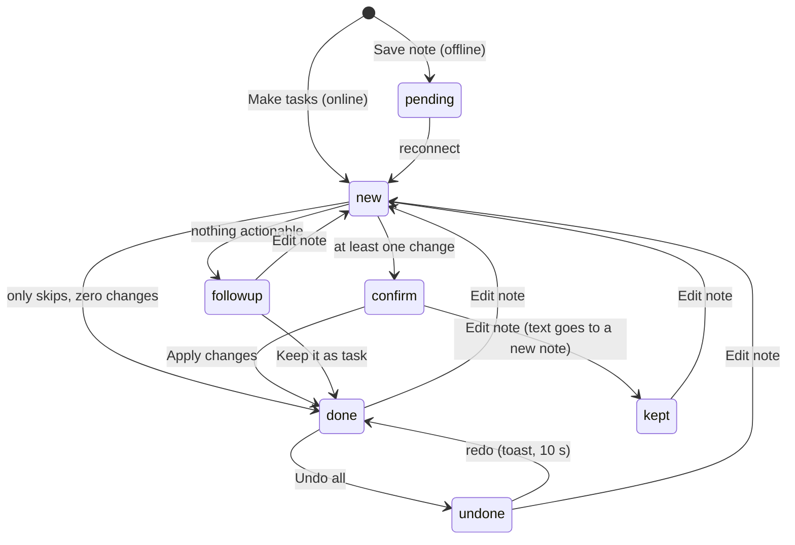
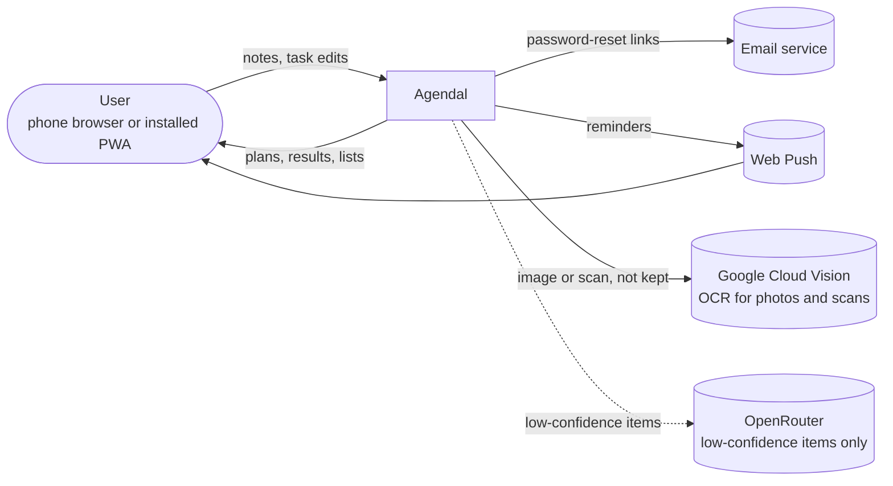
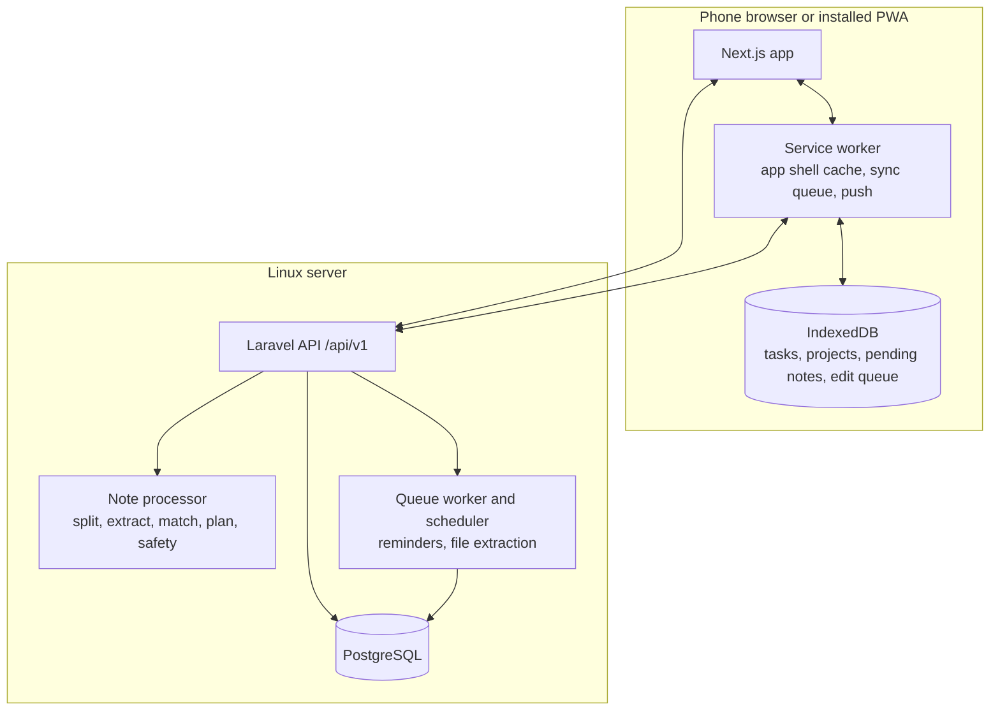
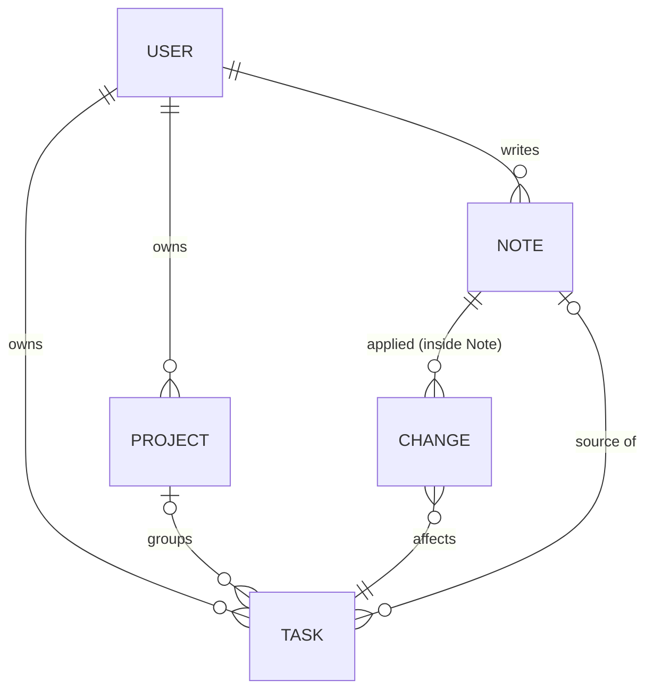
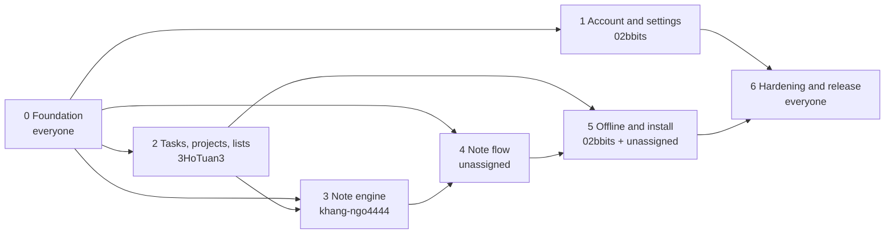

> **A summary for humans. Not a source of truth.** The spec in `docs/01-product` to `docs/08-project` wins. Agents keep this file in step with the spec and the build (section 13), but never cite it as the authority for a decision.

# Agendal in one read

_Updated 2026-11-04 from `main` at commit `b30b8b2`. If anything here disagrees with the spec, the spec wins. IDs in brackets, like (NU-5), are look-up keys into the spec, not links._

This is a summary for people who have to make decisions about Agendal: what it is, what the rules are, how it is built, and what is still undecided. It replaces reading about 50 files. It leaves out screens' pixel details, copy text, test lists and edge-case tables.

---

## 1. What Agendal is

Agendal is a phone-first web app (a PWA) where you **write or say whatever is on your mind, and it becomes dated, organised tasks**. The note comes first, lists come second. It is a course demo for VNUK _Advanced Web Development_, so it has no launch plan, success metrics or analytics.

> _"sql quiz monday 9am, email the group tonight, buy printer ink tomorrow"_
> becomes three tasks: **SQL quiz** (Monday 09:00, High, project SQL Course, reminder a day before), **Email the group** (today 20:00, Medium, reminder 15 minutes before) and **Buy printer ink** (tomorrow, Low). The note is named "This week".

**The problem.** People get tasks in bursts (a deadline in a meeting, a date agreed in a group chat). Forms for each one are too much friction, so tasks end up in notes apps and memory, and get missed. Agendal keeps capture as cheap as writing a line, and keeps the user in control: every change is listed, editable and undoable.

**Why notes, not chat.** The first design (V1) was a chat with an assistant. V2 replaced it: a note is written once and turned into tasks, with no conversation to manage. The assistant asks a question only when a note is unclear or a change is risky.

**Who it is for**

| User                        | What they need                                                                        |
| --------------------------- | ------------------------------------------------------------------------------------- |
| Busy user (primary)         | Get things out of their head in seconds; see what is due today; never miss a deadline |
| Team member                 | Paste or attach meeting notes and get one task per action item                        |
| Planner                     | Full manual control: a **+** button adds a task by hand and every field is editable   |
| Low-vision or keyboard user | Readable contrast, labelled controls, visible focus (WCAG 2.2 AA)                     |

There are two roles: a guest (can create an account, sign in, reset a password) and an account holder (everything, on their **own** data only). There is no admin and nothing is shared between users.

**Goals.** Capture several tasks in one note under 15 seconds. The assistant is right often enough to trust, and fixing or undoing a mistake takes one tap. Today's work is visible at a glance. It works offline and installs like an app.

**Not in v1.** Shared lists or assigning tasks, calendar sync, chat with the assistant, a desktop-only or desktop-first layout (Agendal is mobile first but responsive up to desktop), native iOS/Android apps, account deletion and data export, a Vietnamese user interface (notes can be Vietnamese, the UI is English).

---

## 2. Scope and release plan

There are **43 functional requirements** in 8 modules. _Must_ is needed for v1, _Should_ ships if time allows (otherwise v1.1), _Could_ is later.

| Module                    | What it covers                                                                                                                       | Requirements |
| ------------------------- | ------------------------------------------------------------------------------------------------------------------------------------ | ------------ |
| **AA** Account and Access | Create account, sign in, lockout, password reset, sign out                                                                           | AA-1 to 5    |
| **NC** Note Capture       | Note editor, dictation, file to note, examples, offline capture, add a task by hand                                                  | NC-1 to 7    |
| **NU** Note Understanding | Split a note, fill in details, act on existing tasks, skip non-tasks, ask before risky changes, name the note, label assistant tasks | NU-1 to 7    |
| **RV** Review and Control | Result screen, Undo all, follow-up question, Notes tab, Edit note                                                                    | RV-1 to 5    |
| **TK** Tasks              | Complete, edit every field, validate the schedule, repeat, delete safely, remind                                                     | TK-1 to 6    |
| **LV** Lists and Search   | Inbox, Upcoming, Search, task row                                                                                                    | LV-1 to 4    |
| **PJ** Projects           | Create, view, rename or recolour, delete                                                                                             | PJ-1 to 4    |
| **AP** App and Platform   | Install, offline, light and dark, back navigation, week start and time format                                                        | AP-1 to 5    |

| Phase        | Contains                                                                                                                                                                                                                                                                   | Gate                                                                                                     |
| ------------ | -------------------------------------------------------------------------------------------------------------------------------------------------------------------------------------------------------------------------------------------------------------------------- | -------------------------------------------------------------------------------------------------------- |
| **1. MVP**   | Every _Must_: accounts, typed notes, note understanding in English and Vietnamese with review and Undo all, tasks, Inbox/Upcoming/Search, projects with rename, offline, install, themes, a responsive layout from phone to desktop, Edit note, week start and time format | All Must acceptance criteria pass; accessibility audit passes; the note corpus passes its accuracy gates |
| **2. v1.1**  | _Should_: voice notes, files as notes, note names, the "Created by the assistant" label, reminders, project colour                                                                                                                                                         | All Should criteria pass                                                                                 |
| **3. Later** | _Could_ and ideas: example chips, calendar view, shared projects, account deletion and export, smarter project suggestions                                                                                                                                                 | none                                                                                                     |

**Platforms.** Mobile first and responsive. Phones 320 to 480 px wide get a centred column up to 600 px; from 768 px a sidebar replaces the tab bar; from 1280 px a task opens in a 400 px side panel that overlays the right edge (the URL carries `?task={id}`, so Back closes it). On the last two versions of Chrome, Safari (iOS 16.4+), Samsung Internet, Firefox and Edge. The look is **Graphite**: a monochrome grey palette in light and dark (the accent is ink, status colours are muted and always paired with a word or icon).

---

## 3. How a note becomes tasks

This is the core of the product. Every note follows the same path; the result screen, safety rules and undo do not depend on how the plan was built.

### The pipeline (on the server, one request)

1. **Normalise** the text (Unicode, stray characters, line endings). Nothing visible left means a "write something first" error. Maximum 5,000 characters.
2. **Split** into items on new lines, commas, semicolons, full stops and the word "then" (Vietnamese "rồi", "sau đó"). A comma list after a task verb ("buy milk, eggs and bread") stays one task. Bullets and numbering are stripped. More than 30 items is rejected.
3. **Classify** each item: skip (ideas, FYIs, filler such as "ok" or "thanks"), command (acts on an existing task) or task.
4. **Extract** the fields of each task (below), each with a confidence of high or low.
5. **LLM fallback** for low-confidence items only (section 8, ADR-008).
6. **Match** commands to the user's open tasks.
7. **Validate** every entry; invalid ones are dropped and the item falls back to its rules result.
8. **Safety check**, then **name** the note, then **persist**. A plan with any change is stored as `confirm` with a preview of its changes (worked out in a rolled-back transaction); Apply changes then applies it in one transaction.

The rules engine is **deterministic**: the same text, time, zone, projects and tasks always give the same plan. That is what lets a fixed "golden corpus" of sample notes (200 or more cases) gate every change.

### What it understands

| Field          | Examples understood                                                                                                                                                                                              | Default when absent                                                                   |
| -------------- | ---------------------------------------------------------------------------------------------------------------------------------------------------------------------------------------------------------------- | ------------------------------------------------------------------------------------- |
| **Due date**   | "by / before / due / hạn / trước X" (a time there is the due time); today, tonight, tomorrow, Monday (always the _next_ one), next week, in 3 days, end of the week/month, 26 Oct                                | No date; or today if a time or repeat is given (tomorrow if that time already passed) |
| **Start date** | "from X to Y", "từ X đến Y" give start X and due Y                                                                                                                                                               | No start date                                                                         |
| **Time**       | 9am, 6:30pm, 14:00, "at 14", morning, noon, evening, tonight (20:00); a range "2–4pm Friday" gives start Fri 14:00 and due time 16:00; relative: "in half an hour", "sau nửa tiếng", "một giờ rưỡi" (90 minutes) | No time                                                                               |
| **Priority**   | urgent, asap, important, deadline, exam, quiz, submit give High; whenever, someday, maybe give Low                                                                                                               | Medium if due today, otherwise Low                                                    |
| **Project**    | the project's name anywhere in the item, or course keywords (sql gives SQL Course; gym, mum gives Personal)                                                                                                      | No project                                                                            |
| **Repeat**     | every day, weekly, every Monday, monthly; every 3 days, every 2 weeks on Mon and Wed, the 15th of each month, the second Monday, the last Friday; with an end ("for 5 occurrences", "until 15/11")               | Never                                                                                 |
| **Reminder**   | exam or quiz gives 1 day before; any task with a time gives 15 minutes before                                                                                                                                    | None (and none if it would already be in the past)                                    |
| **Title**      | what is left after removing date, time, priority and repeat words and lead-ins ("remember to", "I need to"); sentence case, acronyms kept (SQL, HCI, CV, UI, API, PDF)                                           | n/a                                                                                   |

A repeat is stored as a frequency (`repeat`) plus an optional calendar rule in RRULE form (`repeat_rule`), anchored on the series' first date (`repeat_anchor`). "Visit house 3 times every day" makes three separate daily series, labelled (1/3) to (3/3). Calendar lists ("gym every month on day 1, 15, 25") are read as one task before the note is split on commas.

**English and Vietnamese** are always both active, with no language detection. Vietnamese must be typed with diacritics: without them many words become ambiguous ("toi" could be "tối" or "tôi"), so unaccented Vietnamese is treated as unknown text and goes to the LLM fallback. Titles keep the user's accents; generated names and all UI text stay English.

### Commands on existing tasks

| Command    | Phrases                        | Effect                                 |
| ---------- | ------------------------------ | -------------------------------------- |
| Complete   | done X, finished X, X is done  | Marks the task done                    |
| Reschedule | move/push/postpone X to Friday | New due date; the result shows "was …" |
| Delete     | delete/cancel/remove X         | Deletes it, always after confirmation  |

A command matches the **open** task whose title contains at least **60%** of the command's meaningful words. On equal scores the title with more of the command's words wins, then the one with fewer extra words ("done buy milk" picks "Buy milk" over "Buy milk and eggs"); still equal is a tie, and the user is asked which one. With no match: a reschedule becomes a new task; a delete with a deadline or a place ("cancel netflix before the 10th") becomes that task; any other complete or delete is skipped with "Couldn't find …". A matching task that is already done is skipped as "already done", and a move to the date and time a task already has is skipped as "no change". Completing a repeating task completes that occurrence and creates the next.

### Safety rules

- **Every note with at least one change** (or a tie) goes to _Check this first_: nothing is applied until the user taps Apply changes. A "change" is one task created, updated or deleted. A note whose items are all skipped (already done, not found, no change) is `done` with zero changes and shows only its skipped list. (Until 2026-11-03 only a delete or 5 or more changes asked first, issue #44.)
- **A note with nothing actionable** gets one question instead of silently doing nothing: _Keep it as task_ or _Edit the note_. There is no "keep as a note" option, so an unanswered question leaves the note waiting in the Notes tab.
- **Every applied note can be undone as a whole**, from its result screen, for 30 days.
- **Offline notes wait** and are processed in order on reconnect under the same rules.
- The language model, if used, can only propose a plan of the same fixed shape. It cannot do anything a plan cannot express, so the worst prompt injection produces a wrong plan the user sees and can undo.

### How a note is named

The first matching row wins; names over 34 characters are cut at a word boundary.

| Plan                     | Name                                                              |
| ------------------------ | ----------------------------------------------------------------- |
| One task                 | The task's title                                                  |
| One change               | "Update:" plus the title                                          |
| Only changes             | "Updates to N tasks"                                              |
| All tasks in one project | "Project to-dos"                                                  |
| All due the same day     | "Today's plan", "Tomorrow's plan" or "Monday plan"                |
| All due within 7 days    | "This week"                                                       |
| Anything else            | First title plus "+ N more"                                       |
| Nothing actionable       | Its first 6 words, until the user chooses (then the task's title) |

### The life of a note

_Edit note_ on Check this first does not re-plan the same note: the note is kept (`kept`) and its text opens in the editor, where Make tasks creates a new note. _Edit note_ from the result screen (IM-47) re-plans the same note.

---

## 4. Review and control

The point of this module is trust: the user can always see what the assistant did and reverse it.

- **Check this first** (every note with a change). The note's name, the quoted note and one row per planned change: a **preview** of what Apply will do. Created and updated rows open Task details on the _planned_ task, and a created task with no date offers **When?** chips; those edits stay on the device and are sent with Apply (by each change's `ref`). Delete rows have a red DELETED badge and don't open. **Apply changes** (red when there is a delete) applies the plan, returns to where the note was written and shows a "made N tasks" toast with **Undo** (Undo all, run from the list). **Edit note** keeps the note unchanged (`kept`) and reopens the editor with its text. A waiting note never expires and shows "needs a look" in the Notes tab. _Deferred:_ tick boxes to drop rows and the "Which task did you mean?" picker for ties (ties use the preselected task for now).
- **Result screen.** Opened from a note (Notes tab or link), or straight after a note whose items were all skipped. Header with time and counts ("Today 08:12 · 3 tasks made · 1 changed"), the note name, "From file" if any, and the original note as a quote. One row per change with a **CREATED / UPDATED / DELETED** badge and its meta (date · time · project), plus the old value for changes ("Fri 30 Oct · HCI · was Wed 28 Oct"). Rows open the task; a task removed since shows "Removed since". Created tasks with no date show **When?** chips (Today, Tomorrow, Next week, Pick date). Skipped items are listed with their reason. Buttons: Undo all and Done, plus Edit note in the menu once IM-47 lands.
- **Follow-up.** For a note with nothing actionable: "I couldn't find a task in this note." with **Keep it as task** or **Edit the note**. _Keep it as task_ makes one task titled with the note's whole text (cut at 200 characters, the rest in the task's notes), marks the note done so Undo all works, and opens Task details so a date can be added. _Edit the note_ opens the editor with the text and works like Edit note. Until the user chooses, the note stays in the follow-up state and shows in the Notes tab as needing a look. The _kept_ state comes only from Edit note on Check this first.
- **Undo all.** One tap reverses a note: created tasks are removed, changed fields get their old values back, deleted tasks come back. It works for **30 days** (matching how long deleted rows are kept). Fields you changed by hand since the note are left alone; if you edited or completed a task the note _created_, a dialog asks before it is removed. An Undo toast offers a 10-second **redo**. Undo needs a connection.
- **Edit note.** Opens the note text in the editor; Make tasks first undoes what the note applied, then plans the new text from scratch under the same safety rules, in one step. The note keeps its id, gets a new name, and shows "Edited". A `done` note past the 30-day undo window can no longer be edited, because its changes can no longer be undone.
- **Notes tab.** All notes, newest first (by when they were written), 20 per page, with time, name, two-line excerpt and a status line (tasks made, needs a look, kept, undone, edited, waiting for connection).

---

## 5. Tasks, lists and projects

**A task.** Only a **title** is required (1 to 200 characters). Optional: project, start date (with an optional start time), due date (with an optional due time), priority (Low/Medium/High), reminder (none, 5, 15, 30 minutes, 1 hour, 1 day before), repeat (never, daily, weekly, monthly, yearly) and notes (up to 5,000 characters). The system adds done/done-at, created-by (user or assistant) and the source note.

**Editing.** Every field is editable on Task details and **saves on change**, with no Save button (each save is a per-field patch). Rules: start before due by date and time ("Start can't be after the due date."); times need their day (a start time with no start date sets the start date to the due date if any, else today; a due time with no due date sets the due date to today); setting repeat with no date sets the due date to today; clearing the start date clears the start time; clearing the due date clears the due time and reminder (with an Undo toast); the reminder is disabled without a date.

**Completing.** Optimistic: the row strikes through, moves to Completed after 600 ms, progress updates and a toast offers Undo. Completing a repeating task creates the next occurrence from the **due date** (not the completion date), moving the start date and due date together and keeping the gap and both times, skipping missed dates so overdue tasks never pile up. A calendar rule skips dates that don't exist (no 31 February); a plain monthly repeat with no rule keeps the original day capped at month end (31 Jan, 28 Feb, 31 Mar). Undo of the completion withdraws the occurrence it created; completing again restores it without a duplicate.

**Deleting.** Always confirmed, always undoable from the toast. A repeating task asks "This task only" (the series continues) or "This and all future" (the series ends). Deleted rows are soft-deleted.

**Reminders** (Should). A web push at the chosen offset from the start time; else 09:00 on the start date; else the due time; else 09:00 on the due date. Permission is asked in context, never at sign-in; on iPhone push works only in the installed app.

**Lists**

| Screen       | Behaviour                                                                                                                                                                                                                                                                                                                                                                                                                                                                                                                                                                       |
| ------------ | ------------------------------------------------------------------------------------------------------------------------------------------------------------------------------------------------------------------------------------------------------------------------------------------------------------------------------------------------------------------------------------------------------------------------------------------------------------------------------------------------------------------------------------------------------------------------------- |
| **Inbox**    | Today's date, desktop subtitle ("2 overdue · 4 today") and progress (done of total). **Overdue comes before Today** (past due date only, in red, with a count and the word, not just colour). Today holds tasks with start date today, due date today, in progress (between start and due), or a start-only task whose day passed ("Planned"). A collapsed _No date_ section holds undated tasks; a collapsed _Completed_ section shows 5 tasks, then "Show all". Overdue and Today collapse too. "Nothing left for today" links to Upcoming. Lists recompute at local midnight |
| **Upcoming** | Tasks from tomorrow on, grouped by day. A task appears on its start date and on its due date; on its due date it sits in a dashed blue card. Due entries of a day share one dashed block under the normal ones in List, and are one card each on Board. Sticky week bar with the week in view; `>` and `<` go to the first day of a week; the calendar's Overdue chip (in place of Today) goes to the Overdue section; creating a task keeps the day in view. List shows two weeks, Board one week; Overdue first. Filters: All (every entry), Scheduled (start days), Due only (due days)                                                                                                                                                                                                                                                                                                         |
| **Search**   | A popup from 768 px (Ctrl/Cmd+K, `/` or the sidebar) on a blurred backdrop that blocks background scrolling; a full screen on phones. Finds tasks (titles and notes, completed included), notes (short snippets) and projects, with All / Tasks / Projects / Notes counts and matched words marked. Before typing: Quick filters, Recent searches, Notes and Search in a project. Vietnamese: without accents ignores accents ("bai tap" finds "Bài tập"), with accents keeps them ("bài" finds "Bài", not "Bãi"), "hoà" equals "hòa", and words of 1 or 2 letters match only at a word start. All words must match. Title matches rank first, then open before completed, then soonest due. A task opens the panel and a project opens the project; opening a note comes with the Notes screen. The skeleton stays until the answer + 200 ms, so "no match" never flashes. Works offline against the device's copy |
| **Task row** | Checkbox, title (2 lines), project dot and name, time, reminder and repeat icons, a priority flag for High and Medium. No swipe gestures                                                                                                                                                                                                                                                                                                                                                                                                                                                                                                                                                                                                                                                                                                                                                                            |

**Projects.** A name (1 to 40 characters, unique per user ignoring case, max 50 projects) and one of **8 colours**. The project screen shows progress ("3 of 5 tasks completed"), open tasks, then completed ones. Rename and recolour are _Should_. Deleting a project asks whether to **move its tasks to No project** (default) or **delete them too**, and the toast offers Undo. "No project" is the absence of a project, not a record.

---

## 6. Account, access and platform

**Accounts.** Email plus a password of at least 8 characters that differs from the email and is not in a known-breached list (a checked minimum of 8, not 12, was a deliberate choice). Create account stays disabled until valid, and success opens Inbox.

**Sign-in and lockout.** Wrong details show one message whether the email is unknown or the password is wrong. **Three failures lock sign-in for 60 seconds** with a countdown from the server. The lock is keyed by (email, IP), so an attacker cannot lock a victim out from another address; extra limits (30 attempts per IP per 10 minutes, 20 failures per email per hour) show the same message.

**Password reset.** The same confirmation appears whether or not the account exists. The link is single-use, expires in **60 minutes**, carries its token in the URL fragment (so it never reaches logs), and **ends every other session** when used. Resend unlocks after 45 seconds.

**Sessions.** First-party cookie session (no token in JavaScript). With _Remember me_ (on by default) it lasts 30 days from sign-in; without it, a browser session with a 2-hour idle timeout. **Sign out** wipes the device's offline data and caches; if changes are unsynced it asks first.

**Platform**

| Area          | Behaviour                                                                                                                                                                                                                                                                                                                                                |
| ------------- | -------------------------------------------------------------------------------------------------------------------------------------------------------------------------------------------------------------------------------------------------------------------------------------------------------------------------------------------------------- |
| **Install**   | An Install banner once per device after the first sign-in; "Install app" stays in Account. iOS and Firefox Android get manual instructions                                                                                                                                                                                                               |
| **Offline**   | Every edit and note capture works offline and syncs later. A "You're offline" banner shows within 2 s. The device keeps open tasks, tasks completed in the last 90 days, all projects, the last 100 notes, the edit queue, pending notes and the draft. Operations that need the server's plan (Undo all, Apply changes, Edit note) are disabled offline |
| **Conflicts** | Last write wins **per field**, so edits to different fields on two devices both survive. The loser sees a "changed on another device" toast and row marker                                                                                                                                                                                               |
| **Themes**    | System/Light/Dark, no flash on load                                                                                                                                                                                                                                                                                                                      |
| **Settings**  | Week starts on Monday or Sunday; 24-hour or 12-hour time. These change date pickers, "next week" in notes and Upcoming, and display only for times                                                                                                                                                                                                       |
| **Back**      | Every screen has a URL; sheets push a history entry; the in-app back and the browser's Back behave the same                                                                                                                                                                                                                                              |
| **Updates**   | "A new version is ready" with Reload, never automatic while the user is typing                                                                                                                                                                                                                                                                           |
| **Draft**     | An unsent note is saved to the device 500 ms after typing stops and restored if the app closes; closing the editor with text asks "Discard this note?"                                                                                                                                                                                                   |

**Capture options.** _Dictation_ (Should) uses the browser's Web Speech API with a one-time notice that Chrome sends audio to its vendor; the mic is hidden where unsupported. _File to note_ (Should) accepts text, Markdown, CSV, PDF, Word and photos up to 5 MB, shows the extracted text for checking, and discards the file afterwards.

---

## 7. Architecture

**Stack.** Next.js (React, TypeScript) front end; a Laravel API; PostgreSQL; everything on **one Linux server** (Nginx, the Next.js server, PHP-FPM, one queue worker under Supervisor, a cron scheduler, PostgreSQL). HTTPS everywhere with Let's Encrypt. Nightly backups kept 7 days and copied off the server. CI on every pull request (lint, types, tests, dependency and secret scans).

| Outside service        | Needed for                                                                                       | If it fails                               |
| ---------------------- | ------------------------------------------------------------------------------------------------ | ----------------------------------------- |
| Email (SMTP)           | Password reset                                                                                   | Reset delayed; sign-in unaffected         |
| Web Push               | Reminders (Should)                                                                               | No push; Inbox still shows what is due    |
| Google Cloud Vision    | Photos and scanned PDFs (Should). Text PDFs and Word are read on the server with no outside call | Photos and scans unreadable; typing works |
| OpenRouter             | Language-model fallback                                                                          | Rules handle notes alone                  |
| Browser speech service | Dictation (Should)                                                                               | Dictation unavailable; typing works       |

**Note processing.** The client sends `POST /notes` with a client-generated id; the processor builds the plan and checks safety; a safe plan is applied in **one transaction**, each change stored with its before-values; the response carries status, name and changes. Budget: **2 seconds (90th percentile) for 10 items**. Everything except note processing works on the device.

**API.** Versioned `/api/v1`, JSON only, one error shape, cursor pagination (max 100). Someone else's resource returns 404 so its existence is not revealed. Tasks and projects use **client-generated UUIDs** so they can be created offline, and a replayed create returns the stored row. JSON Schemas and example fixtures for the main responses are kept in the repo and checked by a backend test.

---

## 8. Technical decisions in plain words

| #           | Decision                                                                                                                                                                                                                                                                                                                                                                                                                                                                                                                                                                     | What it means for you                                                                                                                                                                                                                 |
| ----------- | ---------------------------------------------------------------------------------------------------------------------------------------------------------------------------------------------------------------------------------------------------------------------------------------------------------------------------------------------------------------------------------------------------------------------------------------------------------------------------------------------------------------------------------------------------------------------------- | ------------------------------------------------------------------------------------------------------------------------------------------------------------------------------------------------------------------------------------- |
| **ADR-001** | **Every note produces a plan of one fixed shape**: create, update, delete, skipped. Rules run first; a model may only fill gaps, through the same shape. The server validates every entry before anything is stored                                                                                                                                                                                                                                                                                                                                                          | The engine can change without touching the UI or undo. A model cannot do more than a plan can express. The 2 s budget must include any model call                                                                                     |
| **ADR-002** | **Undo through a per-note change log.** Each applied change is stored with its before-values in the note itself, in the same transaction as the task writes. Undo replays it in reverse. Tasks deleted by a note stay soft-deleted while the note is undoable                                                                                                                                                                                                                                                                                                                | The result screen and Notes tab read the same log; no separate audit table. Hand-edits after a note need the conflict policy in section 4. Edit note reuses it                                                                        |
| **ADR-003** | **Offline note queue with client ids.** Every note gets a UUID when written. On reconnect, queued task edits replay first, then pending notes oldest first. The database enforces one note per (user, client id)                                                                                                                                                                                                                                                                                                                                                             | Duplicates are prevented by the database, not timing. A pending note may act on tasks that changed since; the same confirmation rules apply                                                                                           |
| **ADR-004** | **Last write wins per field.** Offline edits are queued as per-field patches with a device timestamp; the server applies a patch only if it is newer than that field's stored timestamp. Completion and deletion are fields too                                                                                                                                                                                                                                                                                                                                              | Edits to different fields both survive; only a true same-field conflict loses the older value. Depends on roughly correct device clocks (the server clamps future timestamps to +5 min)                                               |
| **ADR-005** | **Sync is cursor pull plus field patches.** Every write gets a sequence number; deletes are tombstones kept 30 days (longer if an undoable note needs them). `GET /sync?cursor=` returns changes; too-old cursors get a full resync. Sync runs on open, reconnect, tab visible and every 60 s. No WebSockets                                                                                                                                                                                                                                                                 | Pull cost grows with changes, not data size. Up to 60 s of staleness between two open devices. Add server push only if two-device editing turns out to be common                                                                      |
| **ADR-006** | **Time zones: floating local times.** Due dates and times are stored as wall-clock values with no zone ("quiz Monday 09:00" stays 09:00 wherever you are). Reminder instants are stored in UTC and recomputed when the task or zone changes. "Now" for a note is when and where it was _written_                                                                                                                                                                                                                                                                             | Travelling does not move deadlines; an offline "tonight" means the night it was written. DST gaps move to the next valid minute. Every date computation takes (now, zone), which makes tests reproducible                             |
| **ADR-007** | **Session and auth.** First-party cookie sessions (Laravel Sanctum): HttpOnly, Secure, SameSite=Lax, CSRF header on writes. Argon2id passwords. Lockout keyed by (email, IP). Sign-out wipes device data                                                                                                                                                                                                                                                                                                                                                                     | XSS cannot steal a token; an attacker cannot lock a victim out from another IP; shared phones keep no data after sign-out                                                                                                             |
| **ADR-008** | **Language-model fallback (OpenRouter).** Called per item, only when the rules flag it low-confidence (an unparsed date-like token, a command with no match, no verb or object, unaccented Vietnamese). The model sees those items, the time and zone, project names and up to 20 candidate task titles with opaque ids; never email, name, other notes or task notes. Structured output against the plan schema, temperature 0. **1.5 s timeout**, then rules win. Caps: **20 per user per day**, a global token budget and a kill switch. Providers must not store prompts | Worst case is a wrong plan that is shown and undoable; deletes always need confirmation. A slow provider lowers accuracy, never speed. The app is fully usable with the model off. Rules are expected to handle at least 80% of items |

---

## 9. Data

Five records, all owned by exactly one user.

- **Note**: the text, a generated name, status (pending, new, done, confirm, followup, kept, undone), the **plan**, the **applied** change list, the engine that produced it (rules, rules plus LLM, or rules after a fallback), and when it was written and in which zone.
- **Task**: as in section 5 (start date and time, due date and time; `end_time` is gone, migrated into `due_time`), plus a per-field timestamp map (for conflict resolution), a UTC reminder instant, and repeat data: the frequency, an optional RRULE (`repeat_rule`, up to 300 characters), the series' anchor date (set by the server) and the previous occurrence.
- **Project**: name and colour. **User**: email, display name, zone, theme, week start, time format.
- Supporting tables: push subscriptions, reminder deliveries (one row per reminder, so each is sent once) and an audit log (kept 90 days, no secrets).
- PostgreSQL with trigram and unaccent search. Deleted rows are tombstones, purged after 30 days. Every table except users is scoped by `user_id`, and every index starts with it.

---

## 10. Security and privacy

**Privacy stance.** Notes, files and tasks belong to the account holder only. Files are used to extract text and **discarded when extraction ends**. **No note or task text goes in logs.** Outside services receive only the minimum (section 8, and photos/scans inline to Google Cloud Vision with metadata stripped). There is no product analytics.

| Threat                                | Main controls                                                                                                                                 |
| ------------------------------------- | --------------------------------------------------------------------------------------------------------------------------------------------- |
| Credential guessing and lockout abuse | Lock per (email, IP) plus per-IP and per-email limits; breached-password check                                                                |
| Account enumeration                   | Same message and timing for known and unknown emails (sign-up is the accepted exception, with a 5 per hour per-IP limit)                      |
| Session theft, CSRF                   | HttpOnly cookie; SameSite plus CSRF header; security headers (CSP that blocks framing and plugins, HSTS, nosniff)                             |
| Reading another user's data           | Every query scoped to the user; other users' ids return 404; an authorization matrix tested for every endpoint                                |
| Flooding to burn the LLM budget       | Per-user and global caps, kill switch                                                                                                         |
| Prompt injection in a note            | The model returns a plan only, can reference only candidate task ids it was given, and the server validates; deletes always need confirmation |
| Duplicate notes on retry              | One note per (user, client id) in the database                                                                                                |
| Malicious uploads                     | Type from magic bytes (not extension), allow-list, sandboxed parser with 10 s and 50 MB caps, 5 MB limit, file deleted in a final step        |
| Forged sync timestamps                | Clamped to server time plus 5 min; field allow-list                                                                                           |
| Next user on a shared phone           | Sign-out wipes IndexedDB and caches; API responses never enter the HTTP cache; a different user signing in wipes the old data first           |
| Vulnerable dependencies               | Audit and secret scan on every PR; high or critical findings block merge                                                                      |

**Rate limits (headline).** Sign-in 3 failures then 60 s; create account 5 per hour per IP; password reset 3 per hour per email; notes 30 per minute and 300 per day per user; files 10 per hour and 30 per day; search 60 per minute; sync 30 per minute; everything else 300 per minute per user and per IP for guests.
**Input limits.** Note 5,000 characters (the editor counter turns red at 4,500); 30 items per note; title 200; task notes 5,000; project name 40; 50 projects; 5,000 open tasks; password 8 to 128.

**Accepted residual risks.** Sign-up reveals that an email is registered. A malicious or misread note can still produce a wrong-but-valid plan for the user's own tasks (mitigated by the result screen, confirmation and Undo all). Forged timestamps can still win inside the 5-minute clamp. The search query stays in the URL, and uploads are not malware-scanned (two approved ASVS deviations).

---

## 11. Quality targets

| Area          | Target                                                                                                                                                                                                                                         |
| ------------- | ---------------------------------------------------------------------------------------------------------------------------------------------------------------------------------------------------------------------------------------------- |
| Accessibility | WCAG 2.2 AA: contrast 4.5:1 for text and 3:1 for control borders in both themes; 44 px touch targets; every icon button named; visible 2 px focus; full keyboard use; reduced motion respected; VoiceOver and TalkBack announce status changes |
| Performance   | First load interactive in 3 s on a mid-range phone over 4G; repeat load 1 s from cache; a note of up to 10 items processed in 2 s (90th percentile), 300 ms on the rules-only path                                                             |
| Offline       | All lists, task edits and note capture work offline and sync without loss                                                                                                                                                                      |
| Reliability   | No task change is ever lost: every applied note stores enough to undo it                                                                                                                                                                       |
| Content       | Sentence case, 24-hour time by default, short dates, no emoji                                                                                                                                                                                  |

**Capacity model (the sizing target).** Up to **5,000 registered users**, about 2,000 weekly and 1,200 daily active, roughly **5,000 notes a day** (a burst of about 2 notes per second), about 15 requests per second at peak, up to 1,000 model calls a day, a peak minute of about 300 reminders, and about 1,000 tasks per user after six months. One server is enough; a second API server, a read replica and Redis are the listed next steps. Service levels: reads 95th percentile 300 ms, writes 500 ms, reminders within 60 s, sync flushed within 10 s for 100 queued edits.

**Testing.** Every acceptance criterion, edge case, state and security control has an automated test named by its ID. The levels are unit (note engine, date maths), the golden note corpus (rules mode on every push, rules plus LLM nightly, against accuracy gates), API/integration with a real database, component tests for every state, end-to-end for the seven workflows (Chromium and WebKit, including offline and two-device sync), axe accessibility checks, security tests (a ZAP baseline nightly) and load tests before the demo. **Merge is blocked** unless lint and types pass, tests are green, a script confirms every acceptance criterion maps to an existing test, backend coverage is at least 80% (the note engine 95%), axe finds no serious issues and there are no high-severity dependency or secret findings. The clock and zone are always injected in tests.

---

## 12. Plan, people and risks

| Owner             | Area                                                                                                                                                                                                  |
| ----------------- | ----------------------------------------------------------------------------------------------------------------------------------------------------------------------------------------------------- |
| **02bbits**       | Platform: repo, CI, auth, settings, offline sync, install, deployment (AA, AP)                                                                                                                        |
| **3HoTuan3**      | Tasks and views: task model, projects, Inbox, Upcoming, Search, design system (TK, PJ, LV)                                                                                                            |
| **khang-ngo4444** | Note understanding: the rules engine, the OpenRouter fallback, the note corpus (NU)                                                                                                                   |
| **Unassigned**    | Note flow: the editor, result screen, undo, Notes tab, Edit note (NC, RV). In practice the GitHub issues share it out: mostly 02bbits and 3HoTuan3 on IM-41 to IM-46, khang-ngo4444 on IM-47 to IM-49 |

After Foundation, phases 1, 2 and 4 run in parallel; note flow is built against agreed fixtures until the engine is ready. **Critical path:** agree the contracts (IM-02), then the task model (IM-20), the note applier (IM-37), undo and Edit note (IM-44, IM-47), and offline notes (IM-53). **MVP gate:** every Must criterion passes, the accessibility audit passes, the corpus passes in rules and LLM mode, and every CI gate is green on `main`.

| Main risk                                   | Mitigation                                                                       |
| ------------------------------------------- | -------------------------------------------------------------------------------- |
| The assistant misreads a note               | Every change is listed; Undo all; Edit note; each task is editable               |
| A command matches the wrong task            | 60% match, ties ask, deletes always confirmed, "was …" shown, Undo               |
| Ambiguous dates ("Friday" said on a Friday) | Weekdays mean the next one ahead; full dates shown; easy edit                    |
| Vietnamese without diacritics               | Expected with diacritics; unaccented text goes to the LLM; editable result       |
| Offline notes act on changed tasks          | Processed in order, same confirm rules, toast reports what happened              |
| iOS PWA limits                              | Manual install guidance; reminders are _Should_; Inbox works without push        |
| Personal data in files                      | Extract and discard; only photos/scans go out, inline; 5 MB limit                |
| LLM provider retains data or is slow        | Providers that do not store prompts; minimum context; 1.5 s timeout; kill switch |

**Already decided (all 21 questions are closed).** Editing a note re-plans it (Q1). Rules first with an LLM fallback (Q2, Q19). English and Vietnamese notes, English UI (Q3). Undated tasks get When? chips (Q4). Confirm before applying (Q5 said 5 or more changes; since 2026-11-03 every note with a change confirms, issue #44). Week start and time format are settings (Q6). No account deletion or export in the first release (Q7). No success metrics or analytics (Q8). Undo after a hand edit restores only fields that still hold the note's value (Q9). Undo window 30 days (Q10). Dictation via the Web Speech API with a privacy notice (Q11). Google Cloud Vision for photos and scans (Q12). Next.js plus Laravel on PostgreSQL on one Linux server (Q13, Q14). The badge is "UPDATED" (Q15). ADR-005 to 008 approved (Q16). Edge-case and module decisions approved (Q17, Q20). Password minimum 8 with a breach check (Q18). Two ASVS deviations accepted (Q21).

---

## 13. Where the build is, and what is still open

_Status of `main` on 2026-11-04. "Done" means the IM issue is closed and its code is on `main`; open PRs are not._

| Phase                        | Done                                                                                                                                                                 | In review (open PR) | Not started                                                                                           |
| ---------------------------- | -------------------------------------------------------------------------------------------------------------------------------------------------------------------- | ------------------- | ----------------------------------------------------------------------------------------------------- |
| **0 Foundation**             | IM-01 to IM-08 (repo, contracts, migrations, CI, clock, design system, shell, API base)                                                                              |                     |                                                                                                       |
| **1 Account and settings**   | IM-10 to IM-18 (sessions, sign-up, sign-in and lockout, reset, sign-out, limits, settings, Back, edge cases)                                                         |                     |                                                                                                       |
| **2 Tasks, projects, lists** | IM-20 to IM-29 (task API, row, complete, details, repeats, delete with Undo, `+` task, projects, Inbox, Upcoming); start date and due time in the task model (#129)  | IM-30 Search (#133) | IM-31 edge cases                                                                                      |
| **3 Note engine**            | IM-32 to IM-37 (splitter, extractors, non-task filter, matcher, safety check, `POST /notes` and the applier), IM-39 corpus runner in rules mode, IM-40 NU edge cases |                     | IM-38 LLM fallback: the issue is closed, but its code is on a branch, not `main` (PR #123 was closed) |
| **4 Note flow**              | IM-41 editor, IM-42 submit, IM-43 result screen, IM-44 Undo all and redo, IM-45 Check this first                                                                     |                     | IM-46 follow-up, IM-47 Edit note, IM-48 Notes tab, IM-49 status machine                               |
| **5 Offline and install**    |                                                                                                                                                                      |                     | IM-50 to IM-55 (service worker, IndexedDB, sync, offline notes, install, purge)                       |
| **6 Hardening and release**  |                                                                                                                                                                      |                     | IM-60 to IM-65 (traceability, E2E, security, performance, a11y audit, deploy)                         |

What that means for a user of `main` today: accounts, settings, tasks by hand (with start and due dates), repeats, delete with Undo, projects, Inbox, Upcoming, and notes through Check this first with Undo all from the toast, all online only. There is no Search, Notes tab, Edit note, follow-up screen, offline mode or install yet, and the language model is not called.

**Recently settled**

1. **Start date and due time** (2026-11-03, #124 docs, #131 code). A task has a start date (with an optional start time) and a due date (with an optional due time); `end_time` is gone and was migrated into `due_time`. Start must be before due. Repeats shift both dates together. Note commands treat the due time as a session end only when start and due are the same day; otherwise it is a deadline a move leaves alone.
2. **Every note with a change confirms first** (2026-11-03, #44, built in #122). It replaced "any delete or 5 or more changes". After Apply the app returns to the list with a toast (with Undo) instead of showing the result screen, and Cancel became Edit note.
3. **Calendar repeats** (2026-11-02, #117): `repeat_rule` (RRULE) and `repeat_anchor`.

**Still open**

| What                                                                                                                                                                                                                                                                 | Where                            |
| -------------------------------------------------------------------------------------------------------------------------------------------------------------------------------------------------------------------------------------------------------------------- | -------------------------------- |
| Inbox and Upcoming still group by due date only: a start-only task lands in _No date_, and there are no start-day entries, "Planned", in-progress or dashed due-day cards yet. The task row shows no due time                                                        | Code gap after #131              |
| Notes don't parse "from X to Y" or "by X" into start and due yet (NU-E6, NU-E42)                                                                                                                                                                                     | Code gap                         |
| The note plan contract still names the field `end_time` (mapped to `due_time` on apply)                                                                                                                                                                              | `note-result.schema.json`, NU §7 |
| "Every day for 3 months" loses its end; whether "3 times every day" makes three series                                                                                                                                                                               | Issues #120, #121                |
| Branded password emails                                                                                                                                                                                                                                              | Issue #77                        |
| Stale text: "any delete or 5 or more changes" in `overview.md`, `domain.md`, TS-05, Q5, the IM-36 row; "End time must be later…" in the copy catalog, `test-scenarios.md` line 72, `error-validation.json`; `end_time` in ADR-006; NU-E35 still says "the end moves" | Needs a docs fix                 |

---

## 14. If you need the detail

| You want                                            | Look in `docs/`                                                                |
| --------------------------------------------------- | ------------------------------------------------------------------------------ |
| Why, who and what is in v1                          | `01-product/overview.md`, `screens.md`                                         |
| The exact phrase tables and rules                   | `02-domain/business-rules.md`; module `03-modules/NU-note-understanding.md`    |
| A module's full behaviour and edge cases            | `03-modules/` (one file per module; section 2 behaviour, section 4 edge cases) |
| End-to-end flows                                    | `04-workflows/` (WF-01 to WF-07)                                               |
| Targets, limits and capacity                        | `05-quality/nfr.md`, `scalability.md`                                          |
| Tests and release gates                             | `06-testing/test-strategy.md`, `traceability-matrix.md`                        |
| Architecture, data, API, security, decisions        | `07-architecture/` (including `decisions/` and `contracts/`)                   |
| Assumptions, risks, closed questions, the task list | `08-project/`                                                                  |
| What changed and when                               | `CHANGELOG.md`                                                                 |

**Glossary.** _PWA_: a website that installs like an app and works offline. _LWW_: last write wins. _Idempotent_: sending a request twice has the effect of once. _OCR_: reading text from a picture. _LLM_: large language model, used here only as a fallback. _p90_: the value 9 in 10 cases are at or under. _Tombstone_: a deleted row kept briefly so other devices learn about the delete.
